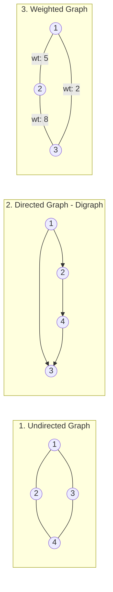
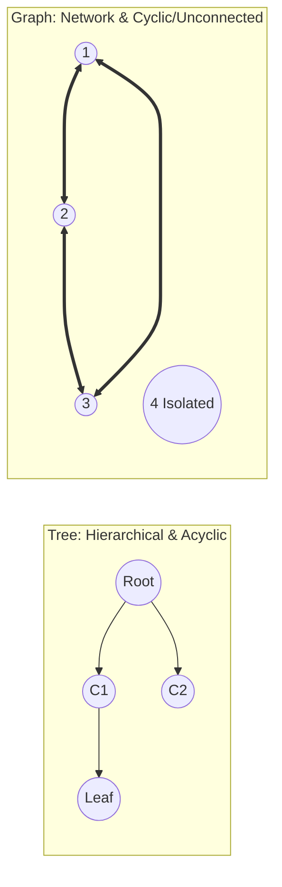

# 01. Graph Representation: Adjacency Matrix vs. Adjacency List

---

## 1. Introduction to Graphs & Core Terminology

### 🎯 2–4 Line Interview-Ready Explanation
> A **Graph** $G = (V, E)$ is a non-linear data structure consisting of a set of **Vertices (Nodes)** $V$ connected by a set of **Edges (Arcs)** $E$. Unlike trees, graphs can contain cycles, can be directed or undirected, weighted or unweighted, and do not have a mandatory root node.



### Core Graph Terminology:
1. **Vertices ($V$):** The entities or data points (e.g., users, cities, routers).
2. **Edges ($E$):** The connections/relationships between pairs of vertices.
3. **Directed Graph (Digraph):** Edges have a specific direction ($u \to v$). $u$ can reach $v$, but $v$ cannot reach $u$ unless explicitly defined.
4. **Undirected Graph:** Edges are bidirectional ($u \leftrightarrow v$). Traversing $u \to v$ and $v \to u$ is equivalent.
5. **Weighted Graph:** Every edge $(u, v)$ carries an associated numerical cost/weight $w$ (e.g., distance, latency, toll).
6. **Unweighted Graph:** All edges have uniform unit cost (equivalent to weight = 1).
7. **Degree of a Vertex:**
   * **Undirected:** Total number of edges incident to that vertex.
     $$\sum_{v \in V} \text{deg}(v) = 2 \times |E| \quad \text{(Handshaking Lemma)}$$
   * **Directed:**
     * **In-Degree:** Number of incoming edges pointing into vertex $v$.
     * **Out-Degree:** Number of outgoing edges leaving vertex $v$.
8. **Cyclic vs Acyclic:**
   * **Cyclic:** Contains at least one path that starts and ends at the same vertex.
   * **Acyclic (DAG):** Contains zero cycles (e.g., Directed Acyclic Graph used in Topological Sort).

---

## 2. Graph Representation 1: Adjacency Matrix

### 🎯 What is an Adjacency Matrix?
An **Adjacency Matrix** is a 2D square array `adj[V][V]` of size $V \times V$ (where $V$ is the number of vertices), where:
- `adj[u][v] = 1` (or edge weight $w$) if there is an edge from vertex $u$ to vertex $v$.
- `adj[u][v] = 0` (or $\infty$ / $-1$) if there is no edge between $u$ and $v$.

```
Given an Undirected Graph with 4 vertices (1-indexed or 0-indexed):
Vertices: {0, 1, 2, 3}
Edges: (0, 1), (0, 2), (1, 2), (2, 3)

Adjacency Matrix (4x4):
       0   1   2   3
  0 [  0   1   1   0  ]
  1 [  1   0   1   0  ]
  2 [  1   1   0   1  ]
  3 [  0   0   1   0  ]
```

> [!NOTE]
> **Symmetry in Undirected Graphs:**
> For any undirected graph, the adjacency matrix is always **symmetric along the main diagonal**: `adj[u][v] == adj[v][u]`.
> For directed graphs, the matrix is generally **asymmetric**.

---

### C++ Code Implementation: Adjacency Matrix

```cpp
#include <iostream>
#include <vector>

using namespace std;

class GraphMatrix {
private:
    int V; // Number of vertices
    bool isDirected;
    vector<vector<int>> adjMatrix;

public:
    // Constructor: Initialize V x V matrix with 0
    GraphMatrix(int vertices, bool directed = false) {
        this->V = vertices;
        this->isDirected = directed;
        adjMatrix.assign(V, vector<int>(V, 0));
    }

    // Add Edge (Unweighted)
    void addEdge(int u, int v) {
        adjMatrix[u][v] = 1;
        if (!isDirected) {
            adjMatrix[v][u] = 1; // Bidirectional edge
        }
    }

    // Add Weighted Edge
    void addWeightedEdge(int u, int v, int weight) {
        adjMatrix[u][v] = weight;
        if (!isDirected) {
            adjMatrix[v][u] = weight;
        }
    }

    // Check if edge exists: O(1)
    bool hasEdge(int u, int v) {
        return adjMatrix[u][v] != 0;
    }

    // Print Adjacency Matrix
    void printMatrix() {
        cout << "\nAdjacency Matrix (" << V << "x" << V << "):\n";
        for (int i = 0; i < V; i++) {
            for (int j = 0; j < V; j++) {
                cout << adjMatrix[i][j] << " ";
            }
            cout << "\n";
        }
    }
};

int main() {
    // 4 Vertices: 0, 1, 2, 3 (Undirected Unweighted)
    GraphMatrix g(4, false);
    g.addEdge(0, 1);
    g.addEdge(0, 2);
    g.addEdge(1, 2);
    g.addEdge(2, 3);

    g.printMatrix();
    cout << "Is there an edge between 0 and 3? " << (g.hasEdge(0, 3) ? "Yes" : "No") << "\n";
    return 0;
}
```

### Time & Space Complexity of Adjacency Matrix
- **Space Complexity:** $\mathbf{O(V^2)}$ regardless of the number of edges. (Consumes massive memory when $V = 10^5 \implies 10^{10} \times 4\text{ bytes} \approx 40\text{ GB} \implies \text{Memory Limit Exceeded}$).
- **Edge Lookup (`hasEdge(u, v)`):** $\mathbf{O(1)}$ instant array index lookup.
- **Find all neighbors of vertex $u$:** $\mathbf{O(V)}$ (must scan entire row $u$).
- **Add an Edge:** $\mathbf{O(1)}$.
- **Remove an Edge:** $\mathbf{O(1)}$.

---

## 3. Graph Representation 2: Adjacency List

### 🎯 What is an Adjacency List?
An **Adjacency List** is an array/vector of lists/vectors `vector<vector<int>> adj` of size $V$, where `adj[u]` stores the list of all adjacent vertices directly connected to vertex $u$.

```
Given the same Undirected Graph:
Edges: (0, 1), (0, 2), (1, 2), (2, 3)

Adjacency List:
Index:   Neighbors List:
  0   ───> [ 1, 2 ]
  1   ───> [ 0, 2 ]
  2   ───> [ 0, 1, 3 ]
  3   ───> [ 2 ]
```

---

### Memory Variations for Adjacency List in C++

```mermaid
graph TD
    AL[Adjacency List Styles in C++]
    AL --> VVI[1. vector<vector<int>> adj<br/>Modern & Dynamic - Preferred in DSA]
    AL --> VVW[2. vector<vector<pair<int,int>>> adj<br/>For Weighted Graphs: {neighbor, weight}]
    AL --> ArrV[3. vector<int> adj[N]<br/>Static Array of Vectors - Competitive Programming]
    AL --> MapV[4. unordered_map<T, vector<T>><br/>For Generic Node Names: String / Char nodes]
```

---

### C++ Code Implementation: Adjacency List (Unweighted & Weighted)

```cpp
#include <iostream>
#include <vector>

using namespace std;

// 1. Unweighted Adjacency List Class
class GraphList {
private:
    int V;
    bool isDirected;
    vector<vector<int>> adj;

public:
    GraphList(int vertices, bool directed = false) {
        this->V = vertices;
        this->isDirected = directed;
        adj.resize(V);
    }

    void addEdge(int u, int v) {
        adj[u].push_back(v);
        if (!isDirected) {
            adj[v].push_back(u); // Reverse edge for undirected graph
        }
    }

    void printGraph() {
        cout << "\nAdjacency List Representation:\n";
        for (int i = 0; i < V; i++) {
            cout << "Vertex " << i << " -> [ ";
            for (int neighbor : adj[i]) {
                cout << neighbor << " ";
            }
            cout << "]\n";
        }
    }
};

// 2. Weighted Adjacency List Class
class WeightedGraphList {
private:
    int V;
    bool isDirected;
    // Stores pair<neighbor, weight>
    vector<vector<pair<int, int>>> adj;

public:
    WeightedGraphList(int vertices, bool directed = false) {
        this->V = vertices;
        this->isDirected = directed;
        adj.resize(V);
    }

    void addEdge(int u, int v, int weight) {
        adj[u].push_back({v, weight});
        if (!isDirected) {
            adj[v].push_back({u, weight});
        }
    }

    void printGraph() {
        cout << "\nWeighted Adjacency List:\n";
        for (int i = 0; i < V; i++) {
            cout << "Vertex " << i << " -> ";
            for (auto& edge : adj[i]) {
                cout << "(" << edge.first << ", wt: " << edge.second << ") ";
            }
            cout << "\n";
        }
    }
};

int main() {
    // Unweighted
    GraphList g(4, false);
    g.addEdge(0, 1);
    g.addEdge(0, 2);
    g.addEdge(1, 2);
    g.addEdge(2, 3);
    g.printGraph();

    // Weighted
    WeightedGraphList wg(3, false);
    wg.addEdge(0, 1, 10);
    wg.addEdge(1, 2, 20);
    wg.addEdge(0, 2, 5);
    wg.printGraph();

    return 0;
}
```

### Time & Space Complexity of Adjacency List
- **Space Complexity:**
  - **Undirected Graph:** $\mathbf{O(V + 2E)}$ (each edge is stored twice: once in `adj[u]` and once in `adj[v]`).
  - **Directed Graph:** $\mathbf{O(V + E)}$ (each directed edge is stored once in `adj[u]`).
- **Edge Lookup (`hasEdge(u, v)`):** $\mathbf{O(\text{deg}(u))}$ (must search through the neighbor list of $u$).
- **Find all neighbors of vertex $u$:** $\mathbf{O(\text{deg}(u))}$ (instant access to `adj[u]`, zero wasted iterations).
- **Add an Edge:** $\mathbf{O(1)}$ (`push_back`).

---

## 4. Adjacency Matrix vs. Adjacency List (Trade-Offs & Decision Matrix)

| Feature / Operation | Adjacency Matrix | Adjacency List |
| :--- | :--- | :--- |
| **Storage Structure** | 2D Array: `int adj[V][V]` | Vector of Vectors: `vector<vector<int>> adj` |
| **Space Complexity** | $\mathbf{O(V^2)}$ (Rigid & dense) | $\mathbf{O(V + E)}$ (Linear & dynamic) |
| **Check if Edge $(u, v)$ Exists** | **$\mathbf{O(1)}$ (Instant index access)** | $\mathbf{O(\text{deg}(u))}$ (Linear scan of $u$'s list) |
| **Find / Iterate All Neighbors of $u$** | $\mathbf{O(V)}$ (Must scan entire row of size $V$) | $\mathbf{O(\text{deg}(u))}$ (Iterates only actual neighbors) |
| **Add an Edge** | $O(1)$ | $O(1)$ (`push_back`) |
| **Remove an Edge** | $O(1)$ | $O(\text{deg}(u))$ (Must find and erase from vector) |
| **Add a Vertex** | $O(V^2)$ (Must allocate $(V+1) \times (V+1)$ matrix) | $O(1)$ (`adj.push_back({})`) |
| **Graph Density Suitability** | **Dense Graphs** ($E \approx V^2$) (e.g., Complete graphs) | **Sparse Graphs** ($E \ll V^2$) (e.g., Road networks, social webs) |
| **Standard DSA Usage** | Rarely used (fails for $V > 1000$ due to memory) | **Used in 99% of DSA & Graph Algorithms** (BFS, DFS, Dijkstra, TopoSort) |

---

## 5. Tree vs. Graph (Key Structural Differences)



| Dimension | Tree | Graph |
| :--- | :--- | :--- |
| **Definition** | A connected, undirected acyclic graph with a single root. | A collection of vertices and edges with arbitrary connections. |
| **Cycles** | **Strictly NEVER has cycles** (Acyclic). | **Can be Cyclic or Acyclic**. |
| **Root Node** | Exactly **one designated root node**. | **No root node concept** (all nodes are symmetric/peers). |
| **Number of Edges** | Exactly **$E = V - 1$** for $V$ vertices. | Any number of edges: $0 \le E \le \frac{V(V-1)}{2}$ (Undirected). |
| **Path Uniqueness** | Exactly **one unique simple path** between any two nodes. | Can have **multiple distinct paths** or zero paths between nodes. |
| **Connectivity** | **Always fully connected** (1 single connected component). | Can be **connected or disconnected** (multiple isolated components). |
| **Parent-Child Hierarchy**| Strict hierarchical parent $\to$ child relationship. | No parent-child relationship (neighbor-to-neighbor). |

> [!IMPORTANT]
> **Summary Theorem:**
> **Every Tree is a Graph, but NOT every Graph is a Tree.**
> A graph is a tree if and only if:
> 1. It is **Connected** (all nodes reachable).
> 2. It has **no cycles** ($E = V - 1$).

---

## 6. Infosys SP L3 Interview Questions & Answers

### Q1: Why do competitive programming and interview platforms almost always use Adjacency Lists instead of Adjacency Matrices?
**Answer:**
Standard problem constraints typically give $V \approx 10^5$ and $E \approx 10^5$.
1. **Memory:** An adjacency matrix requires $V^2 = 10^{10}$ integers $\approx 40\text{ GB}$ of RAM, immediately throwing a **Memory Limit Exceeded (MLE)** error. An adjacency list requires only $V + 2E \approx 3 \times 10^5$ integers $\approx 1.2\text{ MB}$.
2. **Algorithm Runtime:** Algorithms like BFS/DFS run in $O(V + E)$ on an adjacency list, but run in $O(V^2)$ on an adjacency matrix because iterating through neighbors forces scanning $V$ slots for every single node.

---

### Q2: When is an Adjacency Matrix preferred over an Adjacency List?
**Answer:**
1. **Dense Graphs:** When the graph is near-complete ($E \approx V^2$), the space used by pointers/vectors in an adjacency list equals or exceeds the flat 2D matrix, while matrix lookup offers zero pointer overhead and $O(1)$ constant time edge checking.
2. **Floyd-Warshall Algorithm:** All-Pairs Shortest Path dynamically updates `dist[i][j] = min(dist[i][j], dist[i][k] + dist[k][j])`, which naturally operates on an adjacency matrix in $O(V^3)$.
3. **Small Vertices ($V \le 1000$):** When fast $O(1)$ edge existence checks (`hasEdge(u, v)`) are heavily repeated.

---

### Q3: How do you represent a graph with string-named vertices (e.g., airport routes "DEL" $\to$ "BOM")?
**Answer:**
Two common approaches:
1. **`unordered_map<string, vector<pair<string, int>>> adj`:** Maps each airport code string directly to a list of destination airport strings with flight distance weights.
2. **Index Mapping (Hash Map + Array):** Map strings to integers ($0 \dots V-1$) using `unordered_map<string, int> nameToId` and `vector<string> idToName`, then use a standard `vector<vector<int>> adj` for maximum cache locality and performance.
