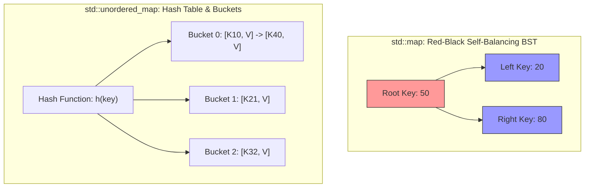

# 02. Associative & Unordered Containers: Map, Set, and Hash Tables

---

## 1. `std::map` vs. `std::unordered_map` (⭐ Priority Topic)



### In-Depth Comparison Matrix

| Dimension | `std::map` | `std::unordered_map` |
| :--- | :--- | :--- |
| **Underlying Data Structure** | **Self-Balancing BST (Red-Black Tree)** | **Hash Table** with separate chaining buckets |
| **Ordering of Keys** | Strictly **Sorted** (Ascending order by default) | **Unordered / Arbitrary** |
| **Lookup / Insert / Delete Time** | **$O(\log N)$ Guaranteed** | **Average: $O(1)$**, Worst-case: **$O(N)$** (Hash collisions) |
| **Key Type Requirements** | Must support `operator<` (Strict Weak Ordering) | Must support `std::hash<Key>` and `operator==` |
| **Memory Overhead** | 3 pointers per node (parent, left, right) + color bit | Array of bucket pointers + linked list nodes |
| **Range Queries / Lower Bound** | ✅ Supports `lower_bound()` / `upper_bound()` in $O(\log N)$ | ❌ **No range queries or sorting support** |
| **DSA Use Cases** | When keys must be printed sorted, or queries need nearest successor/predecessor. | Frequency counting, fast two-sum lookups, caching. |

---

### Core Operations on `std::map`

```cpp
#include <map>
#include <string>
#include <iostream>

std::map<std::string, int> ageMap;

// 1. Insertion
ageMap["Alice"] = 25;                       // Inserts or updates: O(log N)
ageMap.insert({"Bob", 30});                 // Inserts only if key does not exist: O(log N)
ageMap.emplace("Charlie", 28);              // In-place construction: O(log N)

// 2. Lookup & The [] Operator Trap
// WARNING: ageMap["David"] automatically INSERTS "David" with default value 0 if not found!
auto it = ageMap.find("Alice");             // Preferred lookup: Returns iterator or ageMap.end()
if (it != ageMap.end()) {
    std::cout << it->first << " -> " << it->second << "\n";
}

// 3. Count / Existence Check
if (ageMap.count("Bob")) {                  // Returns 1 if present, 0 if absent: O(log N)
    // Key exists
}

// 4. Deletion
ageMap.erase("Alice");                      // Erases by key: O(log N)

// 5. Sorted Iteration
for (const auto& [name, age] : ageMap) {
    std::cout << name << ": " << age << "\n"; // Prints in alphabetical order!
}
```

---

## 2. `std::set` vs. `std::unordered_set` (⭐ Priority Topic)

### 🎯 2–4 Line Interview-Ready Explanation
> `std::set` is an associative container containing a **sorted set of unique objects of type Key**, implemented via a **Red-Black Tree ($O(\log N)$)**. `std::unordered_set` is a collection of unique keys organized into a **Hash Table**, offering **average $O(1)$ constant time operations** without any key ordering.

```cpp
#include <set>
#include <unordered_set>

// 1. std::set (Sorted & Unique)
std::set<int> s = {50, 10, 30, 10, 50}; // Stores: {10, 30, 50}
s.insert(20);                           // O(log N)
s.erase(30);                            // O(log N)
bool has10 = s.count(10);               // O(log N)

// Range lookups in std::set:
auto lb = s.lower_bound(20);            // First element >= 20: O(log N)
auto ub = s.upper_bound(20);            // First element > 20: O(log N)

// 2. std::unordered_set (Fast O(1) Unique Filter)
std::unordered_set<int> seen;
std::vector<int> nums = {4, 2, 4, 5, 2, 3};
for (int x : nums) {
    if (seen.find(x) == seen.end()) {
        seen.insert(x);                 // Average O(1)
    }
}
```

---

## 3. `std::multiset` and `std::multimap` (Duplicate Keys)

Unlike `std::set` and `std::map`, **Multisets** and **Multimaps** permit multiple elements with identical keys while maintaining sorted order.

```cpp
#include <set>
#include <iostream>

std::multiset<int> ms = {10, 20, 20, 20, 30};

// 1. Deletion Warning Trap:
// ms.erase(20);        // DANGER: Erases ALL instances of 20!
// To erase ONLY A SINGLE instance of 20:
auto it = ms.find(20);  // Finds iterator to the first instance
if (it != ms.end()) {
    ms.erase(it);       // Erases only that single element!
}

// 2. Count instances of duplicate key: O(log N + count)
int count20 = ms.count(20);

// 3. Find Range of Duplicates (equal_range)
auto [first, last] = ms.equal_range(20);
// [first, last) represents the iterator range of all 20s
```

* **DSA Use Case for `std::multiset`:** Finding the running median, sliding window minimum/maximum with duplicates, Dijkstra's algorithm (alternative to `priority_queue`).

---

## 4. Infosys SP L3 Interview Questions & Answers

### Q1: What is the difference between `map[key]` and `map.at(key)`?
**Answer:**
- **`map[key]`:** If `key` exists, it returns a reference to the mapped value. If `key` does **NOT** exist, it **modifies the map** by inserting a new key with a default-constructed value (e.g., `0` for `int`) and returns a reference to it. It cannot be used on a `const std::map`.
- **`map.at(key)`:** Returns a reference to the mapped value if found. If `key` does not exist, it **does not modify the map** and throws a `std::out_of_range` exception. Safe for `const` maps.

---

### Q2: Why can `std::unordered_map` degrade to $O(N)$ complexity? How do you prevent it?
**Answer:**
`std::unordered_map` relies on a hash function to distribute keys uniformly across buckets. If an adversary provides malicious input crafted to produce identical hash values (or a poor hash function is used), all $N$ keys hash to the **exact same bucket**, degrading the hash table into a single linked list where search/insert costs $O(N)$.
- **Prevention:** Use a custom anti-hash-collision RNG custom hasher (e.g., `custom_hash` with `splitmix64`) or switch to `std::map` (guaranteed $O(\log N)$ via Red-Black tree).

---

### Q3: How do you erase only one instance of a duplicate key in `std::multiset`?
**Answer:**
Passing the key value directly (`ms.erase(val)`) will delete **all copies** of that value from the multiset. To delete only a single instance, locate an iterator to the first occurrence using `ms.find(val)` and pass the **iterator** to erase:
```cpp
auto it = ms.find(val);
if (it != ms.end()) {
    ms.erase(it); // Erases exactly one element
}
```
