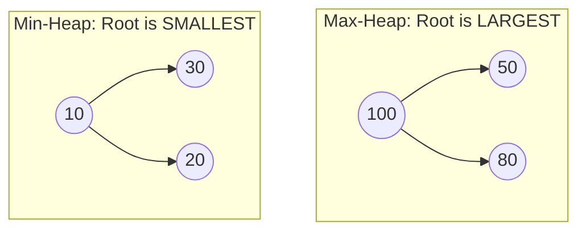

# 03. Container Adapters: Stack, Queue, and Priority Queue (Heaps)

---

## 1. `std::stack` (LIFO - Last In, First Out)

### 🎯 2–4 Line Interview-Ready Explanation
> `std::stack` is a container adapter that provides a **LIFO (Last-In, First-Out)** data structure interface. It wraps an underlying sequence container (by default `std::deque`, but can use `std::vector` or `std::list`), exposing only top-element access with **strict $O(1)$ operations**.

```cpp
#include <stack>
#include <iostream>

std::stack<int> st;

st.push(10);          // Inserts element on top: O(1)
st.emplace(20);       // In-place construction on top: O(1)
int t = st.top();     // Returns reference to top element (20): O(1)
st.pop();             // Removes top element (does NOT return value): O(1)
bool empty = st.empty(); // Returns true if size == 0: O(1)
size_t sz = st.size();   // Number of elements: O(1)
```

> [!CAUTION]
> **Safety Warning:** Calling `st.top()` or `st.pop()` on an **empty stack** causes **Undefined Behavior / Segmentation Fault**. Always check `!st.empty()` first.

* **Top DSA Use Cases:** Monotonic Stack (Next Greater Element, Daily Temperatures, Largest Rectangle in Histogram), Valid Parentheses, Depth-First Search (DFS) recursion simulation.

---

## 2. `std::queue` (FIFO - First In, First Out)

### 🎯 2–4 Line Interview-Ready Explanation
> `std::queue` is a container adapter that gives the programmer the functionality of a **FIFO (First-In, First-Out)** queue. Elements are pushed into the back and popped from the front in **$O(1)$ time complexity** (default underlying container is `std::deque`).

```cpp
#include <queue>

std::queue<int> q;

q.push(10);          // Inserts at back: O(1)
q.push(20);          // Inserts at back: O(1)
int f = q.front();   // Reads oldest front element (10): O(1)
int b = q.back();    // Reads newest back element (20): O(1)
q.pop();             // Removes front element (10): O(1)
```

* **Top DSA Use Cases:** Breadth-First Search (BFS) graph/tree traversals, Level Order Traversal, Producer-Consumer task buffering.

---

## 3. `std::priority_queue` (Heaps) (⭐ Critical Priority Topic)

### 🎯 2–4 Line Interview-Ready Explanation
> `std::priority_queue` is a container adapter that provides **$O(1)$ lookup of the largest (Max-Heap) or smallest (Min-Heap) element**, backed by an array structured as a Complete Binary Tree. Insertion and removal of the extreme element both take **$O(\log N)$ logarithmic time**.

---

### Max-Heap vs Min-Heap Declarations



```cpp
#include <queue>
#include <vector>
#include <iostream>

// 1. Max-Heap (Default: Largest element on top)
std::priority_queue<int> maxHeap;
maxHeap.push(10);
maxHeap.push(30);
maxHeap.push(20);
int maxVal = maxHeap.top(); // Returns 30: O(1)
maxHeap.pop();              // Removes 30, re-heapifies: O(log N)

// 2. Min-Heap (Smallest element on top)
// Syntax: std::priority_queue<Type, Container, Comparator>
std::priority_queue<int, std::vector<int>, std::greater<int>> minHeap;
minHeap.push(10);
minHeap.push(30);
minHeap.push(20);
int minVal = minHeap.top(); // Returns 10: O(1)
```

---

### Priority Queue with Custom Comparators

```cpp
#include <queue>
#include <vector>
#include <string>
#include <iostream>

struct Employee {
    int id;
    int salary;
    std::string name;
};

// Custom Comparator Struct (For Min-Heap on Salary)
struct CompareSalary {
    // In C++ STL Heaps, returning TRUE means 'a' has LOWER priority than 'b'
    bool operator()(const Employee& a, const Employee& b) {
        return a.salary > b.salary; // Min-Heap: Smaller salary comes to top
    }
};

int main() {
    std::priority_queue<Employee, std::vector<Employee>, CompareSalary> empPQ;
    
    empPQ.push({101, 80000, "Alice"});
    empPQ.push({102, 50000, "Bob"});
    empPQ.push({103, 95000, "Charlie"});
    
    // Bob (50000) will be on top!
    std::cout << "Lowest Earner: " << empPQ.top().name << " (" << empPQ.top().salary << ")\n";
}
```

---

### Summary Table of Complexity & Methods

| Container Adapter | Insertion (`push`) | Removal (`pop`) | Inspection (`top` / `front`) | Default Underlying Container |
| :--- | :---: | :---: | :---: | :--- |
| **`std::stack`** | $O(1)$ | $O(1)$ | `top()` $\to O(1)$ | `std::deque` |
| **`std::queue`** | $O(1)$ | $O(1)$ | `front()` & `back()` $\to O(1)$ | `std::deque` |
| **`std::priority_queue`** | **$O(\log N)$** | **$O(\log N)$** | `top()` $\to \mathbf{O(1)}$ | `std::vector` |

---

## 4. Infosys SP L3 Interview Questions & Answers

### Q1: Why does `pop()` in `std::stack` and `std::queue` return `void` instead of returning the removed element?
**Answer:**
For **Exception Safety (Strong Exception Guarantee)**.
If `pop()` returned the value by value (`T val = st.pop()`), the value would have to be copied to the caller. If the copy constructor of type `T` threw an exception during that copy, the element would have already been deleted from the stack and lost forever. By separating inspection (`top()`) from deletion (`pop()`), STL guarantees zero data loss if an exception occurs.

---

### Q2: How do you choose between `std::priority_queue` and `std::set` in DSA problems?
**Answer:**
- Use **`std::priority_queue`** if you only ever need to access/remove the extreme minimum or maximum element (e.g., Top K elements, Dijkstra's algorithm). It has lower memory overhead ($0$ pointers, stored in flat vector) and faster constant-factor heapify operations.
- Use **`std::set` / `std::multiset`** if you need to **search for arbitrary intermediate elements**, delete arbitrary non-top elements in $O(\log N)$, or perform range queries (`lower_bound` / `upper_bound`). `priority_queue` does not support searching or removing arbitrary non-top elements.

---

### Q3: What is the time complexity of building a heap from an unsorted array of size $N$?
**Answer:**
- Pushing $N$ elements into an empty `priority_queue` one by one takes **$O(N \log N)$**.
- Using the range constructor `std::priority_queue<int> pq(v.begin(), v.end())` invokes `std::make_heap` under the hood, which uses bottom-up heap construction running in **$O(N)$ linear time**.
