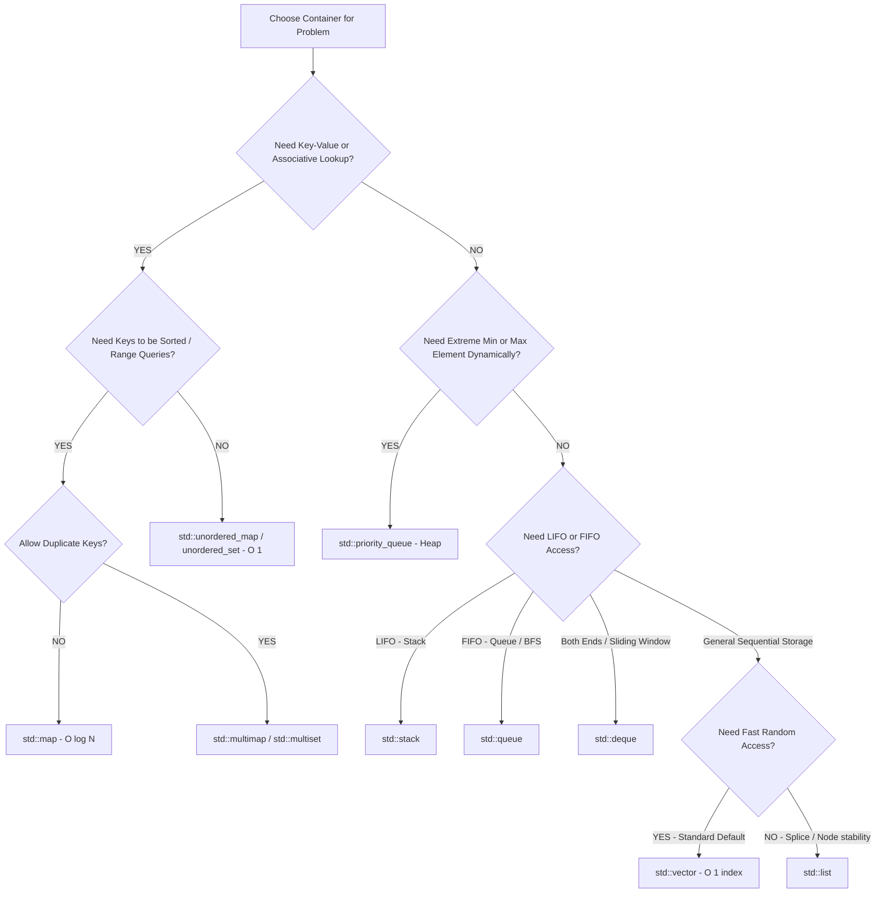

# 05. Modern C++ Features, Complexity Cheat Sheet, and Container Selector

---

## 1. Modern C++ Features for High-Speed Interview Coding

### 1. `auto`, `auto&`, and `const auto&`

```cpp
std::vector<std::string> words = {"Infosys", "Specialist", "Programmer"};

// 1. auto x (COPY - Avoid for heavy objects / strings)
for (auto s : words) { /* Copies each string into s */ }

// 2. const auto& x (READ-ONLY REFERENCE - Preferred for fast iteration)
for (const auto& s : words) { /* Zero copies, read-only */ }

// 3. auto& x (MUTABLE REFERENCE - When you need to modify container in-place)
for (auto& s : words) { s += "!"; }
```

---

### 2. Structured Bindings (C++17)

Unpacks tuples, pairs, maps, and structs into clean, readable local variables:

```cpp
#include <map>
#include <string>
#include <iostream>

std::map<std::string, int> scores = {{"Alice", 95}, {"Bob", 88}};

// Modern C++17 Map Iteration
for (const auto& [name, score] : scores) {
    std::cout << name << " got " << score << "\n";
}
```

---

### 3. Lambda Functions (Anonymous Closures)

```cpp
// Syntax: [capture](parameters) -> return_type { body }
auto isEven = [](int x) -> bool { return x % 2 == 0; };

// In STL algorithms:
std::vector<int> nums = {1, 2, 3, 4, 5, 6};
int evenCount = std::count_if(nums.begin(), nums.end(), [](int n) {
    return n % 2 == 0;
});
```

---

### 4. `push_back` vs. `emplace_back` & `insert` vs. `emplace`

```cpp
struct Point {
    int x, y;
    Point(int a, int b) : x(a), y(b) {}
};

std::vector<Point> pts;

// push_back: Creates a temporary Point(1, 2), then moves/copies it into vector
pts.push_back(Point(1, 2));

// emplace_back: Constructs Point(1, 2) directly IN-PLACE inside vector memory
pts.emplace_back(1, 2); // Faster, zero temporary copies
```

---

## 2. Master STL Complexity Cheat Sheet (⭐ Priority Reference)

| Container / Algorithm | Operation | Average Time Complexity | Worst-Case Time Complexity | Underlying Data Structure |
| :--- | :--- | :---: | :---: | :--- |
| **`std::vector`** | Random Access (`v[i]`) | $O(1)$ | $O(1)$ | Dynamic contiguous array |
| | Insert / Erase at end (`push_back` / `pop_back`) | **Amortized $O(1)$** | $O(N)$ (during resize) | |
| | Insert / Erase in middle | $O(N)$ | $O(N)$ | |
| **`std::deque`** | Random Access (`dq[i]`) | $O(1)$ | $O(1)$ | Map of fixed-size chunks |
| | Push / Pop at Front & Back | **$O(1)$** | $O(1)$ | |
| **`std::list`** | Insert / Erase (with iterator) | **$O(1)$** | $O(1)$ | Doubly linked list |
| | Random Access | ❌ Not supported | $O(N)$ traversal | |
| **`std::set` / `std::map`** | Search / Insert / Erase | **$O(\log N)$** | **$O(\log N)$** | Red-Black Tree (Self-balancing BST) |
| **`std::unordered_map`** | Search / Insert / Erase | **Average $O(1)$** | **$O(N)$** (Hash collision) | Hash Table with Chaining |
| **`std::unordered_set`** | Search / Insert / Erase | **Average $O(1)$** | **$O(N)$** | Hash Table with Chaining |
| **`std::stack`** | Push / Pop / Top | **$O(1)$** | $O(1)$ | Adapter over `std::deque` |
| **`std::queue`** | Push / Pop / Front | **$O(1)$** | $O(1)$ | Adapter over `std::deque` |
| **`std::priority_queue`**| Push / Pop (Heapify) | **$O(\log N)$** | **$O(\log N)$** | Binary Heap over `std::vector` |
| | Top (Peek root) | **$O(1)$** | **$O(1)$** | |
| **`std::sort`** | Range Sorting | **$O(N \log N)$** | **$O(N \log N)$** | IntroSort (Quick + Heap + Insertion) |
| **`std::lower_bound`** | Binary Search Range | **$O(\log N)$** | **$O(\log N)$** | Binary Search on Random-Access iterator |

---

## 3. DSA Container Selector: "Which Container to Use When?"



### Quick DSA Selection Rules:
1. **Default to `std::vector`** for 90% of array/sequence problems.
2. **Use `std::unordered_map`** for frequency counting, $O(1)$ lookup, and two-sum patterns.
3. **Use `std::map` / `std::set`** when you need elements **automatically sorted**, or need **`lower_bound()` / `upper_bound()`** successor searches.
4. **Use `std::priority_queue`** for Top-K problems, running stream medians, and Dijkstra's algorithm.
5. **Use `std::deque`** for sliding window minimum/maximum (monotonic deque) and double-ended buffers.
6. **Use `std::stack`** for monotonic stack problems (Next Greater Element, Histograms) and nested parenthesization.

---

## 4. Infosys SP L3 Interview Questions & Answers

### Q1: When would you deliberately use `std::map` instead of `std::unordered_map`?
**Answer:**
1. **Sorted Output:** When the problem requires outputting keys in sorted alphabetical or numeric order.
2. **Successor / Range Lookups:** When you need to find the nearest element $\ge$ or $>$ a target via `lower_bound()` / `upper_bound()`.
3. **Guaranteed $O(\log N)$ Worst-Case:** When malicious test cases could exploit hash collisions in `unordered_map` causing $O(N)$ timeouts.
4. **Custom Key Types:** When the key type lacks a built-in `std::hash` specialization (e.g., `std::pair<int, int>` cannot be used as an `unordered_map` key without a custom hash, but works out-of-the-box in `std::map`).

---

### Q2: What is the difference between `const auto& x` and `auto x` in range-based loops?
**Answer:**
- `auto x` makes a **copy** of each element. For a vector of large objects (e.g., `std::vector<std::string>` or `std::vector<vector<int>>`), copying every element incurs massive dynamic heap allocations and slows down code by $10\times - 100\times$.
- `const auto& x` creates an **immutable reference** to the element inside the vector, achieving **zero copies and maximum cache efficiency**.
