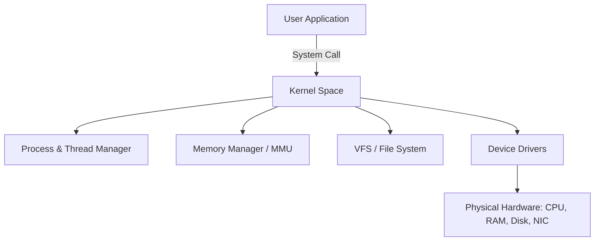
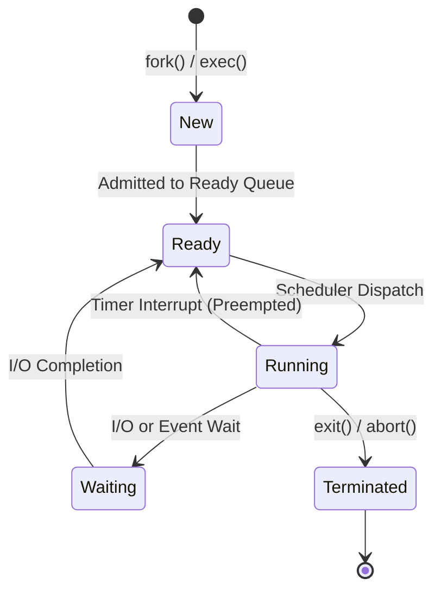

# 01. OS Fundamentals, Processes, and Threads

---

## 1. Operating System Fundamentals

### 🎯 2–4 Line Interview-Ready Explanation
> An **Operating System (OS)** is system software that acts as an intermediary between computer hardware and user applications. Its primary responsibilities are **resource management** (CPU, memory, I/O devices), **process execution/isolation**, and providing a secure, unified **Hardware Abstraction Layer (HAL)** via System Calls so applications don't need direct hardware-level drivers.

---

### Key Concepts Breakdown



#### 1. Kernel & Dual-Mode Operation
* **User Mode (Ring 3):** User applications execute here with restricted CPU privileges. Cannot directly access hardware or raw physical memory.
* **Kernel Mode (Ring 0 / Supervisor Mode):** Unrestricted access to CPU instructions and physical memory. The OS core runs here.
* **Mode Switch Trigger:** A CPU hardware trap triggered by **System Calls**, **Hardware Interrupts**, or **Exceptions (e.g., Division by Zero, Page Fault)** switches execution from User Mode to Kernel Mode.

#### 2. System Calls vs Interrupts
* **System Call (Software Interrupt / Trap):** Programmatic request initiated synchronously by user code to request OS services (e.g., `fork()`, `read()`, `write()`, `mmap()`).
* **Hardware Interrupt:** Asynchronous electrical signal sent by external devices (e.g., keyboard press, timer tick, NIC packet arrival) causing CPU to pause user execution and jump to an **Interrupt Service Routine (ISR)**.

#### 3. Types of Operating Systems
* **Batch OS:** Jobs queued and processed sequentially without interactive user intervention (legacy mainframes).
* **Time-Sharing / Multitasking OS:** CPU switches rapidly between multiple active processes via preemptive scheduling (Linux, Windows, macOS).
* **Real-Time OS (RTOS):** Hard/Soft deadline guarantees where task completion predictability is critical (e.g., FreeRTOS, VxWorks in aerospace, automotive brakes).
* **Distributed OS:** Manages a group of independent networked computers, presenting them as a single computational system.

---

## 2. Processes (⭐ Priority Topic)

### 🎯 2–4 Line Interview-Ready Explanation
> A **Process** is a program in execution. While a program is a passive set of binary instructions stored on disk, a process is an active entity loaded into RAM containing its own isolated **Virtual Address Space** (Code/Text, Data, Heap, Stack) and tracked by a **Process Control Block (PCB)**.

---

### Process Memory Layout & Process Control Block (PCB)

```
Process Virtual Memory Layout (32/64-bit Address Space):
0xFFFFFFFF ┌──────────────────────────────────────┐ (High Memory)
           │ Stack (Local variables, return addrs)│ ↓ Grows Downward
           ├──────────────────────────────────────┤
           │               ↓                      │
           │         (Unused Space)               │
           │               ↑                      │
           ├──────────────────────────────────────┤
           │ Heap (Dynamic alloc: malloc / new)   │ ↑ Grows Upward
           ├──────────────────────────────────────┤
           │ BSS Segment (Uninitialized globals)  │
           ├──────────────────────────────────────┤
           │ Data Segment (Initialized globals)   │
           ├──────────────────────────────────────┤
0x00000000 │ Text / Code Segment (Binary opcode)  │ (Low Memory - Read Only)
           └──────────────────────────────────────┘
```

#### PCB (Process Control Block) Components:
* **Process ID (PID)** & Parent PID (PPID).
* **Process State:** Ready, Running, Waiting, Terminated.
* **Program Counter (PC):** Address of the next CPU instruction to execute.
* **CPU Registers & Stack Pointer (SP):** Register context saved during context switch.
* **Memory Management Info:** Page tables, segment limits.
* **Open File Descriptors Table & I/O Status.**

---

### Process State Lifecycle



---

### Process Creation, Fork, and Termination
* **`fork()`:** System call that creates an exact child duplicate process.
  * Returns `0` to child process, child PID to parent process, and `< 0` on failure.
  * Uses **Copy-On-Write (COW)**: Pages are initially shared read-only; physical copy is made only when either process modifies memory.
* **`exec()`:** Replaces the current process address space with a new executable program binary.
* **Zombie Process:** A child process that has finished execution (`exit()`), but its exit code hasn't been read by its parent via `wait()`. Remains in process table.
* **Orphan Process:** A child whose parent terminated before calling `wait()`. Automatically adopted by `init` / `systemd` (PID 1), which cleans them up.

---

### Context Switching
* **What is it?** The mechanism where the CPU saves the state (registers, PC, stack pointer, page table base register) of the currently running process to its PCB and loads the saved state of another process.
* **Overhead:** Pure OS overhead (no useful application work is done during context switch). Invalidates CPU cache (L1/L2/L3) and Translation Lookaside Buffer (TLB).

---

## 3. Threads (⭐ Priority Topic)

### 🎯 2–4 Line Interview-Ready Explanation
> A **Thread** is the smallest schedulable unit of CPU execution within a process, often called a **Lightweight Process (LWP)**. All threads of the same process **share the same address space (Code, Data, Heap, and open files)**, but each thread possesses its own **private Program Counter (PC), Register set, and Stack**.

---

### Process vs Thread: Deep Dive Comparison

```mermaid
graph TD
    subgraph Process_Memory_Space [Process (Shared Address Space)]
        Code[Code / Text Segment]
        Data[Data & BSS Segments]
        Heap[Heap - Dynamic Memory]
        Files[File Descriptors]
        
        subgraph Thread_1 [Thread 1]
            SP1[Stack 1]
            Reg1[Registers & PC 1]
        end
        
        subgraph Thread_2 [Thread 2]
            SP2[Stack 2]
            Reg2[Registers & PC 2]
        end
    end
```

| Dimension | Process | Thread |
| :--- | :--- | :--- |
| **Definition** | Heavyweight execution unit with isolated memory space. | Lightweight unit of execution within a parent process. |
| **Memory Sharing** | Completely isolated; communication requires IPC. | Shared Heap, Globals, Code, and Open Files. |
| **Private State** | Isolated PCB, full address space, file table. | Private Thread ID, Stack, PC, and CPU Registers. |
| **Creation Overhead** | High (allocates new page tables, address map). | Very Low ($10\times - 30\times$ faster than process). |
| **Context Switch** | Slow (requires flushing TLB and switching page directory). | Fast (same page table; preserves CPU cache and TLB). |
| **Fault Isolation** | High (if one process crashes, others are unaffected). | Low (unhandled crash in one thread crashes the whole process). |

---

### User-Level Threads (ULT) vs Kernel-Level Threads (KLT)

```
User-Level Threads (1:N Model):
[ Thread 1 ] [ Thread 2 ] [ Thread 3 ]  (Managed by User Thread Library / Runtime)
              │
      [ 1 Kernel Thread ] ──> Cannot utilize multiple CPU cores concurrently!

Kernel-Level Threads (1:1 Model - Modern Linux/Windows):
[ Thread 1 ]   [ Thread 2 ]   [ Thread 3 ]
     │              │              │
[ K-Thread 1 ] [ K-Thread 2 ] [ K-Thread 3 ] ──> Full multi-core CPU parallelism!
```

* **User-Level Threads (ULT):** Thread management done by user-space runtime (e.g., green threads). Fast context switch, but if one thread blocks on I/O, the entire process blocks. Cannot utilize multi-core parallelism.
* **Kernel-Level Threads (KLT):** OS kernel creates, schedules, and manages threads. Full hardware multi-core execution. Slightly higher creation/switch overhead than ULT.

---

## 4. Infosys SP L3 Interview Questions & Answers

### Q1: What exactly happens during a Context Switch between two processes vs two threads?
**Answer:**
- **Process Context Switch:** CPU saves registers and Program Counter to the current PCB, flushes the Translation Lookaside Buffer (TLB), switches the Page Table Base Register (`CR3` in x86) to the new process's page table, and loads the new PCB registers. Cache locality is cold.
- **Thread Context Switch (Same Process):** Virtual memory mapping remains identical (`CR3` register and TLB are untouched). The CPU only saves and switches the Stack Pointer, Program Counter, and CPU registers. Far cheaper with lower latency.

---

### Q2: What is the difference between a Zombie process and an Orphan process? How do you eliminate a Zombie?
**Answer:**
- **Zombie:** A terminated process whose parent hasn't reaped its exit status via `wait()` / `waitpid()`. It consumes no CPU or memory, only an entry in the OS process table. To eliminate it, kill the parent process so `init` / `systemd` adopts and reaps it.
- **Orphan:** A running process whose parent terminated unexpectedly. Adopted by `init` (PID 1) which monitors and cleans it up upon termination.

---

### Q3: Why does `fork()` not immediately copy all physical RAM pages of the parent?
**Answer:**
Modern OS engines use **Copy-On-Write (COW)**. When `fork()` is called, the child gets a duplicate page table pointing to the exact same physical pages as the parent, with permissions set to **Read-Only**. Physical memory is duplicated only when either parent or child attempts a write to a page, triggering a page fault where the kernel allocates a new physical frame. This makes `fork()` near instantaneous, especially when immediately followed by `exec()`.

---

### Q4: When would you choose Multi-Processing over Multi-Threading in a production backend?
**Answer:**
- Choose **Multi-Threading** when tasks share large in-memory caches, require rapid low-latency communication, and are I/O-bound or CPU-parallel without risk of memory corruption.
- Choose **Multi-Processing** when **fault isolation and security boundaries** are critical (e.g., web browsers like Chrome where a crashed tab shouldn't crash the browser, or CPU-heavy Python scripts to bypass the Global Interpreter Lock - GIL).
