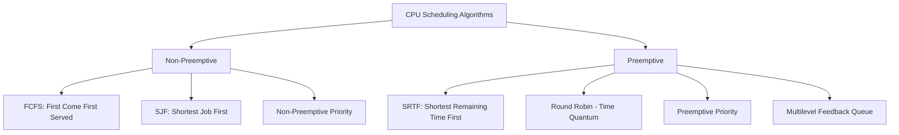
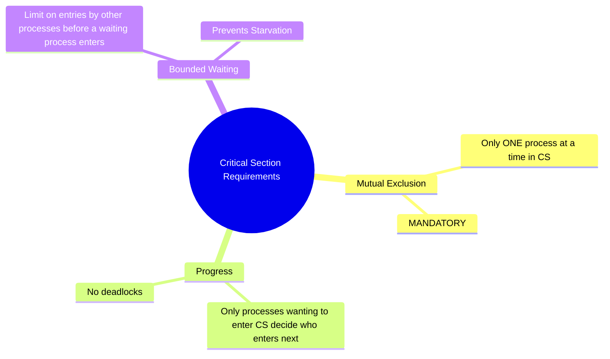
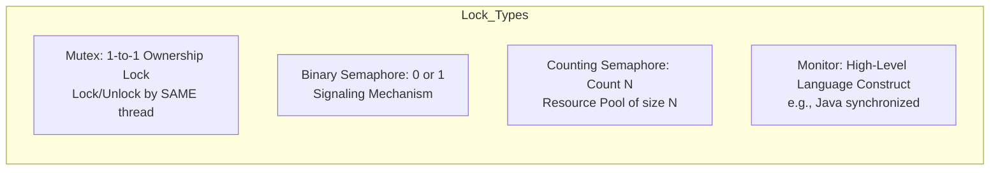

# 02. CPU Scheduling and Process Synchronization

---

## 1. CPU Scheduling (⭐ Priority Topic)

### 🎯 2–4 Line Interview-Ready Explanation
> **CPU Scheduling** is the OS mechanism that determines which ready process is allocated the CPU when the current process finishes or enters a wait state. The goal is to maximize **CPU Utilization** and **Throughput** while minimizing **Waiting Time**, **Turnaround Time**, and **Response Time** under fairness constraints.

---

### Core Performance Metrics & Definitions

| Metric | Formula / Definition | Goal |
| :--- | :--- | :--- |
| **Arrival Time ($AT$)** | Time at which process enters the Ready Queue. | — |
| **Burst Time ($BT$)** | Total CPU time required by process for execution. | — |
| **Completion Time ($CT$)** | Timestamp when process completely finishes execution. | Minimize |
| **Turnaround Time ($TAT$)** | $$TAT = CT - AT$$ (Total time spent in system). | Minimize |
| **Waiting Time ($WT$)** | $$WT = TAT - BT$$ (Time spent waiting in Ready Queue). | Minimize |
| **Response Time ($RT$)** | Time from arrival until the process gets the CPU for the very **first** time. | Minimize (Critical for UI/interactive systems) |

---

### Scheduling Algorithms Comparison



| Algorithm | Preemptive? | Selection Criteria | Pros | Cons / Major Trap |
| :--- | :---: | :--- | :--- | :--- |
| **FCFS** (First-Come, First-Served) | ❌ No | Arrival Time ($AT$) | Simplest, zero scheduling overhead. | **Convoy Effect:** Short processes stuck waiting behind a massive CPU-heavy process; poor average waiting time. |
| **SJF** (Shortest Job First) | ❌ No | Smallest Burst Time ($BT$) | **Provably optimal** minimum average waiting time. | Impossible to know burst time in advance; causes **Starvation** of long jobs. |
| **SRTF** (Shortest Remaining Time First) | ✅ Yes | Smallest Remaining CPU time | Preemptive version of SJF; ultra-low average waiting time. | High context switch overhead; starvation of long processes. |
| **Round Robin (RR)** | ✅ Yes | FCFS order with fixed **Time Quantum ($q$)** | Fair, excellent response time for interactive systems. | If $q$ too large $\to$ degrades to FCFS. If $q$ too small $\to$ massive context switch overhead ruins CPU throughput. (Ideal $q$: 10–50 ms). |
| **Priority Scheduling** | Both | Process Priority integer | Critical tasks run first. | **Starvation (Indefinite Blocking)** of low-priority processes. Resolved via **Aging** (gradually increasing priority of waiting processes). |

---

## 2. Process Synchronization (⭐ Priority Topic)

### 🎯 2–4 Line Interview-Ready Explanation
> **Process Synchronization** is the coordination of concurrent processes sharing memory or resources to prevent **Race Conditions** and ensure data consistency. The code segment accessing shared resources is the **Critical Section**, which must satisfy **Mutual Exclusion**, **Progress**, and **Bounded Waiting**.

---

### The Three Critical Section Requirements



1. **Mutual Exclusion:** If process $P_i$ is executing in its critical section, no other processes can be executing in their critical sections.
2. **Progress:** If no process is executing in its critical section and some processes wish to enter, only those processes not in their remainder section can participate in deciding who enters next, and this selection cannot be postponed indefinitely.
3. **Bounded Waiting:** A bound must exist on the number of times other processes are allowed to enter their critical sections after a process has made a request to enter and before that request is granted (prevents starvation).

---

### Synchronization Mechanisms: Mutex vs Semaphore vs Monitor



| Feature | Mutex (Mutual Exclusion Lock) | Binary Semaphore | Counting Semaphore |
| :--- | :--- | :--- | :--- |
| **Definition** | A locking mechanism used to synchronize access to a single shared resource. | A signaling mechanism initialized with value `1`. | A signaling mechanism initialized with integer count `N` (representing available resource instances). |
| **Ownership** | **Strict Ownership:** The exact thread that locked the mutex **must** be the one that unlocks it. | **No Ownership:** Any thread can signal (`V()`/`post()`) to unblock a waiting thread. | **No Ownership:** Used for resource pooling and producer-consumer signaling. |
| **Operations** | `lock()` and `unlock()` | `wait()` (P) and `signal()` (V) | `wait()` (decrements count) / `signal()` (increments count). |
| **Primary Use** | Protecting critical sections & data structures. | Thread synchronization / event notification. | Managing pools of $N$ identical database connections or buffers. |

---

### Classical Synchronization: Producer-Consumer Problem (Bounded Buffer)

```cpp
// Pseudocode using Semaphores
const int BUFFER_SIZE = 5;
int buffer[BUFFER_SIZE];

semaphore mutex = 1;       // Binary semaphore for mutual exclusion
semaphore empty = BUFFER_SIZE; // Counting semaphore: empty slots
semaphore full = 0;        // Counting semaphore: filled slots

void Producer() {
    while (true) {
        int item = produce_item();
        
        wait(empty);        // Decrement empty slot count (blocks if buffer full)
        wait(mutex);        // Acquire lock
        
        insert_into_buffer(item);
        
        signal(mutex);      // Release lock
        signal(full);       // Increment filled slot count (wakes up consumer)
    }
}

void Consumer() {
    while (true) {
        wait(full);         // Decrement filled slot count (blocks if buffer empty)
        wait(mutex);        // Acquire lock
        
        int item = remove_from_buffer();
        
        signal(mutex);      // Release lock
        signal(empty);      // Increment empty slot count (wakes up producer)
        
        consume_item(item);
    }
}
```

> [!WARNING]
> **Common Deadlock Trap:** Never swap `wait(empty)` and `wait(mutex)`!
> If Producer calls `wait(mutex)` first on a full buffer, it holds the mutex while waiting on `empty`. The Consumer cannot enter to read items because the mutex is locked $\implies$ **Permanent Deadlock**.

---

## 3. Infosys SP L3 Interview Questions & Answers

### Q1: What is the Convoy Effect in CPU Scheduling? How is it resolved?
**Answer:**
The Convoy Effect occurs in **FCFS scheduling** when a CPU-bound process with a huge burst time arrives just before many short I/O-bound processes. The short processes sit idle in the ready queue waiting for the long process to finish, causing poor CPU and device utilization and terrible average waiting times. It is resolved by using **Preemptive Scheduling** (such as Round Robin or SRTF).

---

### Q2: What is the exact difference between a Mutex and a Binary Semaphore?
**Answer:**
1. **Ownership:** A Mutex has the concept of thread ownership—only the thread that acquired the mutex can release it. A Binary Semaphore has no owner; thread A can call `wait()` and thread B can call `signal()` (e.g., signaling an event).
2. **Priority Inversion Protection:** Mutexes support **Priority Inheritance** (boosting a low-priority thread's priority while it holds a lock needed by a high-priority thread). Semaphores do not support priority inheritance.

---

### Q3: What is a Spinlock? When is a Spinlock preferred over a Mutex?
**Answer:**
A Spinlock is a lock where a thread repeatedly polls in a busy-wait CPU loop (`while (test_and_set(&lock));`) until the lock becomes free, rather than going to sleep and causing a context switch.
- **When to use:** Multi-core systems where the critical section is **extremely short** (a few CPU cycles) and the cost of two context switches (sleep + wakeup $\approx 2–5\,\mu\text{s}$) exceeds the spin duration (e.g., in low-level OS kernel interrupt handlers).

---

### Q4: How do you prevent Starvation in Priority Scheduling?
**Answer:**
Via **Aging**. Aging is a technique that gradually increments the priority of processes waiting in the ready queue over time. For example, every 10 seconds a low-priority process waits without CPU time, its priority is incremented by 1. Eventually, even the lowest priority process reaches the highest priority in the queue and executes.
