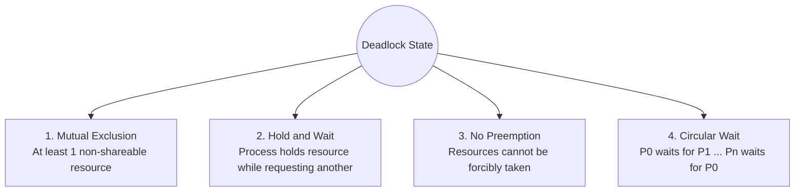
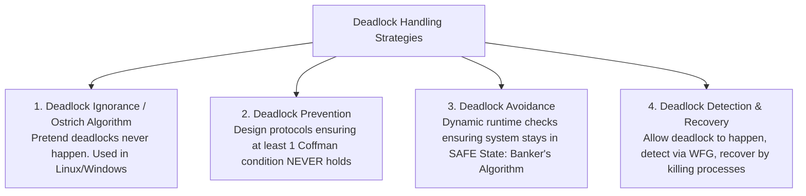
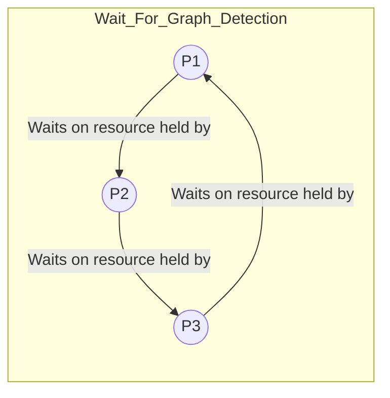

# 03. Deadlocks: Prevention, Avoidance, and Recovery

---

## 1. Deadlock Overview (⭐ Priority Topic)

### 🎯 2–4 Line Interview-Ready Explanation
> A **Deadlock** is a state in a multi-process or multi-threaded system where a set of processes are permanently blocked because each process holds a resource that another process needs while waiting for a resource held by another process in the set. None of the processes can make progress or release resources on their own.

---

### The Four Necessary (Coffman) Conditions for Deadlock

Deadlock can arise **if and only if** all 4 Coffman conditions hold simultaneously in the system:



1. **Mutual Exclusion:** At least one resource must be held in a non-shareable mode (only one process can use it at a time).
2. **Hold and Wait:** A process must currently hold at least one resource and be waiting to acquire additional resources currently held by other processes.
3. **No Preemption:** Resources cannot be forcibly preempted from a process; they can only be released voluntarily by the holding process after completing its task.
4. **Circular Wait:** A closed chain of processes exists: $\{P_0, P_1, \dots, P_n\}$ such that $P_0$ is waiting for a resource held by $P_1$, $P_1$ is waiting for $P_2$, $\dots$, and $P_n$ is waiting for $P_0$.

---

## 2. Four Strategies for Handling Deadlocks



---

### Strategy 1: Deadlock Prevention (Breaking Coffman Conditions)

To prevent deadlocks, we invalidate at least one of the 4 Coffman conditions at compile time or protocol design time:

| Condition to Eliminate | Practical Method | Drawbacks |
| :--- | :--- | :--- |
| **1. Invalidate Mutual Exclusion** | Make all resources shareable (e.g., Read-Only shared files). | Impossible for inherently non-shareable hardware/locks (e.g., Printers, Exclusive Write Locks). |
| **2. Invalidate Hold and Wait** | **Conservative 2PL:** Require a process to request and be allocated **all** its required resources at once before beginning execution. If any resource is unavailable, it gets none. | Extremely poor resource utilization and high risk of starvation. |
| **3. Invalidate No Preemption** | If process $P_1$ holding resources requests a busy resource, all of $P_1$'s currently held resources are forcibly preempted and returned to the pool. | Practical only for resources whose state is easily saved and restored (CPU registers, RAM pages), not disk writes or databases. |
| **4. Invalidate Circular Wait** *(Most Practical)* | **Strict Global Resource Ordering:** Assign a global integer hierarchy $F(R)$ to every resource (e.g., Lock A = 1, Lock B = 2). A process can only request resource $R_j$ if $F(R_j) > F(R_i)$ for all currently held resources $R_i$. | Highly effective, but limits application flexibility if order changes. |

---

### Strategy 2: Deadlock Avoidance (Banker's Algorithm)

**Deadlock Avoidance** dynamically examines resource allocation state at runtime to ensure the system **never enters an Unsafe State**.

```
+-------------------------------------------------------------+
|                     All States                              |
|   +-----------------------------------------------------+   |
|   |                  Safe States                        |   |
|   |   +---------------------+                           |   |
|   |   |   No Deadlock       |   Unsafe States           |   |
|   |   |                     |   (Potential Deadlock)    |   |
|   |   +---------------------+                           |   |
|   +-----------------------------------------------------+   |
|                 Deadlock Occurs HERE                        |
+-------------------------------------------------------------+
```

* **Safe State:** A state is safe if there exists a **Safe Sequence** $\langle P_1, P_2, \dots, P_n \rangle$ of processes such that for each $P_i$, the maximum resources $P_i$ may still request can be satisfied by current available resources plus resources held by all preceding processes $P_j$ ($j < i$).
* **Unsafe State $\neq$ Deadlock:** An unsafe state is not necessarily a deadlock, but an unsafe state **may lead** to a deadlock. Deadlock is a subset of unsafe states.

#### Banker's Algorithm Data Structures:
* **`Available[m]`:** Vector of length $m$ (available instances of each resource type).
* **`Max[n][m]`:** Matrix defining maximum demand of each process.
* **`Allocation[n][m]`:** Matrix defining current resources allocated to each process.
* **`Need[n][m]`:** Matrix defining remaining resources needed:
$$\text{Need}[i][j] = \text{Max}[i][j] - \text{Allocation}[i][j]$$

#### Safety Check Algorithm:
1. Let `Work = Available` and `Finish[i] = false` for all $i$.
2. Find an index $i$ such that `Finish[i] == false` and $\text{Need}[i] \le \text{Work}$.
   - If no such $i$ exists, go to step 4.
3. $\text{Work} = \text{Work} + \text{Allocation}[i]$, $\text{Finish}[i] = \text{true}$, go to step 2.
4. If `Finish[i] == true` for all $i$, the system is in a **SAFE STATE**.

---

### Strategy 3: Deadlock Detection and Recovery



* **Detection:** Construct a directed **Wait-For Graph (WFG)** by collapsing resource nodes. Run cycle detection algorithms ($O(V + E)$ or DFS). A cycle in WFG $\iff$ Deadlock (for single-instance resources).
* **Recovery Options:**
  1. **Process Termination:** Abort all deadlocked processes (expensive) OR abort one process at a time until the cycle is eliminated.
  2. **Resource Preemption:** Preempt resources from a victim process, roll back its state to a checkpoint, and restart it. (Must guard against victim starvation).

---

## 3. Deadlock vs Starvation

| Dimension | Deadlock | Starvation (Indefinite Blocking) |
| :--- | :--- | :--- |
| **Definition** | Two or more processes blocked waiting for each other's resources permanently. | A runnable process is repeatedly overlooked by the scheduler/lock manager in favor of higher-priority processes. |
| **Resource State** | Resources are held by frozen, waiting processes. | Resources are continuously in use by other running processes. |
| **Resolution** | Requires external intervention (killing processes, OS preemption). | Resolved by **Aging** or fair FIFO queuing. |
| **Involved Processes** | Requires at least 2 processes interacting cyclically. | Can happen to a single isolated low-priority process. |

---

## 4. Infosys SP L3 Interview Questions & Answers

### Q1: What is the difference between Deadlock Prevention and Deadlock Avoidance?
**Answer:**
- **Deadlock Prevention** is a static, design-time approach that eliminates deadlocks by ensuring that at least one of the 4 Coffman conditions can never occur (e.g., enforcing strict global lock acquisition ordering). It requires no runtime knowledge of future requests but restricts resource utilization.
- **Deadlock Avoidance** is a dynamic, runtime approach (e.g., Banker's Algorithm) where the OS inspects every allocation request and only grants it if the resulting state remains in a **Safe State**. It requires processes to declare their maximum resource needs in advance.

---

### Q2: Why do modern operating systems (Linux, Windows) use the Ostrich Algorithm for deadlocks?
**Answer:**
The Ostrich Algorithm means "burying your head in the sand" and pretending deadlocks never happen. Real-world OSes adopt this because:
1. Deadlocks in general OS user-space software are rare.
2. The runtime overhead of constantly checking for safe states (Banker's) or tracking WFG cycles on every single resource lock significantly degrades CPU throughput.
3. The cost of prevention/avoidance outweighs the occasional cost of restarting a hung application.

---

### Q3: How does Resource Ordering eliminate Circular Wait in multi-threaded C++ applications?
**Answer:**
By assigning a unique integer ID to each lock (e.g., Lock A = 1, Lock B = 2) and enforcing a rule that all threads must acquire locks in strictly increasing order ($1 \to 2 \to 3$). 
- Thread 1 needs A and B $\implies$ Acquires A (1), then B (2).
- Thread 2 needs B and A $\implies$ Must also acquire A (1) first, then B (2).
Because Thread 2 cannot acquire B while waiting for A, circular wait ($P_1 \to P_2 \to P_1$) is mathematically impossible. In modern C++, `std::lock(m1, m2)` or `std::scoped_lock lock(m1, m2)` implements this deadlock-avoidance lock ordering automatically.
