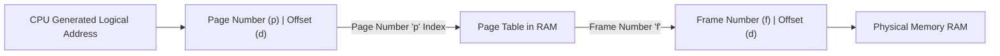
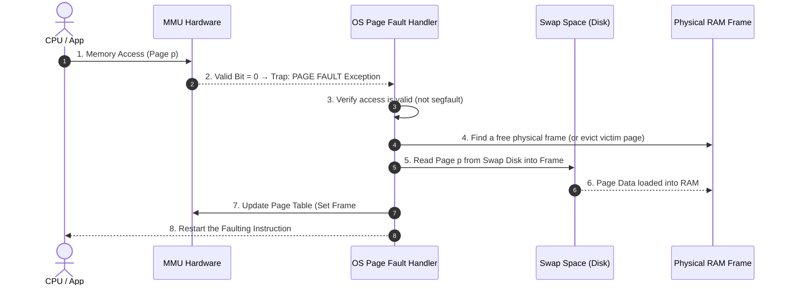
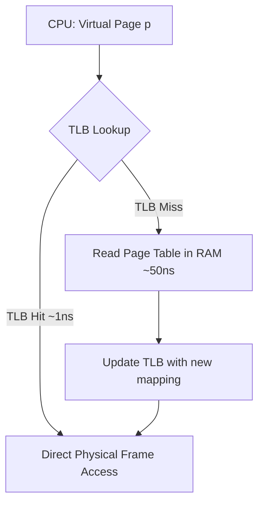

# 04. Memory Management and Virtual Memory

---

## 1. Memory Management Fundamentals (⭐ Priority Topic)

### 🎯 2–4 Line Interview-Ready Explanation
> **Memory Management** is the OS subsystem responsible for allocating, tracking, and protecting physical RAM among competing processes. It abstracts physical memory by translating **Logical (Virtual) Addresses** generated by the CPU into **Physical Addresses** in RAM using hardware-level **Memory Management Units (MMU)**.

---

### Logical vs Physical Address & Address Binding

```
CPU ────> Logical Address (Virtual Address) ────> [ MMU ] ────> Physical Address ────> [ Physical RAM ]
```

* **Logical (Virtual) Address:** Generated by the CPU during instruction execution. Represents an address in the process's isolated virtual address space ($0$ to $2^{32}-1$ or $2^{64}-1$).
* **Physical Address:** The actual hardware memory location in physical RAM chips (loaded into the Memory Address Register - MAR).
* **Address Binding Times:**
  1. **Compile Time:** Absolute physical addresses embedded in binary (inflexible, legacy).
  2. **Load Time:** Relocatable code; addresses bound when program is loaded into RAM.
  3. **Execution (Runtime) Time:** Standard in modern OSes; binding is dynamically performed by the MMU on every instruction access (enables swapping, paging, and virtual memory).

---

### Internal vs External Fragmentation

```
Internal Fragmentation (Fixed-Size Allocation):
Allocated Block: 4 KB (Page)
Process Needs:   2.5 KB
Wasted Space:    1.5 KB inside the allocated block (Internal)

External Fragmentation (Variable-Size Contiguous Allocation):
[ Block 1: Used 2MB ] [ Free: 1MB ] [ Block 2: Used 3MB ] [ Free: 1MB ]
Total Free Memory = 2 MB, but a 1.8 MB process CANNOT be loaded because free space is non-contiguous!
```

| Dimension | Internal Fragmentation | External Fragmentation |
| :--- | :--- | :--- |
| **Occurrence** | Fixed-partition allocation / **Paging**. | Variable-partition allocation / **Segmentation**. |
| **Location** | **Inside** the allocated memory block (assigned space $>$ requested space). | **Between** allocated blocks of memory (total free memory is sufficient, but fractured into small, non-contiguous chunks). |
| **Solution** | Use smaller page sizes (e.g., 4 KB instead of 64 KB). | **Compaction** (relocating active memory) or switching to **Paging**. |

---

## 2. Paging, Page Tables, and Segmentation

### 1. Paging Architecture

**Paging** is a non-contiguous memory allocation scheme that completely eliminates external fragmentation.
- Physical memory is broken into fixed-sized blocks called **Frames** (e.g., 4 KB).
- Logical memory is broken into equal-sized blocks called **Pages** (e.g., 4 KB).



#### Address Translation Formula:
- **Logical Address:** Size $m$ bits; Page Size $2^n$ bytes $\implies$ Offset $d = n$ bits; Page Number $p = m - n$ bits.
- **Physical Address:** $\text{Physical Address} = (\text{Frame Number } f \times \text{Page Size}) + \text{Offset } d$.

---

### 2. Multi-Level Page Tables

In a 32-bit architecture with 4 KB pages, a flat single-level page table requires $2^{20} = 1\text{ Million entries} \times 4\text{ Bytes} = 4\text{ MB}$ **per process**, much of which is unused.
- **Multi-Level Paging:** Breaks the page table itself into paged hierarchical chunks. Unallocated regions of virtual memory do not need physical page table pages in RAM, drastically reducing memory overhead.

---

### 3. Paging vs. Segmentation

| Feature | Paging | Segmentation |
| :--- | :--- | :--- |
| **Block Division** | Fixed-size blocks (**Pages** / **Frames** determined by hardware). | Variable-size blocks (**Segments** based on user's logical modules: Main, Stack, Heap, Function). |
| **Programmer View** | Invisible to developer (transparent abstraction). | Visible / aligned with program logical structure. |
| **Fragmentation** | Suffers from **Internal Fragmentation** (last page); zero external fragmentation. | Suffers from **External Fragmentation**; zero internal fragmentation. |
| **Address Structure** | $\text{Page Number } (p) + \text{Offset } (d)$. | $\text{Segment Number } (s) + \text{Offset } (d)$ (Checked against Segment Limit). |

---

## 3. Virtual Memory & Demand Paging (⭐ Priority Topic)

### 🎯 2–4 Line Interview-Ready Explanation
> **Virtual Memory** is a storage allocation technique that allows the execution of processes whose address spaces exceed the capacity of physical RAM. It maps virtual addresses to physical RAM backed by secondary storage (Swap Space / Disk) using **Demand Paging**, loading pages into RAM only when they are referenced during execution.

---

### The Page Fault Handling Cycle

A **Page Fault** occurs when an instruction references a virtual page whose **Valid/Invalid bit** in the Page Table is marked `0` (Invalid / Not in RAM, resides on Disk).



---

### Translation Lookaside Buffer (TLB)

The **TLB** is a fast, associative hardware cache inside the CPU that stores recent $\langle \text{Page Number} \to \text{Frame Number} \rangle$ mappings.



#### Effective Memory Access Time (EMAT):
$$\text{EMAT} = (\text{Hit Ratio } h) \times (t_{TLB} + t_{RAM}) + (1 - h) \times (t_{TLB} + 2 \times t_{RAM})$$
*(Assuming single-level page table where a miss requires 2 RAM accesses: 1 for page table, 1 for actual data).*

---

## 4. Page Replacement Algorithms (⭐ Priority Topic)

When a page fault occurs and physical RAM is completely full (no free frames), the OS must select a **Victim Page** to swap out to disk.

```
Reference String: 7, 0, 1, 2, 0, 3, 0, 4, 2, 3, 0, 3, 2 (Frames = 3)
```

### 1. FIFO (First-In, First-Out)
* **Rule:** Replaces the page that was brought into memory the earliest.
* **Belady's Anomaly:** For certain reference strings in FIFO, **increasing the number of physical frames causes MORE page faults!** (Violates expected monotonic performance).

---

### 2. Optimal Page Replacement (OPT / MIN)
* **Rule:** Replaces the page that will **not be used for the longest period of time in the future**.
* **Status:** Provably achieves the minimum possible page faults, but **impossible to implement in practice** (requires clairvoyant future knowledge). Used as a theoretical benchmark.

---

### 3. LRU (Least Recently Used)
* **Rule:** Replaces the page that has **not been used for the longest period of time in the past** (approximates OPT using the principle of temporal locality).
* **Belady's Anomaly:** LRU is a **Stack Algorithm** and is mathematically **immune** to Belady's Anomaly.
* **Implementation:** Counter/Timestamps on page access OR a Doubly Linked List + Hash Map (same as LeetCode LRU Cache).

---

### Comparison of Page Replacement Algorithms

| Algorithm | Replacement Criteria | Vulnerable to Belady's Anomaly? | Hardware Overhead | Practical Production Use? |
| :--- | :--- | :---: | :--- | :--- |
| **FIFO** | Oldest loaded page | ⚠️ **YES** | Very Low (FIFO queue) | Rarely used directly |
| **Optimal (OPT)** | Page unneeded longest in future | ❌ **NO** | Impossible (requires future) | Benchmark only |
| **LRU** | Page unreferenced longest in past | ❌ **NO** | High (exact timestamp/list) | High (approximated via Clock / Second-Chance) |

---

## 5. Thrashing

### 🎯 Definition
> **Thrashing** occurs when a computer's virtual memory subsystem is in a constant state of paging—spending significantly **more time swapping pages in and out of disk than executing CPU instructions**.

```
CPU Utilization vs Degree of Multiprogramming:
CPU Utilization
   100% │          /\
        │         /  \
        │        /    \
        │       /      \  <── THRASHING OCCURS HERE!
        │      /        \
     0% └────────────────────────────
              Degree of Multiprogramming (Number of active processes)
```

* **Cause:** The sum of the **Working Sets** (actively needed pages) of all concurrent processes exceeds total physical RAM.
* **Resolution:**
  1. Reduce the Degree of Multiprogramming (suspend/swap out some processes completely).
  2. Implement **Working Set Model** / Page Fault Frequency (PFF) controls.
  3. Add more physical RAM.

---

## 6. Infosys SP L3 Interview Questions & Answers

### Q1: What is Belady's Anomaly? Which page replacement algorithms suffer from it?
**Answer:**
Belady's Anomaly is the counter-intuitive phenomenon where increasing the number of allocated physical frames results in an **increase** in the total number of page faults for a given memory access pattern.
- **Suffers from it:** **FIFO** (First-In, First-Out).
- **Immune to it:** **Stack Algorithms** such as **LRU** (Least Recently Used) and **Optimal (OPT)**, because the set of pages in an $N$-frame system is always a strict subset of pages in an $(N+1)$-frame system.

---

### Q2: What happens step-by-step during a Page Fault?
**Answer:**
1. CPU references a virtual address; MMU checks page table and detects the **valid bit is 0** (page not in RAM).
2. MMU triggers a hardware trap (Page Fault exception), switching the CPU to Kernel Mode.
3. OS page fault handler verifies whether the memory access was valid (if invalid $\implies$ send `SIGSEGV` / segmentation fault).
4. OS finds a free physical frame (if full, invokes a page replacement algorithm like LRU to evict a victim page, writing to disk if dirty).
5. OS schedules disk I/O to read the requested page from swap space into the chosen frame.
6. The faulting process is moved to Waiting state; CPU context-switches to another ready process.
7. Disk I/O completes $\implies$ Disk raises interrupt. OS updates the page table (sets Frame #, marks valid bit = 1).
8. Faulting process is moved back to Ready queue; when scheduled, OS **restarts the exact CPU instruction** that caused the fault.

---

### Q3: Why is Multi-Level Paging used despite slowing down memory access?
**Answer:**
A flat page table on a 32-bit system with 4 KB pages requires 4 MB of contiguous RAM per process, even if the process only uses 100 KB of code. For thousands of processes, this wastes gigabytes of RAM on page tables alone. Multi-level paging breaks the page table into a tree structure where inner page tables are only allocated when virtual memory in that range is actually used. To offset the latency of multiple memory lookups, the CPU uses the **TLB (Translation Lookaside Buffer)** to achieve 98%+ one-cycle translation hits.
