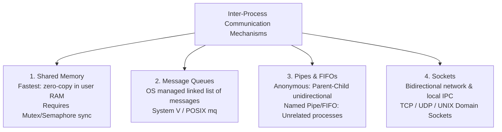

# 05. File Systems, IPC, and OS Miscellaneous

---

## 1. File Systems & Inodes

### 🎯 2–4 Line Interview-Ready Explanation
> A **File System** provides a logical mechanism to organize, name, store, retrieve, and protect files on non-volatile secondary storage. In UNIX/Linux systems, the **Virtual File System (VFS)** abstracts storage through **Inodes (Index Nodes)**, which store all file metadata (permissions, ownership, size, disk block pointers) except the file name and actual data contents.

---

### Inode Structure & Block Addressing

```
Inode Structure:
┌────────────────────────────────────────┐
│ Inode Number, File Type, File Size     │
│ Permissions (rwxr-xr--) [chmod]        │
│ Owner UID, Group GID, Timestamps       │
├────────────────────────────────────────┤
│ Direct Block Pointers (12 blocks)      │ ───> Directly point to Data Blocks on disk
│ Single Indirect Block Pointer          │ ───> Points to a block containing block pointers
│ Double Indirect Block Pointer          │ ───> Points to indirect blocks
│ Triple Indirect Block Pointer          │ ───> Supports terabyte-sized files
└────────────────────────────────────────┘
```

* **Directory Entry:** A directory in Linux is simply a special file containing a list of pairs: $\langle \text{Filename}, \text{Inode Number} \rangle$.
* **Hard Link:** A new directory entry pointing to the **same Inode number**. Deleting one file does not delete the data until the Inode link count reaches 0.
* **Soft Link (Symbolic Link):** A small pointer file containing the text path to another file. If the target file is deleted, the symlink becomes a dangling pointer.

---

### File Allocation Methods

```mermaid
graph TD
    FA[File Allocation Methods]
    FA --> CA[1. Contiguous Allocation<br/>Disk blocks in sequential order<br/>Fast sequential/direct access; suffers external fragmentation]
    FA --> LA[2. Linked Allocation<br/>Each block contains pointer to next<br/>No external fragmentation; slow random access]
    FA --> IA[3. Indexed Allocation (Inodes)<br/>Index block holds all pointers<br/>Fast direct access; standard in Unix/ext4]
```

---

## 2. Inter-Process Communication (IPC)

Because processes run in strictly isolated address spaces, they cannot directly read/write each other's memory. **IPC (Inter-Process Communication)** provides mechanisms for processes to exchange data.



### IPC Mechanisms Comparison Table

| IPC Mechanism | Speed / Throughput | Scope of Processes | Synchronization Provided by OS? | Ideal Use Case |
| :--- | :--- | :--- | :---: | :--- |
| **Pipes (Anonymous)** | Fast (In-memory buffer) | Related (Parent-Child via `fork`) | ✅ Yes (blocking reads/writes) | Command line pipelines (`ls \| grep txt`). |
| **Named Pipes (FIFO)** | Fast (In-memory buffer) | Any unrelated processes on same machine | ✅ Yes | One-way communication between daemons. |
| **Shared Memory** | **Fastest (Direct RAM access, Zero OS copying)** | Any local processes | ❌ **No** (Developer must manage Mutex / Semaphores) | High-performance multimedia streaming, database shared buffer pools. |
| **Message Queues** | Moderate (Requires kernel copy) | Any local processes | ✅ Yes (Message boundary preservation) | Asynchronous task decoupling. |
| **Sockets** | Slower (Network stack overhead) | Local or across different machines over Network | ✅ Yes | Client-Server architectures, REST APIs, Microservices. |

---

## 3. OS Miscellaneous Concepts

### 1. Stack vs. Heap Memory

```
High Memory
┌────────────────────────────┐
│ Stack:                     │
│ - Local variables          │
│ - Function call frames     │  ↓ Grows Downward automatically
│ - Fast, contiguous CPU SP  │
├────────────────────────────┤
│             ↓              │
│      (Unallocated)         │
│             ↑              │
├────────────────────────────┤
│ Heap:                      │
│ - Dynamic allocation       │  ↑ Grows Upward via brk() / mmap()
│ - malloc / new             │
│ - Manual deallocation      │
│ - Slower, fragmentation    │
└────────────────────────────┘
Low Memory
```

| Dimension | Stack Memory | Heap Memory |
| :--- | :--- | :--- |
| **Allocation Mechanism** | Automatic by CPU instruction pointer (push/pop). | Explicit programmatic allocation (`malloc()`, `new`). |
| **Deallocation** | Automatic when function returns / goes out of scope. | Explicitly freed (`free()`, `delete`) or Garbage Collector. |
| **Access Speed** | **Extremely fast** (hardware stack pointer, L1 cache friendly). | Slower (requires pointer dereferencing and memory lookup). |
| **Size Limit** | Fixed and small (typically 1–8 MB; overflow causes `StackOverflowError`). | Large (bounded only by total virtual memory / RAM). |
| **Fragmentation** | Zero fragmentation. | Prone to memory fragmentation. |

---

### 2. User Space vs. Kernel Space

* **User Space (Ring 3):** Memory region where standard user applications run. Cannot execute privileged CPU instructions (e.g., direct disk I/O, disabling interrupts).
* **Kernel Space (Ring 0):** Reserved memory space where the core OS kernel, device drivers, and interrupt handlers execute with unrestricted hardware access.

---

### 3. Scheduling vs. Synchronization
* **CPU Scheduling:** Decides **WHEN** and **WHICH** process gets the CPU to run next (Focus: Throughput, fairness, latency).
* **Synchronization:** Decides **HOW** concurrent processes access shared resources safely without race conditions (Focus: Correctness, mutual exclusion, consistency).

---

## 4. Infosys SP L3 Interview Questions & Answers

### Q1: Why is Shared Memory the fastest IPC mechanism?
**Answer:**
In all other IPC mechanisms (Pipes, Message Queues, Sockets), data transfer requires **two memory copies and multiple system call context switches**: from the sender's user space into kernel buffer memory, and then from the kernel buffer into the receiver's user space.
With **Shared Memory**, after the initial mapping via `mmap()`/`shmget()`, both processes read and write directly to the exact same physical RAM frames in user space with **zero kernel intervention and zero extra memory copies**.

---

### Q2: What is the difference between an Anonymous Pipe and a Named Pipe (FIFO)?
**Answer:**
- **Anonymous Pipe:** Exists only in memory, has no file system path, and can only be used for communication between **related processes** that share a common ancestor (parent-child via `fork()`). It is destroyed as soon as the processes terminate.
- **Named Pipe (FIFO):** Appears as a special FIFO device node in the file system namespace (`mkfifo /tmp/myfifo`). Any two **completely unrelated processes** can open it by path for reading and writing.

---

### Q3: What is the difference between a Hard Link and a Soft (Symbolic) Link in Linux?
**Answer:**
- **Hard Link:** A directory entry that directly references the **exact same Inode** as the original file. Both share identical permissions, size, and data blocks. If the original file is deleted, the hard link retains the data because the Inode link count decreases by 1 (data deleted only when link count reaches 0). Hard links cannot cross file systems or link directories.
- **Soft Link (Symlink):** A completely new, independent file with its own Inode containing the text path to the target file. If the original file is deleted, the symlink becomes a **broken / dangling link**. Symlinks can cross different file systems and link directories.
