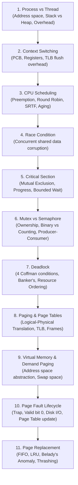

# Operating Systems (OS) — Master Interview Repository

> **Target Role:** Infosys Specialist Programmer (SP) L3 Interview  
> **Course Scope:** Complete Core OS Curriculum (Fundamentals, Processes & Threads ⭐, CPU Scheduling ⭐, Synchronization ⭐, Deadlocks ⭐, Memory Management & Virtual Memory ⭐, File Systems & IPC).

---

## 🚀 The High-Priority SP L3 Concept Chain

Master this interconnected chain from start to end — interviewers frequently follow this exact progression:

---

## 📚 Master Topic Index & Curriculum Roadmap

| Module | File | Core Concepts Covered |
| :--- | :--- | :--- |
| **01** | [01. Fundamentals, Processes & Threads](file:///d:/interview/Infosys/Operating%20Systems/01-os-fundamentals-processes-threads.md) | OS Responsibilities, Dual-Mode (User vs Kernel), System Calls vs Interrupts, Program vs Process, PCB, Process States, Fork & Copy-on-Write (COW), Context Switching, Process vs Thread, ULT vs KLT. |
| **02** | [02. CPU Scheduling & Synchronization](file:///d:/interview/Infosys/Operating%20Systems/02-cpu-scheduling-and-synchronization.md) | Scheduling Metrics ($AT, BT, CT, TAT, WT, RT$), FCFS, Convoy Effect, SJF/SRTF, Round Robin (Quantum tuning), Priority Scheduling & Aging, Race Condition, 3 Critical Section requirements, Mutex vs Binary/Counting Semaphore, Producer-Consumer Bounded Buffer implementation. |
| **03** | [03. Deadlocks: Prevention, Avoidance & Recovery](file:///d:/interview/Infosys/Operating%20Systems/03-deadlocks-handling-prevention.md) | 4 Coffman Necessary Conditions, Deadlock Handling Strategies (Ostrich, Prevention, Avoidance, Detection), Resource Ordering hierarchy, Banker's Algorithm Safe State matrix walkthrough, Wait-For Graph (WFG) cycle detection, Deadlock vs Starvation. |
| **04** | [04. Memory Management & Virtual Memory](file:///d:/interview/Infosys/Operating%20Systems/04-memory-management-and-virtual-memory.md) | Logical vs Physical Address, Dynamic Address Binding (MMU), Internal vs External Fragmentation, Paging & Frame calculation, Multi-level Page Tables, Paging vs Segmentation, Virtual Memory & Demand Paging, Step-by-step Page Fault lifecycle, TLB and EMAT formula, FIFO vs Optimal vs LRU, Belady's Anomaly, Thrashing & Working Set Model. |
| **05** | [05. File Systems, IPC & Miscellaneous](file:///d:/interview/Infosys/Operating%20Systems/05-file-systems-ipc-and-miscellaneous.md) | Inode Structure & Direct/Indirect block pointers, Hard Links vs Soft Links, Contiguous/Linked/Indexed file allocation, Inter-Process Communication (Pipes, FIFOs, Shared Memory, Message Queues, Sockets), Stack vs Heap memory deep dive, User vs Kernel Space. |

---

## ⚡ Top 10 High-Yield OS Interview Q&A (Quick Revision)

### 1. What is the fundamental difference between a Process and a Thread?
A **Process** is an independent execution unit with its own isolated virtual address space (Code, Data, Heap, Stack) and PCB. A **Thread** is a lightweight execution unit within a process that shares the parent process's address space, heap, global data, and open files, but has its own private Stack, Program Counter (PC), and CPU Registers.

### 2. What causes the Convoy Effect in CPU Scheduling?
The Convoy Effect occurs in **FCFS (First-Come, First-Served)** when a large CPU-bound process blocks all subsequent short I/O-bound processes from getting the CPU, drastically increasing average waiting times and degrading throughput.

### 3. What is the exact difference between a Mutex and a Binary Semaphore?
- **Mutex:** A locking mechanism with strict **thread ownership** (only the thread that locked the mutex can unlock it). Supports Priority Inheritance.
- **Binary Semaphore:** A **signaling mechanism** initialized to 1 without ownership (any thread can signal/release it). Used for inter-thread notifications.

### 4. What are the 4 Coffman conditions for Deadlock?
1. **Mutual Exclusion** (non-shareable resources).
2. **Hold and Wait** (holding one resource while requesting another).
3. **No Preemption** (resources cannot be forcibly reclaimed).
4. **Circular Wait** ($P_0 \to P_1 \to \dots \to P_n \to P_0$).

### 5. How do you prevent deadlocks using Resource Ordering?
Assign a unique integer ID to each resource and mandate that all threads/processes must acquire locks in strictly ascending order ($1 \to 2 \to 3$). This mathematically breaks the **Circular Wait** condition.

### 6. What is the difference between Internal and External Fragmentation?
- **Internal Fragmentation:** Unused wasted space **inside** an allocated fixed-size block/page (occurs in Paging).
- **External Fragmentation:** Total free memory is sufficient to satisfy a request, but is fractured into non-contiguous blocks between allocated segments (occurs in Segmentation / variable partitioning).

### 7. What happens step-by-step during a Page Fault?
1. MMU detects Valid bit = 0 $\implies$ triggers Page Fault trap to Kernel.
2. OS handler checks address validity.
3. OS finds a free physical frame (or evicts a victim page using LRU/FIFO).
4. OS loads the missing page from swap disk into the physical RAM frame.
5. OS updates the Page Table (sets Frame #, Valid bit = 1).
6. OS restarts the exact faulting CPU instruction.

### 8. What is Belady's Anomaly and which algorithm suffers from it?
Belady's Anomaly is the phenomenon where allocating **more physical frames leads to MORE page faults**. **FIFO** suffers from it. Stack algorithms like **LRU** and **Optimal** are mathematically immune.

### 9. What is Thrashing and how is it resolved?
Thrashing occurs when the OS spends more time swapping pages in/out of swap disk than executing actual instructions because the total working sets of active processes exceed physical RAM. It is resolved by reducing the degree of multiprogramming (suspending processes) or adding RAM.

### 10. Why is Shared Memory faster than Pipes and Sockets?
Shared Memory maps physical RAM directly into the address spaces of both processes, enabling direct reads/writes with **zero kernel context switches and zero intermediate memory copies**. Pipes and Sockets require copying data from user space to kernel buffer and then back to user space.
