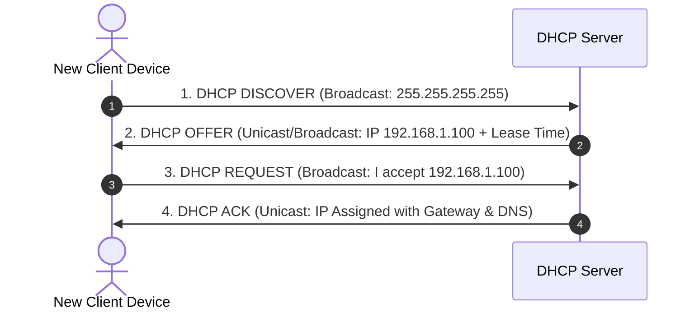
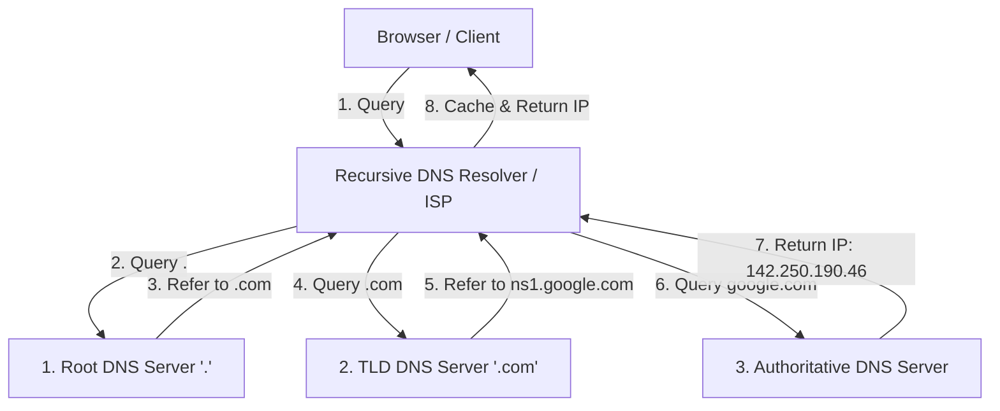
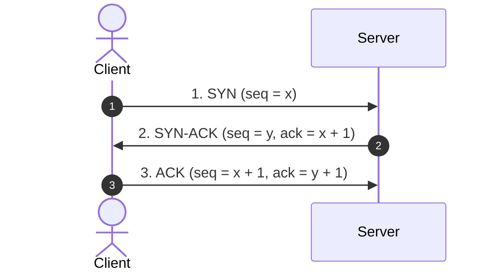
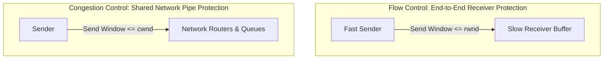
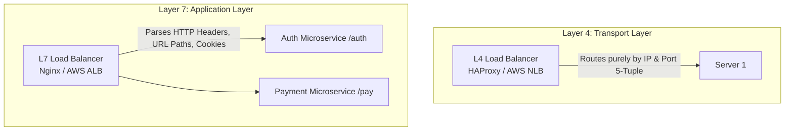

# Computer Networks — Interview Question Answers (Q1 – Q22)

---

## Easy / Fundamentals

### Q1. What is a computer network, and why do we need different layers in a networking model?
**Answer:**
A **computer network** is an interconnected collection of autonomous computational nodes (servers, PCs, routers, mobile devices) capable of exchanging data and sharing resources over physical or wireless transmission media using standardized communication protocols.

**Why Layering is Essential:**
1. **Modularity & Abstraction:** Each layer solves a specific problem (e.g., Physical layer deals with voltages/bits; Transport layer deals with process-to-process delivery). High-level application software doesn't need to know if the underlying link is Fiber, Wi-Fi, or Ethernet.
2. **Interoperability:** Hardware and software from different vendors can interoperate seamlessly as long as they adhere to the same layer protocol interface standards (e.g., IP at Layer 3).
3. **Ease of Maintenance & Upgrades:** Changes in one layer (e.g., upgrading from IPv4 to IPv6 at the Network layer, or switching from Wi-Fi 5 to Wi-Fi 6 at the Data Link layer) do not break the Application layer (HTTP/browsers).

---

### Q2. Explain the OSI model layer by layer. What responsibility does each layer have?
**Answer:**
The **OSI (Open Systems Interconnection) 7-Layer Model** is a conceptual framework:

| Layer # | Layer Name | Data Unit (PDU) | Primary Responsibilities & Protocols |
| :---: | :--- | :---: | :--- |
| **7** | **Application** | Data | User interface, network services for apps (`HTTP`, `HTTPS`, `DNS`, `FTP`, `SMTP`, `SSH`). |
| **6** | **Presentation** | Data | Data translation, character encoding (`ASCII`, `UTF-8`), encryption (`TLS`/`SSL`), compression. |
| **5** | **Session** | Data | Session establishment, maintenance, synchronization, and termination (`RPC`, `NetBIOS`, `Sockets`). |
| **4** | **Transport** | Segment (TCP) / Datagram (UDP) | End-to-end process-to-process delivery, port multiplexing, segmentation, flow control, reliability (`TCP`, `UDP`). |
| **3** | **Network** | Packet | Host-to-host logical routing, IP addressing, path selection, packet forwarding (`IPv4`, `IPv6`, `ICMP`, `OSPF`, `BGP`). |
| **2** | **Data Link** | Frame | Node-to-node hop physical framing, MAC addressing, error detection (`CRC`), flow control (`Ethernet`, `Wi-Fi 802.11`, `ARP`). |
| **1** | **Physical** | Bits | Physical transmission of raw binary electrical, optical, or radio signals (`Cables`, `Fiber`, `Hubs`, `Repeaters`). |

---

### Q3. What is the TCP/IP model? How does it differ from the OSI model?
**Answer:**
The **TCP/IP Model (Internet Model)** is the practical, 4-layer architectural model that actually powers the global Internet, designed around protocols rather than rigid theoretical abstractions.

```
OSI 7-Layer Model                     TCP/IP 4-Layer Model
┌──────────────────────┐              ┌───────────────────────────┐
│ 7. Application       │ ──┐          │                           │
│ 6. Presentation      │ ──┼────────> │ 4. Application Layer      │ (HTTP, DNS, SSH, TLS)
│ 5. Session           │ ──┘          │                           │
├──────────────────────┤              ├───────────────────────────┤
│ 4. Transport         │ ───────────> │ 3. Transport Layer (Host) │ (TCP, UDP)
├──────────────────────┤              ├───────────────────────────┤
│ 3. Network           │ ───────────> │ 2. Internet Layer         │ (IP, ICMP, ARP)
├──────────────────────┤              ├───────────────────────────┤
│ 2. Data Link         │ ──┐          │                           │
│ 1. Physical          │ ──┴────────> │ 1. Network Access / Link  │ (Ethernet, Wi-Fi)
└──────────────────────┘              └───────────────────────────┘
```

**Key Differences:**
1. **Practical vs. Theoretical:** OSI is a theoretical reference model; TCP/IP is the real-world implementation model.
2. **Layer Count:** OSI has 7 layers; TCP/IP merges Application, Presentation, and Session into 1 **Application Layer**, and merges Data Link and Physical into 1 **Link / Network Access Layer**.
3. **Protocol Independence:** OSI was designed before protocols were created; in TCP/IP, the protocols came first (`TCP` and `IP`), and the model described them.

---

### Q4. What is the difference between TCP and UDP? Give practical examples where you would choose each.
**Answer:**

| Feature | TCP (Transmission Control Protocol) | UDP (User Datagram Protocol) |
| :--- | :--- | :--- |
| **Connection** | **Connection-Oriented** (Requires 3-Way Handshake) | **Connectionless** (Sends datagrams immediately) |
| **Reliability** | **Guaranteed Delivery** (ACKs, Retransmissions on loss) | **Unreliable / Best Effort** (No ACKs, no retransmissions) |
| **Ordering** | **Guaranteed in-order delivery** (Sequence numbers) | **No ordering guarantee** (Packets may arrive out-of-order) |
| **Flow & Congestion Control** | ✅ Yes (Sliding window & dynamic congestion window) | ❌ None (Blasts packets at wire speed) |
| **Header Overhead** | **20 to 60 Bytes** | **8 Bytes** (Minimal overhead) |
| **Speed / Latency** | Slower (due to handshakes, ACKs, retransmissions) | **Ultra-fast & low latency** |

**Practical Use Cases:**
* **Choose TCP:** When **zero data loss and ordering are mandatory** (e.g., Web browsing / `HTTPS`, Database transactions, File transfers / `FTP`, Email / `SMTP`, Financial payments).
* **Choose UDP:** When **low latency and speed matter more than occasional lost packets** (e.g., Live video streaming / `WebRTC`, VoIP voice calls, Multiplayer gaming / `FPS games`, DNS queries, NTP time sync).

---

### Q5. What is an IP address? Explain IPv4 addressing and subnet masks at a high level.
**Answer:**
An **IP (Internet Protocol) Address** is a unique logical numerical identifier assigned to every device connected to a computer network participating in the Internet Protocol.

* **IPv4 Structure:** 32-bit binary number written in dotted-decimal format as 4 octets ($8\text{ bits} \times 4 = 32\text{ bits}$), ranging from `0.0.0.0` to `255.255.255.255` ($\approx 4.29\text{ Billion addresses}$).
* **Network ID vs Host ID:** An IP address consists of two parts:
  1. **Network Prefix:** Identifies which subnetwork the host belongs to.
  2. **Host Identifier:** Identifies the specific physical device within that subnetwork.
* **Subnet Mask & CIDR:** A 32-bit mask of contiguous `1`s followed by `0`s used to separate the Network ID from the Host ID:
  * Example: `192.168.1.50` with subnet mask `255.255.255.0` (or `/24` in CIDR notation).
  * Bitwise AND: `192.168.1.50 & 255.255.255.0` $\implies$ Network ID = `192.168.1.0`, Host = `50`.

---

### Q6. What is a MAC address? How is it different from an IP address?
**Answer:**
A **MAC (Media Access Control) Address** is a unique 48-bit (6-byte) physical hardware identifier permanently burned into a Network Interface Card (NIC) by the hardware manufacturer, formatted as hexadecimal (e.g., `1A:2B:3C:4D:5E:6F`).

| Dimension | MAC Address (Layer 2) | IP Address (Layer 3) |
| :--- | :--- | :--- |
| **Layer** | Data Link Layer (Layer 2) | Network Layer (Layer 3) |
| **Nature** | **Physical & Permanent** (Burned into NIC hardware) | **Logical & Dynamic** (Assigned by DHCP or admin) |
| **Scope** | **Local Subnet Only** (Hop-to-hop communication on same LAN) | **Global End-to-End** (Routable across different networks/Internet) |
| **Address Length**| 48 bits (6 Bytes in Hex) | 32 bits (IPv4) or 128 bits (IPv6) |
| **Analogy** | A person's **Social Security Number / Fingerprint** | A person's current **Mailing Street Address** |

---

## Medium / Interview-Level

### Q7. What problem does ARP solve? Walk me through what happens when a machine wants to communicate with another machine on the same LAN but only knows its IP address.
**Answer:**
**Address Resolution Protocol (ARP)** bridges Layer 3 and Layer 2 by dynamically resolving a known **Logical IP Address** into a physical **Hardware MAC Address** within a local broadcast domain.

**Step-by-Step Scenario (Machine A wants to send data to Machine B on same LAN):**
1. **Check Local ARP Cache:** Machine A first checks its in-memory ARP table. If mapping $\langle \text{IP}_B \to \text{MAC}_B \rangle$ is cached, it encapsulates the frame immediately.
2. **ARP Request Broadcast (Layer 2 Broadcast):** If not cached, Machine A constructs an ARP Request packet: *"Who has IP 192.168.1.10? Tell 192.168.1.5"*.
   - Destination MAC is set to `FF:FF:FF:FF:FF:FF` (Broadcast).
   - Every machine on the switch receives this frame.
3. **Target Filtering:** All non-target machines drop the frame. Machine B recognizes its own IP.
4. **ARP Reply Unicast:** Machine B records Machine A's MAC in its cache and sends a **Unicast ARP Reply** directly back to Machine A containing its physical MAC address.
5. **Caching & Transmission:** Machine A caches Machine B's MAC and transmits the actual IP data payload encapsulated in an Ethernet frame.

---

### Q8. What is DHCP? Explain the DHCP DORA process.
**Answer:**
**DHCP (Dynamic Host Configuration Protocol)** is an Application/Network layer protocol (using UDP ports 67/68) that automatically assigns IP addresses, subnet masks, default gateways, and DNS server addresses to client devices when they join a network.



**The 4-Step DORA Process:**
1. **D — Discover:** Client broadcasts `DHCPDISCOVER` looking for any available DHCP server on the local subnet (`Src: 0.0.0.0`, `Dst: 255.255.255.255`).
2. **O — Offer:** The DHCP server reserves an unassigned IP from its pool and sends a `DHCPOFFER` containing the proposed IP, subnet mask, lease duration, and gateway.
3. **R — Request:** Client broadcasts `DHCPREQUEST` formally accepting the specific offered IP and notifying other DHCP servers that their offers were not chosen.
4. **A — Acknowledge:** Server sends `DHCPACK` finalizing the lease contract. The client binds the IP to its network interface.

---

### Q9. What happens when you type `google.com` into a browser and press Enter? Explain the process from DNS resolution through receiving the webpage.
**Answer:**
This classic interview question tests full-stack networking flow:

1. **URL Parsing & Browser Cache Check:** Browser parses protocol (`https://`), domain (`google.com`), and checks 4 levels of DNS cache: (Browser Cache $\to$ OS Cache $\to$ Router Cache $\to$ Local ISP Resolver Cache).
2. **DNS Resolution (if uncached):** Resolves `google.com` into IP `142.250.190.46` via hierarchical iterative lookups (Root $\to$ `.com` TLD $\to$ Google Authoritative Nameserver).
3. **ARP Resolution (Routing to Gateway):** OS determines that destination IP is outside local subnet. Uses ARP to find the MAC address of the local **Default Gateway (Router)**.
4. **TCP 3-Way Handshake (Port 443):**
   - Client $\to$ Server: `SYN (seq=x)`
   - Server $\to$ Client: `SYN-ACK (seq=y, ack=x+1)`
   - Client $\to$ Server: `ACK (ack=y+1)`
5. **TLS 1.3 Handshake (Cryptographic Security):** Client and server exchange `ClientHello` / `ServerHello`, verify the server's X.509 SSL Certificate, perform Diffie-Hellman key exchange, and establish symmetric AES-256 session keys.
6. **HTTP/HTTPS Request:** Browser sends encrypted `GET / HTTP/1.1` (or HTTP/2 / HTTP/3 frame) with headers (`Host`, `User-Agent`, `Cookie`).
7. **Server Processing & Response:** Reverse Proxy / Load Balancer routes request to Web Server $\to$ returns `HTTP/1.1 200 OK` with HTML payload.
8. **Browser Rendering:** Browser parses HTML $\to$ constructs DOM tree $\to$ fetches CSS/JS/images $\to$ renders page.

---

### Q10. What is DNS? Explain recursive DNS resolution and DNS caching.
**Answer:**
**DNS (Domain Name System)** is the distributed, hierarchical naming system that translates human-readable hostnames (`google.com`) into machine-routable IP addresses (`142.250.190.46`).



* **Recursive Resolution:** The client asks the **Recursive Resolver (ISP / 8.8.8.8)** to do all the heavy lifting. The resolver iteratively contacts:
  1. **Root Nameserver (`.`):** Directs resolver to Top-Level Domain (TLD) servers.
  2. **TLD Nameserver (`.com`):** Directs resolver to the domain's Authoritative servers.
  3. **Authoritative Nameserver:** Holds the official DNS records (`A`, `AAAA`, `CNAME`) and returns the final IP.
* **DNS Caching & TTL:** Every DNS record includes a **Time-To-Live (TTL)**. Resolvers and OSes cache the IP for the TTL duration, eliminating expensive remote DNS queries for subsequent visits.

---

### Q11. What is the difference between HTTP and HTTPS? What does TLS actually provide?
**Answer:**
* **HTTP (Hypertext Transfer Protocol):** Plaintext protocol running over port 80. All headers, form inputs, passwords, and cookies are transmitted unencrypted, vulnerable to packet sniffing and Man-in-the-Middle (MitM) eavesdropping.
* **HTTPS (HTTP Secure):** HTTP encapsulated inside a cryptographic **TLS (Transport Layer Security)** tunnel running over port 443.

**The 3 Core Guarantees of TLS:**
1. **Confidentiality (Encryption):** Encrypts all transmitted data using symmetric encryption (AES-GCM / ChaCha20) so third parties on the wire see only unintelligible ciphertext.
2. **Integrity (Tamper-Proofing):** Uses Message Authentication Codes (HMAC) to guarantee data cannot be altered or injected in transit without detection.
3. **Authentication (Identity Verification):** Uses digital certificates issued by trusted Certificate Authorities (CAs) with asymmetric public-key cryptography (RSA/ECC) to verify the client is actually talking to the legitimate website owner, not an imposter.

---

### Q12. Explain common HTTP methods such as GET, POST, PUT, PATCH, and DELETE. What makes a method idempotent?
**Answer:**

| Method | Semantic Purpose | Request Body? | Safe? (Read-only) | Idempotent? |
| :--- | :--- | :---: | :---: | :---: |
| **`GET`** | Retrieve resource data. | ❌ No | ✅ **Yes** | ✅ **Yes** |
| **`POST`** | Create a new subordinate resource or trigger an action. | ✅ Yes | ❌ No | ❌ **No** |
| **`PUT`** | Completely **replace / overwrite** a resource (or create if ID specified). | ✅ Yes | ❌ No | ✅ **Yes** |
| **`PATCH`** | **Partially update** specific fields of an existing resource. | ✅ Yes | ❌ No | ❌ **No** (Depends on payload) |
| **`DELETE`**| Remove a resource. | Optional | ❌ No | ✅ **Yes** |

**What is Idempotence?**
An HTTP method is **Idempotent** if making $N$ identical requests has the exact same side-effects on the server state as making a single request:
$$f(f(x)) = f(x)$$
* Calling `PUT /users/1 {"name": "Bob"}` 10 times results in User 1 having name "Bob" (Idempotent).
* Calling `POST /orders` 10 times creates 10 separate orders and charges 10 times (NOT Idempotent).

---

### Q13. Explain HTTP status codes 200, 201, 301, 302, 400, 401, 403, 404, 409, 429, 500, 502, 503, and 504. When would you use each?
**Answer:**

* **2xx (Success):**
  * **`200 OK`:** Standard successful request (`GET`, `PUT`, `PATCH`).
  * **`201 Created`:** Resource successfully created via `POST` (includes `Location` header).
* **3xx (Redirection):**
  * **`301 Moved Permanently`:** URL has permanently changed (browsers cache this redirect).
  * **`302 Found (Temporary Redirect)`:** Temporary redirect (browsers do not cache).
* **4xx (Client Errors):**
  * **`400 Bad Request`:** Malformed request syntax or invalid JSON body.
  * **`401 Unauthorized`:** Missing or invalid authentication token (User not authenticated).
  * **`403 Forbidden`:** User is authenticated but lacks required RBAC permissions to access resource.
  * **`404 Not Found`:** Requested endpoint or resource ID does not exist.
  * **`409 Conflict`:** State conflict (e.g., trying to register an email that already exists).
  * **`429 Too Many Requests`:** Rate limit exceeded (client must back off).
* **5xx (Server Errors):**
  * **`500 Internal Server Error`:** Uncaught exception / crash in backend application code.
  * **`502 Bad Gateway`:** Reverse proxy/gateway received an invalid response from upstream backend service.
  * **`503 Service Unavailable`:** Server is temporarily overloaded or down for maintenance.
  * **`504 Gateway Timeout`:** Upstream backend server failed to respond to the gateway within timeout limit.

---

### Q14. What are cookies and sessions? How does a web server remember that a user is logged in?
**Answer:**
Because HTTP is a **stateless protocol**, servers do not natively remember previous requests from the same client.

**Session-Based Authentication Flow:**
1. **Login:** User sends credentials (`POST /login`) with username and password.
2. **Session Creation:** Server validates credentials, creates a session object stored in memory/Redis containing `user_id`, and generates a cryptographically secure random **Session ID** (e.g., `sess_99a8b7c`).
3. **Set-Cookie Header:** Server responds to client with header:
   `Set-Cookie: session_id=sess_99a8b7c; HttpOnly; Secure; SameSite=Strict`
4. **Subsequent Requests:** Browser automatically attaches this cookie in the `Cookie` header on every subsequent request to that domain.
5. **Session Verification:** Server reads `session_id`, looks it up in Redis in $O(1)$, identifies the authenticated user, and serves the request.

---

### Q15. What is a port number? Why can multiple applications communicate over the same IP address?
**Answer:**
A **Port Number** is a 16-bit unsigned integer ($0$ to $65535$) used at the Transport Layer (Layer 4) to identify a specific process or network service running on a host.

**Why Multiple Apps Can Share an IP (Socket 5-Tuple Multiplexing):**
An IP address identifies the machine (host). Port numbers allow the operating system kernel's network stack to **multiplex and demultiplex** network traffic to the correct process.
Every network connection is uniquely identified by a **5-Tuple**:
$$\langle \text{Source IP}, \text{Source Port}, \text{Destination IP}, \text{Destination Port}, \text{Protocol (TCP/UDP)} \rangle$$
Because the 5-tuple is unique, a single server with one IP can run a Web Server on Port 80/443, a Database on Port 5432, and an SSH daemon on Port 22 simultaneously without interference.

---

### Q16. What is the difference between a switch and a router?
**Answer:**

| Feature | Network Switch (Layer 2) | Router (Layer 3) |
| :--- | :--- | :--- |
| **Operating Layer** | Data Link Layer (Layer 2) | Network Layer (Layer 3) |
| **Addressing Used** | **MAC Addresses** | **IP Addresses** |
| **Table Maintained**| **MAC Address Table (CAM Table)** | **IP Routing Table** |
| **Primary Function**| Connects devices **within the same local network (LAN)**. | Connects and routes packets **between different networks (LAN $\leftrightarrow$ WAN/Internet)**. |
| **Broadcast Domain**| Single broadcast domain (all ports receive broadcasts). | **Breaks broadcast domains** (does not forward broadcasts). |
| **Data Unit** | Frames | Packets |

---

### Q17. Explain the TCP three-way handshake. Why are three steps required instead of two?
**Answer:**
The **TCP 3-Way Handshake** establishes a reliable, bidirectional connection before data transfer begins:



1. **Step 1 (SYN):** Client generates random Initial Sequence Number (ISN) $x$ and sends `SYN` packet to server: *"I want to connect; my sequence number starts at x"*.
2. **Step 2 (SYN-ACK):** Server acknowledges client's ISN (`ack = x + 1`), generates its own random ISN $y$, and sends `SYN-ACK`: *"Acknowledged x; my sequence number starts at y"*.
3. **Step 3 (ACK):** Client acknowledges server's ISN (`ack = y + 1`): *"Acknowledged y; connection is established"*.

**Why 2 Steps are Insufficient:**
TCP is a **bidirectional** full-duplex communication channel. Both sides must independently choose, transmit, and have their Initial Sequence Numbers confirmed.
- A 2-way handshake only confirms that the server received the client's SYN, but the server has **no confirmation that the client received the server's SYN**.
- If duplicate, delayed legacy SYN packets arrive at the server from an old dead connection, a 2-way handshake would cause the server to allocate resources and open phantom half-open connections.

---

### Q18. How does TCP provide reliable communication even though IP itself does not guarantee delivery?
**Answer:**
IP is an unreliable, best-effort packet delivery network. TCP builds 100% reliable streams on top of IP through 5 key mechanisms:
1. **Sequence Numbers:** Every byte of data is tagged with a sequential sequence number, allowing the receiver to detect missing packets, discard duplicate packets, and reassemble out-of-order packets into the exact original order.
2. **Positive Acknowledgments (ACKs):** Receiver sends ACK numbers indicating the next expected byte.
3. **Retransmission Timers (RTO & Fast Retransmit):**
   - **Retransmission Timeout (RTO):** If sender doesn't receive an ACK before a dynamically calculated timer expires, it retransmits the segment.
   - **Triple Duplicate ACKs (Fast Retransmit):** Receiving 3 duplicate ACKs triggers immediate retransmission without waiting for the slow RTO timer.
4. **Checksums:** Every TCP segment includes a 16-bit checksum to detect bit corruption; corrupted segments are discarded and automatically retransmitted.
5. **Flow and Congestion Control:** Prevents data loss caused by receiver buffer overflows or network queue saturation.

---

## Hard / Deeper Reasoning

### Q19. Explain TCP flow control versus TCP congestion control. Why are they different problems?
**Answer:**



| Dimension | TCP Flow Control | TCP Congestion Control |
| :--- | :--- | :--- |
| **Problem Solved** | Prevents a fast sender from **overwhelming a slow receiver's buffer**. | Prevents all senders collectively from **overwhelming intermediate network routers/switches**. |
| **Scope** | **End-to-End (Point-to-Point):** Between sender and receiver only. | **Global / Network-Wide:** Shared intermediate transmission pipes. |
| **Control Metric**| **Receive Window (`rwnd`)**: Receiver advertises available buffer space in TCP header. | **Congestion Window (`cwnd`)**: Dynamically estimated by sender based on packet loss/delays. |
| **Algorithms** | Sliding Window Protocol. | Slow Start, Congestion Avoidance (AIMD), Fast Retransmit, Fast Recovery (Reno, Cubic, BBR). |

$$\text{Effective Transmission Window} = \min(\text{rwnd}, \text{cwnd})$$

---

### Q20. Suppose a TCP connection has high latency but almost no packet loss. What factors could still reduce throughput?
**Answer:**
Throughput in a lossless, high-latency network (Long Fat Network - LFN) is bounded by the **Bandwidth-Delay Product (BDP)**:
$$\text{BDP} = \text{Bandwidth (bits/sec)} \times \text{Round Trip Time (RTT)}$$

**Factors Limiting Throughput:**
1. **TCP Receive Window (`rwnd`) Size Limit:** If the receiver's window buffer is small (legacy 64 KB limit without TCP Window Scaling / RFC 1323), the sender must stop and wait for ACKs after sending 64 KB, achieving throughput of only $\text{rwnd} / \text{RTT}$.
2. **Slow Start Ramp-up Duration:** In high RTT links (e.g., satellite with 600 ms latency), reaching maximum `cwnd` takes many RTT cycles.
3. **Application Buffer Limits:** The application layer reading socket buffers too slowly causing `rwnd` to shrink to 0 (Zero Window Probe).

---

### Q21. What is the difference between a forward proxy and a reverse proxy? Where would you use each in a production architecture?
**Answer:**

```
Forward Proxy (Protects/Hides Clients):
[ Internal Clients ] ───> [ Forward Proxy ] ───> (Internet / External Servers)

Reverse Proxy (Protects/Hides Servers):
(Internet / External Clients) ───> [ Reverse Proxy (Nginx/HAProxy) ] ───> [ Backend Servers 1..N ]
```

| Dimension | Forward Proxy | Reverse Proxy |
| :--- | :--- | :--- |
| **Position** | Sits in front of **Clients** (Internal corporate network). | Sits in front of **Backend Origin Servers**. |
| **Who it Represents** | Represents the **Client** to the outside world (hides client IPs). | Represents the **Server** to the client (clients think proxy IS the server). |
| **Use Cases** | Content filtering, bypass geo-restrictions, corporate security, internal caching. | **Load balancing, SSL/TLS termination, DDoS protection, API routing, static caching**. |

---

### Q22. Explain L4 versus L7 load balancing. What information can an L7 load balancer use that an L4 load balancer cannot?
**Answer:**



| Dimension | Layer 4 Load Balancer (L4) | Layer 7 Load Balancer (L7) |
| :--- | :--- | :--- |
| **OSI Layer** | Transport Layer (TCP/UDP) | Application Layer (HTTP/HTTPS/gRPC) |
| **Inspection Depth** | Looks only at IP addresses and Port numbers (Packet header). | **Full payload inspection:** HTTP URL paths, Headers, Cookies, JSON body. |
| **TLS Termination**| Passes raw TCP stream through (or simple TLS passthrough). | **Terminates TLS**, decrypts and inspects application requests. |
| **Performance** | **Ultra-high throughput, minimal CPU overhead** (Zero payload parsing). | Higher CPU overhead (Must decrypt TLS and parse HTTP strings). |
| **Routing Capability**| Hash of $\langle \text{Src IP, Dst IP, Port} \rangle$. | **Path-based routing** (`/api/v1/orders`), Header routing (`Host: mobile.app`), Cookie-based session stickiness. |
