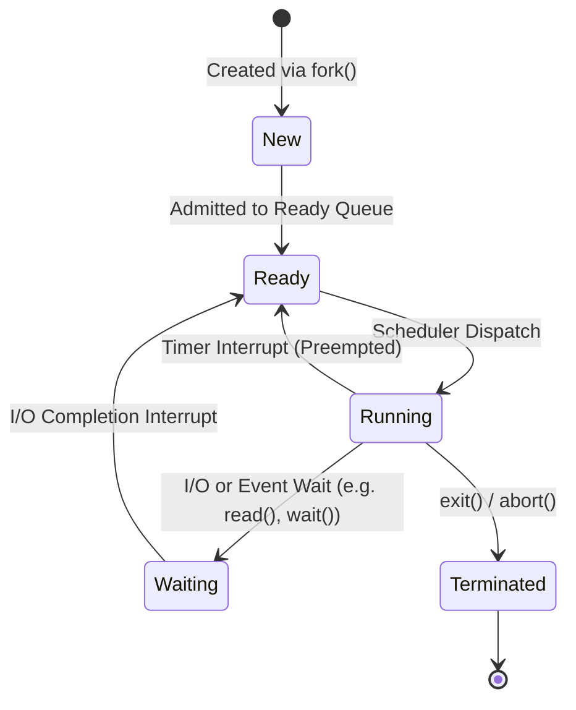
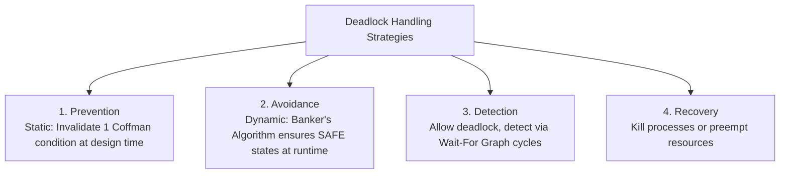

# Operating Systems — Interview Question Answers (Q23 – Q44)

---

## Easy / Fundamentals

### Q23. What is a process? What is a thread?
**Answer:**
* **Process:** An executing instance of a program in memory. It is a heavyweight entity allocated its own dedicated, isolated **virtual address space** (Text/Code, Data, Heap, Stack), a unique Process ID (PID), file descriptor table, and security context tracked by a **Process Control Block (PCB)**.
* **Thread:** The smallest schedulable unit of CPU execution within a process (often called a **Lightweight Process - LWP**). Multiple threads belonging to the same parent process **share the same address space (Code, Data, Heap, and open file descriptors)**, but each thread maintains its own private **Stack, Program Counter (PC), and CPU Registers**.

---

### Q24. What are the major states of a process? Explain the transitions between them.
**Answer:**



1. **New:** Process is being created/allocated.
2. **Ready:** Process is loaded into RAM and waiting in the Ready Queue to be assigned a CPU core by the scheduler.
3. **Running:** Instructions are currently executing on a CPU core.
4. **Waiting / Blocked:** Process cannot execute because it is waiting for an external event or I/O operation (e.g., disk read, socket receive, mutex lock).
5. **Terminated:** Process has finished execution; its resources are deallocated while its exit status awaits parent reaping.

---

### Q25. What is the difference between a process and a thread in terms of memory and resources?
**Answer:**

| Dimension | Process | Thread |
| :--- | :--- | :--- |
| **Address Space** | Completely **isolated** (separate virtual memory map). | **Shared** (all threads share the parent's Heap, Globals, and Code). |
| **Private State** | PCB, entire virtual address space, file descriptor table. | Thread ID, **private Stack, Program Counter (PC), and CPU Registers**. |
| **Communication** | Requires **Inter-Process Communication (IPC)** (Pipes, Shared Memory, Sockets). | **Direct Memory Access** (reads/writes shared heap variables directly). |
| **Creation Cost** | High (allocates new page tables, address map, file table). | **Low ($10\times - 30\times$ faster)**; lightweight allocation. |
| **Context Switch** | Slow (flushes TLB and reloads Page Table Base Register `CR3`). | **Fast** (virtual address space and TLB remain identical). |
| **Crash Impact** | Isolated (one process crash does not affect others). | **Shared fate** (unhandled crash in one thread terminates the whole process). |

---

### Q26. What is context switching? Why does it have overhead?
**Answer:**
A **Context Switch** is the kernel procedure of saving the CPU execution state (Program Counter, registers, stack pointer) of the currently running process/thread to its control block (PCB/TCB) and restoring the saved state of another runnable process/thread into CPU registers.

**Why it Incurs Pure OS Overhead:**
1. **Zero Useful Work:** No user application progress occurs during a context switch.
2. **Register & State Saving:** CPU must push dozens of architectural registers to RAM/kernel stack.
3. **TLB Flush & Cold CPU Caches:** For a process switch, the Translation Lookaside Buffer (TLB) is invalidated, and high-speed CPU L1/L2 caches become "cold", causing a storm of cache misses when the new process executes.

---

### Q27. What is multithreading? What are its advantages and disadvantages?
**Answer:**
**Multithreading** is the ability of an operating system or program to execute multiple concurrent or parallel threads of execution within the same process address space.

* **Advantages:**
  1. **Enhanced Responsiveness:** UI threads stay responsive while background worker threads handle slow disk I/O or network requests.
  2. **Multi-Core Parallelism:** Utilizes multiple physical CPU cores simultaneously for CPU-bound computations.
  3. **Resource Efficiency:** Minimal memory footprint compared to spawning multiple separate processes.
  4. **Fast Data Sharing:** Zero IPC overhead for reading shared memory.
* **Disadvantages:**
  1. **Concurrency Hazards:** Prone to **Race Conditions**, **Deadlocks**, and **Data Inconsistencies**.
  2. **Complex Debugging:** Non-deterministic execution order makes reproducing bugs difficult.
  3. **Lack of Fault Isolation:** A segmentation fault in one thread crashes the entire process.

---

### Q28. What is the difference between user mode and kernel mode?
**Answer:**

```mermaid
graph TD
    UserApp[User Application (User Mode - Ring 3)] -->|System Call / Interrupt| Kernel[OS Kernel (Kernel Mode - Ring 0)]
    Kernel --> Hardware[Physical Hardware: CPU, RAM, Disk, Devices]
```

| Dimension | User Mode (Ring 3) | Kernel Mode (Ring 0 / Supervisor) |
| :--- | :--- | :--- |
| **Privilege Level** | Restricted privileges. | **Full / Unrestricted privileges**. |
| **Hardware Access** | Cannot directly execute privileged CPU instructions (e.g., `cli`, direct disk I/O). | Can execute all CPU instructions and manage all hardware directly. |
| **Memory Access** | Access limited to the process's own virtual user space. | Can access all physical RAM and kernel memory structures. |
| **Crash Impact** | Process crashes cleanly with a segmentation fault (`SIGSEGV`). | Kernel panic / Blue Screen of Death (BSOD) halts entire machine. |
| **Mode Transition** | Switches to Kernel Mode via **System Calls**, **Hardware Interrupts**, or **Exceptions**. | Switches back to User Mode via `sysret` / `iret`. |

---

## Medium / Interview-Level

### Q29. Explain FCFS, SJF, Round Robin, and Priority CPU scheduling.
**Answer:**

1. **FCFS (First-Come, First-Served):** Non-preemptive. Processes are dispatched strictly in the order of their arrival time ($AT$). Simple, but suffers from the **Convoy Effect**.
2. **SJF (Shortest Job First):** Dispatches the process with the smallest Burst Time ($BT$). Non-preemptive (or preemptive as **SRTF** - Shortest Remaining Time First). Optimal average waiting time, but causes **Starvation** of long jobs.
3. **Round Robin (RR):** Preemptive. Each process is given a fixed time slice (**Time Quantum $q$**) in FIFO order. If not finished within $q$, it is preempted and pushed to the back of the Ready Queue. Excellent response time for interactive systems.
4. **Priority Scheduling:** Each process is assigned an integer priority; the CPU selects the highest-priority process. Can be preemptive or non-preemptive. Can cause starvation of low-priority processes (solved by **Aging**).

---

### Q30. Why can SJF produce better average waiting time than FCFS?
**Answer:**
SJF is **provably optimal** in minimizing average waiting time. 
* Moving a shorter job ahead of a longer job decreases the waiting time of the short job by the burst time of the long job, while only increasing the long job's wait time by the short job's burst time.
* **Mathematical Intuition:**
  Given jobs $P_1 (BT=100)$ and $P_2 (BT=2)$:
  - **FCFS:** $P_1$ runs first $\implies WT(P_1)=0, WT(P_2)=100 \implies \text{Avg } WT = 50$.
  - **SJF:** $P_2$ runs first $\implies WT(P_2)=0, WT(P_1)=2 \implies \text{Avg } WT = 1$.

---

### Q31. What is starvation in CPU scheduling? Which scheduling algorithms can cause it, and how can aging solve it?
**Answer:**
* **Starvation (Indefinite Blocking):** A state where a runnable, ready process is indefinitely delayed from receiving CPU time because higher-priority or shorter processes continuously arrive ahead of it.
* **Algorithms Prone to Starvation:**
  - **SJF / SRTF:** Long burst jobs starve if short jobs continuously arrive.
  - **Priority Scheduling:** Low-priority jobs starve under a constant stream of high-priority jobs.
* **Solution (Aging):** A technique where the operating system gradually increases the priority of processes waiting in the Ready Queue over time. For example, every 10 seconds of waiting increments priority by 1; eventually, even the lowest-priority job becomes the highest-priority job in the queue and executes.

---

### Q32. What is a critical section? Give a real-world example of a race condition.
**Answer:**
* **Critical Section:** A code segment that accesses shared mutable resources (shared memory, global variables, files) that must not be executed concurrently by more than one thread/process at a time.
* **Race Condition:** A flaw where the final outcome of concurrent execution depends unpredictably on the exact sequence or timing of thread scheduling.
* **Real-World Example (Bank Account Balance):**
  Shared balance = \$1000.
  - Thread 1 (ATM withdrawal of \$500): Reads balance (\$1000). Context switch occurs before write.
  - Thread 2 (Online withdrawal of \$500): Reads balance (\$1000), subtracts \$500, writes balance = \$500.
  - Thread 1 resumes: Subtracts \$500 from its stale local copy (\$1000) and writes balance = \$500.
  - **Result:** \$1000 total was withdrawn, but remaining balance is \$500 instead of \$0 (lost update!).

---

### Q33. What is a mutex? How is it different from a semaphore?
**Answer:**

```
Mutex (Mutual Exclusion Lock with Ownership):
[ Thread A acquires lock ] ───> [ Enters Critical Section ] ───> [ Thread A MUST unlock ]

Counting Semaphore (Resource Pool Signaling):
Semaphore count = 3 (3 DB connections available)
Thread A, B, C call wait() -> Count drops to 0. Thread D blocks until ANY thread signals post().
```

| Dimension | Mutex | Semaphore |
| :--- | :--- | :--- |
| **Mechanism** | **Locking Mechanism** | **Signaling Mechanism** |
| **Ownership** | **Strict Ownership:** The exact thread that locked the mutex MUST unlock it. | **No Ownership:** Any thread can signal (`post()` / `V()`) to wake up a waiting thread. |
| **Values** | Binary state: Locked (1) or Unlocked (0). | Integer value: Binary (0/1) or Counting ($N$). |
| **Priority Inheritance**| ✅ Supported (Prevents Priority Inversion). | ❌ Not supported. |
| **Primary Use** | Mutual exclusion around critical sections. | Synchronization, event notification, and resource pooling. |

---

### Q34. What is synchronization? Why is synchronization necessary in multithreaded programs?
**Answer:**
**Synchronization** is the coordination of concurrent threads or processes to ensure orderly execution and predictable access to shared mutable state.

**Why It is Necessary:**
1. **Atomicity:** Non-atomic operations like `count++` actually compile into 3 separate CPU machine instructions (`LOAD`, `INCREMENT`, `STORE`). Without synchronization, interleaved context switches corrupt data.
2. **Memory Visibility & Caching:** Modern CPUs cache variables in L1/L2 registers. Synchronization primitives insert **Memory Barriers / Fences** ensuring writes on CPU core 1 are immediately visible to CPU core 2.
3. **Execution Ordering:** Coordinates producer-consumer workflows (e.g., ensuring a consumer does not read from an empty buffer).

---

### Q35. Explain deadlock. What are the four necessary conditions for deadlock?
**Answer:**
A **Deadlock** is a condition where a set of concurrent processes are permanently blocked because each process holds a resource that another process needs while waiting for a resource held by another process in the cycle.

**The 4 Necessary Coffman Conditions:**
1. **Mutual Exclusion:** At least one resource is held in a non-shareable mode (exclusive access).
2. **Hold and Wait:** A process holds at least one resource while waiting to acquire another resource held by another process.
3. **No Preemption:** Resources cannot be forcibly seized from a process; only the holding process can release them voluntarily.
4. **Circular Wait:** A closed loop chain exists: $P_0$ waits for $P_1$, $P_1$ waits for $P_2$, $\dots$, and $P_n$ waits for $P_0$.

---

### Q36. Differentiate deadlock prevention, deadlock avoidance, deadlock detection, and recovery.
**Answer:**



| Strategy | When Applied | Core Mechanism | Trade-Off |
| :--- | :--- | :--- | :--- |
| **Deadlock Prevention** | Compile/Design Time | Systematically invalidates at least one of the 4 Coffman conditions (e.g., Global Resource Ordering breaks Circular Wait). | Low runtime overhead, but restricts resource utilization. |
| **Deadlock Avoidance** | Runtime Request Time | OS dynamically evaluates every allocation request using **Banker's Algorithm**; grants request only if the resulting state is **SAFE**. | Requires processes to declare maximum resource needs in advance. |
| **Deadlock Detection** | Periodic Runtime | OS allows allocations freely and periodically constructs a **Wait-For Graph (WFG)** to detect cycles. | WFG cycle check overhead; requires recovery strategy. |
| **Deadlock Recovery** | Post-Deadlock | Aborts deadlocked processes (one by one or all) OR preempts resources and rolls back state. | Loss of uncheckpointed work. |

---

### Q37. Explain paging. Why is paging useful?
**Answer:**
**Paging** is a memory management scheme that eliminates the need for contiguous allocation of physical memory:
* Physical RAM is divided into fixed-size blocks called **Frames** (e.g., 4 KB).
* Logical process address space is divided into equal-sized blocks called **Pages** (e.g., 4 KB).
* The **Page Table** maps each logical page to a physical RAM frame.

```
CPU (Virtual Address) ──> [ Page Number (p) | Offset (d) ] ──> Page Table ──> [ Frame (f) | Offset (d) ] ──> RAM
```

**Why Paging is Useful:**
1. **Eliminates External Fragmentation:** Any free frame anywhere in physical RAM can be allocated to any process page.
2. **Enables Virtual Memory & Swapping:** Unused pages can be swapped out to disk.
3. **Memory Protection & Sharing:** Page table flags enforce Read-Only (code) or Read-Write (heap) permissions and allow processes to share code libraries (e.g., `libc.so`).

---

### Q38. What is virtual memory? Why does an operating system use it?
**Answer:**
**Virtual Memory** is an abstraction provided by the OS and MMU that gives each process the illusion of having a vast, contiguous, private block of memory, regardless of the physical RAM size.

**Why the OS Uses Virtual Memory:**
1. **Programs Exceed Physical RAM:** Allows running a 16 GB program on a machine with only 8 GB of physical RAM via **Demand Paging** backed by disk swap space.
2. **Process Isolation & Security:** A process cannot access or corrupt the memory of another process or the kernel because its virtual addresses are translated independently.
3. **Efficient Memory Utilization:** Only actively referenced code and data pages reside in RAM; dormant code stays on disk.

---

### Q39. What is a page fault? Walk through what happens when a process accesses a page that is not currently in physical memory.
**Answer:**
A **Page Fault** is a hardware interrupt/trap raised by the Memory Management Unit (MMU) when a program accesses a virtual page whose **Valid bit in the Page Table is 0** (meaning the page is not in physical RAM).

**Step-by-Step Page Fault Lifecycle:**
1. CPU executes memory access; MMU checks page table entry $\implies$ Valid bit is `0`.
2. MMU triggers **Page Fault Trap**, switching CPU to Kernel Mode.
3. OS page fault handler checks if the virtual address is valid within the process address space (if invalid $\implies$ send `SIGSEGV` segmentation fault).
4. OS locates the required page on the secondary swap disk.
5. OS searches for a free physical RAM frame (if physical RAM is full, it invokes a Page Replacement algorithm like **LRU** to evict a victim page, writing it to disk if dirty).
6. OS schedules disk I/O to read the requested page into the allocated physical frame. The faulting process is moved to Waiting state.
7. Disk I/O completes $\implies$ Disk raises hardware interrupt.
8. OS updates Page Table (sets Frame Number, marks Valid bit = `1`).
9. OS moves process back to Ready Queue; when dispatched, the CPU **restarts the exact instruction that caused the fault**.

---

## Hard / Deeper Reasoning

### Q40. Compare paging and segmentation. What problem does each solve?
**Answer:**

| Feature | Paging | Segmentation |
| :--- | :--- | :--- |
| **Division Unit** | **Fixed-size blocks (Pages/Frames)** determined by CPU hardware (e.g., 4 KB). | **Variable-size blocks (Segments)** determined by programmer logical modules (Main, Stack, Heap, Functions). |
| **Developer Visibility**| Completely invisible to programmer (transparent OS abstraction). | Visible / aligned with logical modular code layout. |
| **Fragmentation** | **Internal Fragmentation** (unused space on last page); **Zero External Fragmentation**. | **External Fragmentation** (free memory fractured between segments); **Zero Internal Fragmentation**. |
| **Address Structure** | $\langle \text{Page Number } p, \text{Offset } d \rangle$. | $\langle \text{Segment Number } s, \text{Offset } d \rangle$ (Checked against Segment Limit). |
| **Primary Problem Solved** | Eliminates external fragmentation; enables demand paging. | Solves logical code modularity, protection, and dynamic growth. |

---

### Q41. Explain FIFO, LRU, and Optimal page replacement. Why can FIFO sometimes perform worse when more frames are added?
**Answer:**
* **FIFO (First-In, First-Out):** Evicts the page that has been in memory the longest. Simple, but suffers from **Belady's Anomaly**.
* **Optimal (OPT / MIN):** Evicts the page that will not be used for the longest period in the future. Provably optimal, but impossible in practice (theoretical benchmark).
* **LRU (Least Recently Used):** Evicts the page that has not been referenced for the longest period in the past (approximates OPT using temporal locality). Immune to Belady's anomaly.

**Belady's Anomaly in FIFO:**
In FIFO, allocating **more physical frames can paradoxically INCREASE the total number of page faults** for specific access patterns (e.g., `1, 2, 3, 4, 1, 2, 5, 1, 2, 3, 4, 5` produces 9 faults on 3 frames, but 10 faults on 4 frames).
- **Reason:** FIFO is not a **Stack Algorithm**. In LRU/OPT, the set of pages in $N$ frames is always a strict subset of pages in $N+1$ frames; FIFO does not maintain this inclusion property.

---

### Q42. What is thrashing? How can an operating system detect and reduce it?
**Answer:**
* **Thrashing:** A pathological state where the OS spends significantly **more time swapping pages in and out of disk than executing actual CPU instructions**, causing CPU utilization to collapse near 0%.
* **Root Cause:** The sum of the **Working Sets** (actively referenced pages) of all concurrent processes exceeds total physical RAM ($\sum \text{WorkingSet}_i > \text{Total RAM}$).

**Detection & Reduction:**
1. **Working Set Model:** OS tracks the set of pages referenced by each process in the last $\Delta$ time units. The OS only admits a process if its working set fits in free frames.
2. **Page Fault Frequency (PFF):** If a process's page fault rate exceeds an upper threshold, allocate it more frames; if below a lower threshold, reclaim frames.
3. **Reduce Degree of Multiprogramming:** Temporarily suspend and swap out several processes completely to free RAM for the remaining processes.

---

### Q43. Two threads update the same bank account balance simultaneously. Explain exactly how a race condition can occur and how you would fix it.
**Answer:**

**The Bug (Data Race):**
```cpp
// Flawed Code
int balance = 1000;

void withdraw(int amount) {
    if (balance >= amount) {      // Read
        balance -= amount;        // Write (Assembly: LOAD, SUB, STORE)
    }
}
```
If Thread 1 and Thread 2 both call `withdraw(800)` simultaneously:
1. Thread 1 checks `balance >= 800` (True: 1000). Context switch occurs.
2. Thread 2 checks `balance >= 800` (True: 1000) $\implies$ executes `balance = 1000 - 800 = 200`.
3. Thread 1 resumes $\implies$ executes `balance = 1000 - 800 = 200`.
4. **Result:** \$1600 was withdrawn, but balance is \$200 (Overdrawn and corrupted!).

**The Fix (std::mutex with std::lock_guard in C++):**
```cpp
#include <mutex>

int balance = 1000;
std::mutex mtx;

void withdraw(int amount) {
    std::lock_guard<std::mutex> lock(mtx); // RAII Mutex acquisition
    if (balance >= amount) {
        balance -= amount;
    }
} // Mutex automatically released here
```

---

### Q44. A multithreaded application suddenly becomes extremely slow even though CPU utilization is low. What OS-level problems would you investigate?
**Answer:**
Low CPU utilization accompanied by high application latency indicates that threads are spending most of their time in **Blocked / Waiting states** rather than executing instructions:

1. **Lock Contention (Thread Lock Starvation):** Hundreds of threads fighting over a single coarse-grained global mutex (e.g., Global Interpreter Lock or a single DB lock), spending 99% of time sleeping in OS wait queues.
2. **Deadlock / Livelock:** Threads are cyclically blocked on locks or spinning without making progress.
3. **I/O Bottleneck / Synchronous Blocking:** Threads are blocked waiting on slow network calls, disk I/O, or database queries without asynchronous I/O.
4. **Thrashing / Paging Storm:** Severe page faulting causes threads to block waiting for disk swap I/O.
5. **Thread Pool Exhaustion & Queue Saturation:** All worker threads are blocked on external dependencies, causing incoming request queues to overflow.
