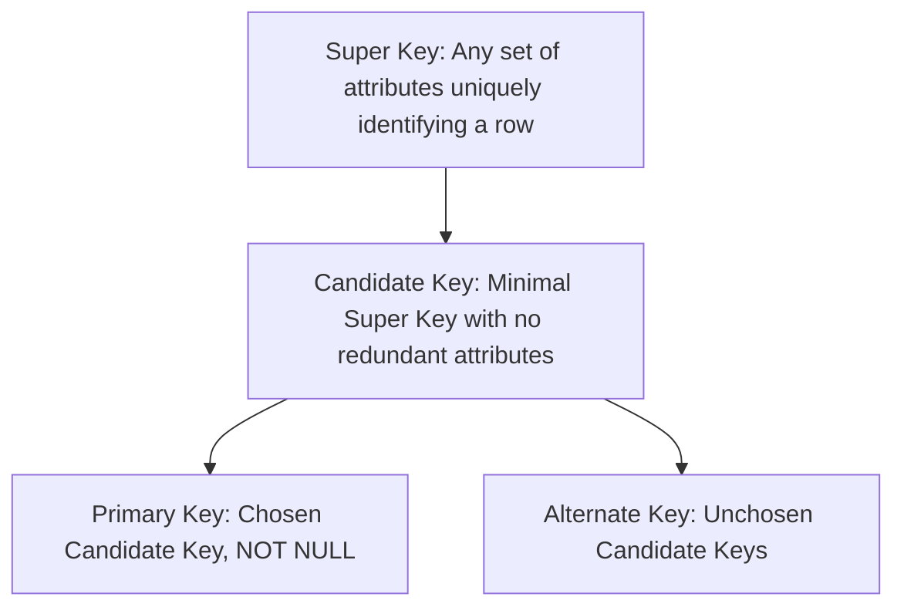
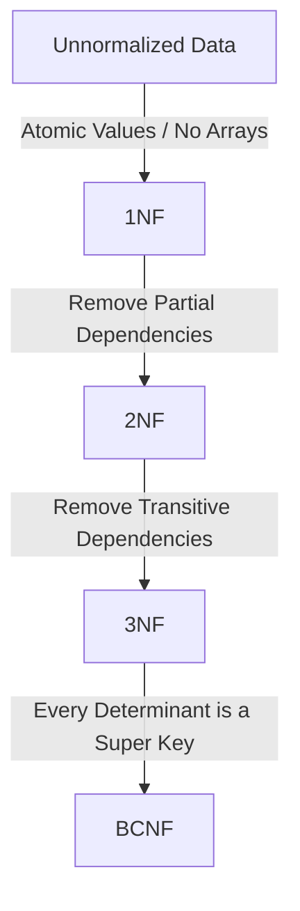

# DBMS & SQL — Interview Question Answers (Q45 – Q84)

---

# Part 1: DBMS Theoretical Questions (Q45 – Q64)

### Q45. What is a DBMS? How is an RDBMS different from a general DBMS?
**Answer:**
* **DBMS (Database Management System):** Software that manages the storage, retrieval, and modification of data. Stores data as files or hierarchical structures, without enforcing formal mathematical relationships between entities (e.g., XML files, simple key-value databases).
* **RDBMS (Relational DBMS):** An advanced DBMS based on **E.F. Codd's Relational Model**. Stores data in structured tables (relations) of rows and columns, strictly enforces **Primary-Foreign Key referential integrity**, supports multi-table `JOIN` operations, and guarantees full **ACID transaction properties** (e.g., PostgreSQL, MySQL, Oracle, MS SQL Server).

---

### Q46. Explain primary key, candidate key, super key, foreign key, and composite key.
**Answer:**



* **Super Key:** Any set of one or more attributes that uniquely identifies a row in a table.
* **Candidate Key:** A **minimal** Super Key (no proper subset is a super key).
* **Primary Key (PK):** The single Candidate Key officially chosen by the database architect to uniquely identify records across the table (cannot contain `NULL`).
* **Foreign Key (FK):** A column (or set of columns) in one table that references the Primary Key of another table, enforcing **Referential Integrity**.
* **Composite Key:** A Primary Key composed of **two or more columns** combined together to achieve uniqueness (e.g., `(student_id, course_id)`).

---

### Q47. What are database constraints? Explain PRIMARY KEY, FOREIGN KEY, UNIQUE, NOT NULL, CHECK, and DEFAULT.
**Answer:**
**Constraints** are declarative business rules enforced on data columns by the RDBMS engine to ensure data validity and integrity:

1. **`PRIMARY KEY`:** Uniquely identifies each row; strictly forbids `NULL` and duplicates; creates a clustered B+ Tree index.
2. **`FOREIGN KEY`:** Ensures values in a child table match an existing value in the parent table's PK (supports `ON DELETE CASCADE`).
3. **`UNIQUE`:** Ensures all values in a column are distinct (allows `NULL` values in standard SQL).
4. **`NOT NULL`:** Forbids a column from storing `NULL` values.
5. **`CHECK`:** Validates that inserted/updated values satisfy a boolean predicate (e.g., `CHECK (age >= 18 AND salary > 0)`).
6. **`DEFAULT`:** Automatically assigns a preset default value if no value is explicitly supplied during `INSERT` (e.g., `DEFAULT CURRENT_TIMESTAMP`).

---

### Q48. Why can't a table have two primary keys?
**Answer:**
1. **Physical Storage Ordering (Clustered Index):** In relational engines (like MySQL InnoDB), the Primary Key defines the **physical on-disk sort order** of table rows (Clustered Index / Index-Organized Table). Data rows can physically exist in only one sorted order on disk.
2. **Unique Identifier Principle:** A table represents a single entity set; a single canonical identifier is mathematically required for unambiguous foreign key referencing.
*(Note: A table can have a **Composite Primary Key** containing multiple columns, but only **one** Primary Key constraint per table).*

---

### Q49. What is normalization? Why do we normalize databases?
**Answer:**
**Normalization** is the systematic database design technique of organizing relations and decomposing large flat tables into smaller, well-structured tables to **minimize data redundancy** and eliminate **modification anomalies**:
1. **Insertion Anomaly:** Inability to record data about an entity without artificially inserting unrelated data of another entity.
2. **Deletion Anomaly:** Unintentional loss of critical data when deleting an unrelated record.
3. **Update / Modification Anomaly:** Inconsistent data resulting from updating duplicated values in some rows but missing others.

---

### Q50. Explain 1NF, 2NF, 3NF, and BCNF with examples.
**Answer:**



1. **1NF (First Normal Form):** All attribute values must be **atomic** (indivisible scalars); no arrays, JSON blobs, or repeating groups.
2. **2NF (Second Normal Form):** Must be in 1NF **AND** have **No Partial Dependencies** (no non-prime attribute depends on a proper subset of a composite candidate key).
   - *Example:* In $R(\underline{\text{Student\_ID, Course\_ID}}, \text{Course\_Fee})$, $\text{Course\_ID} \to \text{Course\_Fee}$ is a partial dependency $\implies$ Decompose into $R_1(\underline{\text{Student\_ID, Course\_ID}})$ and $R_2(\underline{\text{Course\_ID}}, \text{Course\_Fee})$.
3. **3NF (Third Normal Form):** Must be in 2NF **AND** have **No Transitive Dependencies**. For every non-trivial FD $X \to Y$, either **$X$ is a Super Key** OR **$Y$ is a Prime Attribute**.
   - *Example:* $\text{Emp\_ID} \to \text{Dept\_ID}$ and $\text{Dept\_ID} \to \text{Dept\_Name} \implies$ Decompose into Employee and Department tables.
4. **BCNF (Boyce-Codd Normal Form):** Strict 3NF. For every non-trivial FD $X \to Y$, **$X$ MUST be a Super Key** unconditionally.

---

### Q51. What is denormalization? When might intentionally violating normalization be useful?
**Answer:**
**Denormalization** is the deliberate strategy of introducing controlled data redundancy by combining normalized tables to optimize read query performance.

* **When to Use:**
  1. **Read-Heavy OLAP Workloads:** In data warehouses, dashboards, and reporting where queries join 6–10 tables millions of times per second.
  2. **Pre-computed Aggregates:** Storing `total_amount` or `item_count` inside the `Orders` table instead of running `SUM(price)` on millions of `OrderItem` rows.
  3. **Trade-off:** Fast reads at the expense of slower writes and application-managed consistency.

---

### Q52. What is a transaction? Explain ACID properties with a practical example.
**Answer:**
A **Transaction** is a logical unit of work consisting of one or more database operations that must execute with complete integrity.

**ACID Properties Explained (Bank Transfer: \$500 from Account A to Account B):**
* **Atomicity ("All or Nothing"):** Either both the debit from A and credit to B succeed (`COMMIT`), or if the server crashes midway, all changes are rolled back (`ROLLBACK`).
* **Consistency ("Invariant Preservation"):** Total money across $(A + B)$ before the transfer must equal total money after the transfer; account balances cannot violate `CHECK (balance >= 0)`.
* **Isolation ("Concurrent Solitude"):** If a third transaction reads Account A's balance during the transfer, it sees either \$1000 or \$500, never an inconsistent intermediate state.
* **Durability ("Survivability"):** Once committed, the \$500 transfer survives permanently on disk even if a sudden power outage occurs immediately after.

---

### Q53. What are COMMIT, ROLLBACK, and SAVEPOINT?
**Answer:**
* **`COMMIT`:** Permanently saves all modifications made by the current transaction to non-volatile disk/WAL and ends the transaction.
* **`ROLLBACK`:** Undoes all modifications made by the current transaction, restoring the database to its pre-transaction consistent state.
* **`SAVEPOINT`:** Creates an intermediate checkpoint marker within a transaction, allowing partial rollback (`ROLLBACK TO savepoint_name`) without aborting the entire transaction.

---

### Q54. What problems can occur when multiple transactions execute concurrently?
**Answer:**
Without proper concurrency control, 4 major anomalies occur:
1. **Dirty Read (Read Uncommitted):** Reading data modified by an uncommitted transaction that later rolls back.
2. **Non-Repeatable Read (Fuzzy Read):** Re-reading the exact same row within a transaction and observing different values because another transaction modified and committed it.
3. **Phantom Read:** Re-running a range query (`WHERE age > 30`) and finding new "phantom" rows inserted by another committed transaction.
4. **Lost Update:** Two concurrent transactions overwrite each other's updates blindly without locking.

---

### Q55. Explain dirty read, non-repeatable read, and phantom read.
**Answer:**

```
1. Dirty Read:
T1: UPDATE salary = 90k ─────────────── ROLLBACK (reverts to 50k)
T2:        └──> READ salary (sees 90k) ──> Makes calculation on fake 90k!

2. Non-Repeatable Read:
T1: READ salary (sees 50k) ────────────────────────── READ salary (sees 80k!)
T2:        └──> UPDATE salary = 80k ──> COMMIT

3. Phantom Read:
T1: SELECT COUNT(*) WHERE dept = 10 (returns 5) ───── SELECT COUNT(*) (returns 6!)
T2:        └──> INSERT (dept = 10) ──> COMMIT
```

---

### Q56. Explain the common SQL transaction isolation levels.
**Answer:**

| Isolation Level | Dirty Read | Non-Repeatable Read | Phantom Read | Mechanism Used |
| :--- | :---: | :---: | :---: | :--- |
| **`READ UNCOMMITTED`** | ❌ Allowed | ❌ Allowed | ❌ Allowed | No read locks; raw uncommitted reads. |
| **`READ COMMITTED`** *(Postgres/Oracle)* | ✅ Prevented | ❌ Allowed | ❌ Allowed | Statement-level MVCC snapshot or short read locks. |
| **`REPEATABLE READ`** *(MySQL InnoDB)* | ✅ Prevented | ✅ Prevented | ❌ Allowed *(Prevented in InnoDB via Gap Locks)* | Transaction-level MVCC snapshot or shared read locks. |
| **`SERIALIZABLE`** | ✅ Prevented | ✅ Prevented | ✅ Prevented | Strict 2PL with Range/Predicate locks or SSI. |

---

### Q57. What is a database deadlock? Give an example involving two transactions.
**Answer:**
A **Database Deadlock** occurs when two or more transactions hold exclusive locks on rows the other transaction needs to proceed, creating a permanent circular wait:

```
Transaction 1:                         Transaction 2:
1. UPDATE Accounts SET ... WHERE id=1  1. UPDATE Accounts SET ... WHERE id=2
   (Acquires Lock on Row 1)               (Acquires Lock on Row 2)
2. UPDATE Accounts SET ... WHERE id=2  2. UPDATE Accounts SET ... WHERE id=1
   (Blocks! Waits for Row 2)              (Blocks! Waits for Row 1)
                    ▲                                  │
                    └──────────────────────────────────┘
```
**Resolution:** The database deadlock detector detects the cycle in its **Wait-For Graph**, chooses a victim transaction based on lowest cost, aborts it with an error (`Deadlock found`), and releases its locks so the other transaction can complete.

---

### Q58. What is an index? Why does an index make reads faster but writes potentially slower?
**Answer:**
An **Index** is an auxiliary persistent B+ Tree or Hash data structure that maps column search keys to physical row pointers on disk.

* **Why Reads are Faster ($O(\log N)$):** Allows the database engine to find specific rows in 3–4 disk block I/Os instead of performing an $O(N)$ **Full Table Scan** over millions of pages.
* **Why Writes are Slower:** Every `INSERT`, `UPDATE`, or `DELETE` statement must not only modify the table data pages, but must also update, rebalance, and split nodes in **every single index tree** built on that table.

---

### Q59. Explain the basic idea behind B-tree and B+ tree indexes. Why are B+ trees commonly useful for database indexes?
**Answer:**
* **B-Tree:** Self-balancing search tree where **both internal nodes and leaf nodes store row data pointers**.
* **B+ Tree (Industry Standard):** Internal nodes store **only search keys and child page pointers** (no data pointers), while **all actual row data/pointers reside exclusively in leaf nodes**. Crucially, all leaf nodes are connected via a **doubly linked list**.

**Why B+ Trees are Superior for Databases:**
1. **Massive Fan-out & Shallow Tree Height:** Because internal nodes store no data pointers, hundreds of keys fit in a single 16 KB page, keeping tree height to only **3–4 levels** for billions of rows.
2. **Lightning-Fast Range Queries (`BETWEEN / > / <`):** To execute a range scan, the engine traverses $O(\log N)$ to find the starting leaf, then simply walks the **doubly linked leaf chain sequentially** without re-traversing the tree.

---

### Q60. What is the difference between clustered and non-clustered indexes?
**Answer:**

| Dimension | Clustered Index | Non-Clustered (Secondary) Index |
| :--- | :--- | :--- |
| **Leaf Node Content** | Contains the **actual complete data row columns**. | Contains the **indexed column value + pointer to PK**. |
| **Physical Order** | Dictates the **physical disk sort order** of table rows. | Independent physical structure; does not affect table order. |
| **Max per Table** | **Exactly 1** (Rows can only be sorted in 1 order). | **Multiple (N)**. |
| **Lookup Cost** | Direct 1-step index traversal. | **2-step lookup (Bookmark Lookup):** Searches secondary index for PK $\to$ traverses clustered index. |

---

### Q61. What is query optimization? What factors might cause a database to choose one execution plan over another?
**Answer:**
**Query Optimization** is the process where the RDBMS **Cost-Based Optimizer (CBO)** analyzes multiple possible physical execution paths for a declarative SQL query and selects the plan with the lowest estimated CPU, memory, and disk I/O cost.

**Factors Influencing Execution Plans:**
1. **Index Selectivity:** If a query filters on a column with high selectivity (e.g., unique ID matching 1 row), it uses an **Index Seek**. If selectivity is low (e.g., `WHERE status = 'Active'` matching 90% of rows), the optimizer chooses a **Full Table Scan** to avoid millions of random disk seek lookups.
2. **Table Statistics:** Data distribution histograms, table row counts, and null counts.
3. **Join Algorithms:** Hash Join (large unsorted tables), Nested Loop Join (small indexed tables), or Sort-Merge Join (pre-sorted inputs).

---

### Q62. SQL vs NoSQL: what are the important architectural differences, and when might you choose one over the other?
**Answer:**
* **SQL (Relational):** Fixed schema, ACID transactions, normalized relational joins, vertical scaling (PostgreSQL, MySQL). Choose for **banking, ERP, e-commerce checkout, and financial ledgers**.
* **NoSQL (Non-Relational):** Dynamic schemaless, BASE eventual consistency, denormalized JSON/key-value storage, native horizontal sharding across commodity clusters (MongoDB, Redis, Cassandra). Choose for **real-time caching, social feeds, high-throughput IoT telemetry, and rapid prototyping with fluid schemas**.

---

### Q63. Explain replication and sharding. What problem does each solve?
**Answer:**
* **Replication (High Availability & Read Scale):** Duplicates identical copies of the database across multiple physical nodes (Master-Slave / Primary-Replica). Solves **single point of failure (HA)** and scales **read query throughput**.
* **Sharding (Horizontal Partitioning for Write & Storage Scale):** Horizontally splits a giant table's rows across multiple independent database servers using a **Shard Key** (e.g., Users 1–1M on Shard 1, 1M–2M on Shard 2). Solves **storage and write throughput bottlenecks** that exceed a single server's physical capacity.

---

### Q64. Explain the CAP theorem. What does consistency mean in this context?
**Answer:**
The **CAP Theorem** states that in any distributed data store, it is impossible to simultaneously guarantee all three:
1. **Consistency (C - Linearizability):** Every read receives the most recent write or an error (all nodes see the exact same data at the same time).
2. **Availability (A):** Every non-failing node returns a non-error response to every request (without guaranteeing it is the latest write).
3. **Partition Tolerance (P):** The system continues functioning despite network packet loss or network split between nodes.

**The Trade-off:**
Since physical network partitions ($P$) are unavoidable in distributed systems, architects must choose between **CP** (reject writes to preserve strong consistency, e.g., MongoDB/HBase) or **AP** (accept writes and serve stale reads to preserve availability, e.g., Cassandra/DynamoDB).

---

# Part 2: SQL Coding Solutions (Q65 – Q84)

*(Based on schemas: `Employee`, `Department`, `Orders`, `Customer`, `Product`, `OrderItem`)*

---

### Q65. Retrieve all employees whose salary is greater than ₹50,000.
```sql
SELECT employee_id, name, salary, department_id 
FROM Employee 
WHERE salary > 50000;
```

---

### Q66. Find the second-highest salary in the Employee table.
```sql
-- Method 1: Subquery with MAX (Handles ties cleanly)
SELECT MAX(salary) AS SecondHighestSalary
FROM Employee
WHERE salary < (SELECT MAX(salary) FROM Employee);

-- Method 2: Using DENSE_RANK()
WITH RankedSalaries AS (
    SELECT salary, DENSE_RANK() OVER (ORDER BY salary DESC) AS rnk
    FROM Employee
)
SELECT salary AS SecondHighestSalary
FROM RankedSalaries
WHERE rnk = 2
LIMIT 1;
```

---

### Q67. Find the Nth-highest salary without assuming N = 2.
```sql
WITH RankedSalaries AS (
    SELECT salary, DENSE_RANK() OVER (ORDER BY salary DESC) AS rnk
    FROM Employee
)
SELECT salary AS NthHighestSalary
FROM RankedSalaries
WHERE rnk = 3 -- Replace 3 with N
LIMIT 1;
```

---

### Q68. Find employees who earn more than the average employee salary.
```sql
SELECT employee_id, name, salary
FROM Employee
WHERE salary > (SELECT AVG(salary) FROM Employee);
```

---

### Q69. Find the highest-paid employee in every department.
```sql
WITH RankedDeptEmployees AS (
    SELECT 
        d.department_name,
        e.name AS employee_name,
        e.salary,
        DENSE_RANK() OVER (PARTITION BY e.department_id ORDER BY e.salary DESC) AS rnk
    FROM Employee e
    JOIN Department d ON e.department_id = d.department_id
)
SELECT department_name, employee_name, salary
FROM RankedDeptEmployees
WHERE rnk = 1;
```

---

### Q70. Find the top three highest-paid employees in every department.
```sql
WITH RankedDeptEmployees AS (
    SELECT 
        d.department_name,
        e.name AS employee_name,
        e.salary,
        DENSE_RANK() OVER (PARTITION BY e.department_id ORDER BY e.salary DESC) AS rnk
    FROM Employee e
    JOIN Department d ON e.department_id = d.department_id
)
SELECT department_name, employee_name, salary, rnk
FROM RankedDeptEmployees
WHERE rnk <= 3
ORDER BY department_name, rnk;
```

---

### Q71. Find duplicate employee names.
```sql
SELECT name, COUNT(*) AS duplicate_count
FROM Employee
GROUP BY name
HAVING COUNT(*) > 1;
```

---

### Q72. Retrieve all employees who do not have a manager.
```sql
SELECT employee_id, name, salary
FROM Employee
WHERE manager_id IS NULL;
```

---

### Q73. Display employee name, department name, and salary using an appropriate JOIN.
```sql
SELECT 
    e.name AS employee_name, 
    COALESCE(d.department_name, 'No Department') AS department_name, 
    e.salary
FROM Employee e
LEFT JOIN Department d ON e.department_id = d.department_id;
```

---

### Q74. Find departments having more than five employees.
```sql
SELECT 
    d.department_id, 
    d.department_name, 
    COUNT(e.employee_id) AS total_employees
FROM Department d
JOIN Employee e ON d.department_id = e.department_id
GROUP BY d.department_id, d.department_name
HAVING COUNT(e.employee_id) > 5;
```

---

### Q75. Find customers who have never placed an order.
```sql
SELECT c.customer_id, c.customer_name, c.city
FROM Customer c
LEFT JOIN Orders o ON c.customer_id = o.customer_id
WHERE o.order_id IS NULL;
```

---

### Q76. Find the total order amount for every customer.
```sql
SELECT 
    c.customer_id, 
    c.customer_name, 
    COALESCE(SUM(o.amount), 0.00) AS total_order_amount
FROM Customer c
LEFT JOIN Orders o ON c.customer_id = o.customer_id
GROUP BY c.customer_id, c.customer_name;
```

---

### Q77. Find the customer who has spent the most money.
```sql
SELECT c.customer_id, c.customer_name, SUM(o.amount) AS total_spent
FROM Customer c
JOIN Orders o ON c.customer_id = o.customer_id
GROUP BY c.customer_id, c.customer_name
ORDER BY total_spent DESC
LIMIT 1;
```

---

### Q78. Find the second-highest order amount for each customer.
```sql
WITH RankedOrders AS (
    SELECT 
        customer_id,
        order_id,
        amount,
        DENSE_RANK() OVER (PARTITION BY customer_id ORDER BY amount DESC) AS rnk
    FROM Orders
)
SELECT customer_id, order_id, amount AS second_highest_amount
FROM RankedOrders
WHERE rnk = 2;
```

---

### Q79. Find products that have never appeared in OrderItem.
```sql
SELECT p.product_id, p.product_name, p.category, p.price
FROM Product p
LEFT JOIN OrderItem oi ON p.product_id = oi.product_id
WHERE oi.product_id IS NULL;
```

---

### Q80. Find the most expensive product in each category.
```sql
WITH RankedProducts AS (
    SELECT 
        product_id,
        product_name,
        category,
        price,
        DENSE_RANK() OVER (PARTITION BY category ORDER BY price DESC) AS rnk
    FROM Product
)
SELECT category, product_name, price
FROM RankedProducts
WHERE rnk = 1;
```

---

### Q81. Difference between WHERE and HAVING with counter-example.
**Explanation:**
- `WHERE` filters rows **before** grouping and cannot use aggregate functions.
- `HAVING` filters aggregated groups **after** `GROUP BY` and can filter on aggregate functions.

```sql
-- INCORRECT (Syntax Error: Invalid use of group function in WHERE)
SELECT department_id, AVG(salary) 
FROM Employee 
WHERE AVG(salary) > 60000 
GROUP BY department_id;

-- CORRECT (Using HAVING)
SELECT department_id, AVG(salary) 
FROM Employee 
GROUP BY department_id 
HAVING AVG(salary) > 60000;
```

---

### Q82. INNER JOIN vs LEFT JOIN with Customer and Orders example.
```sql
-- INNER JOIN: Returns ONLY customers who have placed at least 1 order
SELECT c.customer_name, o.order_id, o.amount
FROM Customer c
INNER JOIN Orders o ON c.customer_id = o.customer_id;

-- LEFT JOIN: Returns ALL customers, showing NULL for customers who placed 0 orders
SELECT c.customer_name, o.order_id, o.amount
FROM Customer c
LEFT JOIN Orders o ON c.customer_id = o.customer_id;
```

---

### Q83. Correlated Subquery: Employees earning more than their own department average.
```sql
SELECT e.employee_id, e.name, e.department_id, e.salary
FROM Employee e
WHERE e.salary > (
    SELECT AVG(sub.salary)
    FROM Employee sub
    WHERE sub.department_id = e.department_id -- Correlated link to outer query
);
```

---

### Q84. Calculate each employee's salary rank within their department using Window Functions.
```sql
SELECT 
    e.employee_id,
    e.name AS employee_name,
    e.department_id,
    e.salary,
    ROW_NUMBER() OVER (PARTITION BY e.department_id ORDER BY e.salary DESC) AS row_num,
    RANK()       OVER (PARTITION BY e.department_id ORDER BY e.salary DESC) AS salary_rank,
    DENSE_RANK() OVER (PARTITION BY e.department_id ORDER BY e.salary DESC) AS dense_salary_rank
FROM Employee e;
```
