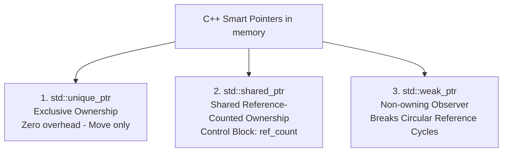

# C++ Programming — Interview Question Answers (Q85 – Q104)

---

## Fundamentals

### Q85. What are the major differences between C and C++?
**Answer:**

| Feature | C | C++ |
| :--- | :--- | :--- |
| **Programming Paradigm** | Procedural / Imperative. | **Multi-paradigm** (Procedural, Object-Oriented, Generic/Templates, Functional). |
| **OOP Support** | ❌ No classes, inheritance, or polymorphism. | ✅ Full OOP support (Encapsulation, Inheritance, Polymorphism). |
| **Memory Management** | `malloc()`, `calloc()`, `free()`. | **`new`**, **`delete`**, and **Smart Pointers (RAII)**. |
| **Function Overloading** | ❌ Not supported. | ✅ Supported (Overloading & Operator Overloading). |
| **Exception Handling** | ❌ Return codes / `errno`. | ✅ Structured `try`, `catch`, `throw`. |
| **Standard Library** | Minimal standard C library. | **Standard Template Library (STL)** (Vectors, Maps, Algorithms). |

---

### Q86. What is a class? What is an object?
**Answer:**
* **Class:** A user-defined blueprint or prototype that encapsulates data members (attributes) and member functions (behaviors) into a unified data type. It is a logical construct that consumes **zero memory** until instantiated.
* **Object:** A concrete **instance** of a class created in memory at runtime that occupies physical RAM space.

```cpp
class Car {          // Blueprint (Class)
    string brand;
public:
    void drive();
};

Car myCar;           // Instance in memory (Object)
```

---

### Q87. What is a constructor? What is a destructor? When are they called?
**Answer:**
* **Constructor:** A special member function having the same name as the class and no return type. It is invoked **automatically when an object is instantiated** to initialize its data members and acquire resources.
* **Destructor:** A special member function prefixed with a tilde (`~ClassName()`) with no arguments and no return type. It is invoked **automatically when an object goes out of scope or is explicitly deleted via `delete`** to release acquired resources (memory, file handles, locks).

---

### Q88. What is the `this` pointer?
**Answer:**
The **`this` pointer** is an implicit constant pointer passed automatically to all non-static member functions of a class. It holds the **physical memory address of the current invoking object (`ClassName* const this`)**.

**Common Uses:**
1. Disambiguating shadowed member variables: `this->name = name;`
2. Returning the calling object by reference for method chaining: `return *this;`
3. Passing the current object instance to other functions/observers: `registerCallback(this);`

---

### Q89. What is the difference between a pointer and a reference?
**Answer:**

| Feature | Pointer (`int* ptr`) | Reference (`int& ref`) |
| :--- | :--- | :--- |
| **Definition** | A variable that stores the **memory address** of another variable. | An **alias (alternative name)** for an existing variable. |
| **Reassignment** | ✅ Can be reseated to point to different addresses. | ❌ **Cannot be reseated**; bound permanently upon initialization. |
| **NULL Safety** | ⚠️ Can be `nullptr` (requires null checks). | ✅ **Must be initialized**; cannot be null in standard C++. |
| **Memory & Address** | Has its own distinct memory address. | Shares the **exact same memory address** as the target object. |
| **Syntax** | Dereferenced with `*ptr` and `->`. | Accessed directly with dot syntax `ref`. |

---

### Q90. What is the difference between stack memory and heap memory?
**Answer:**

```
High Memory
┌────────────────────────────┐
│ Stack (Local frames)       │  ↓ Automatically allocated & popped by CPU SP
├────────────────────────────┤
│             ↓              │
│      (Free Space)          │
│             ↑              │
├────────────────────────────┤
│ Heap (Dynamic memory)      │  ↑ Allocated via new / malloc; manual delete
└────────────────────────────┘
Low Memory
```

| Dimension | Stack Memory | Heap Memory |
| :--- | :--- | :--- |
| **Allocation** | Automatic by compiler/CPU stack pointer. | Explicit programmatic allocation (`new`, `malloc`). |
| **Deallocation** | Automatic when function/scope exits. | Manual (`delete`, `free`) or via Smart Pointers. |
| **Speed** | **Extremely fast** (L1/L2 cache friendly). | Slower (pointer indirection, book-keeping). |
| **Size Limit** | Fixed and small (typically 1–8 MB; excess causes Stack Overflow). | Large (bounded only by total physical RAM / Virtual Memory). |
| **Fragmentation** | Zero fragmentation. | Prone to memory fragmentation. |

---

### Q91. Explain `const` in C++. Where can it be used?
**Answer:**
The `const` keyword enforces compile-time immutability:

1. **Variables:** `const int MAX = 100;` (Cannot be modified).
2. **Pointers:**
   - `const int* p;` (Pointer to constant int: data is immutable, pointer can move).
   - `int* const p = &x;` (Constant pointer: pointer address is fixed, data is mutable).
   - `const int* const p = &x;` (Both address and data are immutable).
3. **Function Parameters:** `void process(const string& s);` (Prevents expensive copying while guaranteeing read-only access).
4. **Const Member Functions:** `int getAge() const;` (Guarantees function will **not modify any member variables** of the class; callable on `const` objects).

---

### Q92. What are static data members and static member functions?
**Answer:**
* **Static Data Member:** A single class-level variable shared by **all instances** of that class (stored in the global/BSS segment, not inside individual objects). Must be defined outside the class body.
* **Static Member Function:** A class-level function that can be called directly on the class without creating an object (`ClassName::func()`).
  - **Limitation:** Does **not have a `this` pointer** and can **only access static data members and other static functions**.

```cpp
class Employee {
public:
    static int employeeCount; // Declaration
    static int getCount() { return employeeCount; }
};
int Employee::employeeCount = 0; // Definition in global scope
```

---

## Medium / Advanced

### Q93. What is a copy constructor? When is it invoked?
**Answer:**
A **Copy Constructor** is a constructor that initializes a new object using an existing object of the same class:
$$\text{Syntax: } \mathbf{\text{ClassName(const ClassName\& other);}}$$

**When It is Invoked:**
1. Initializing an object from another at declaration: `Car c2 = c1;` or `Car c2(c1);`
2. Passing an object **by value** into a function: `void drive(Car c);`
3. Returning an object **by value** from a function (if not optimized away by RVO / Copy Elision).

---

### Q94. What is the difference between a copy constructor and copy assignment operator?
**Answer:**

| Feature | Copy Constructor | Copy Assignment Operator (`operator=`) |
| :--- | :--- | :--- |
| **Target Object State** | Target object is **being newly constructed** (uninitialized memory). | Target object **already exists and is initialized**. |
| **Syntax** | `Car c2 = c1;` OR `Car c2(c1);` | `Car c2; c2 = c1;` |
| **Existing Cleanup** | No cleanup needed (object didn't exist). | **Must deallocate existing resources first** to avoid memory leaks. |
| **Self-Assignment** | Impossible (new object cannot be itself). | **Must check for self-assignment (`if (this == &other) return *this;`)**. |

---

### Q95. Explain shallow copy versus deep copy with an example involving dynamically allocated memory.
**Answer:**

```
Shallow Copy (Dangling Pointer Disaster):
Obj 1 [ ptr ] ──┐
                ├───> Heap Memory [ "Hello" ]
Obj 2 [ ptr ] ──┘  (Both point to SAME address! Destructor triggers DOUBLE FREE!)

Deep Copy (Safe & Independent):
Obj 1 [ ptr ] ───> Heap Memory Block 1 [ "Hello" ]
Obj 2 [ ptr ] ───> Heap Memory Block 2 [ "Hello" ]
```

```cpp
class SafeString {
    char* data;
public:
    // Constructor
    SafeString(const char* str) {
        data = new char[strlen(str) + 1];
        strcpy(data, str);
    }

    // DEEP Copy Constructor
    SafeString(const SafeString& other) {
        data = new char[strlen(other.data) + 1]; // Allocates fresh independent memory!
        strcpy(data, other.data);
    }

    // Destructor
    ~SafeString() { delete[] data; }
};
```

---

### Q96. Explain the Rule of 3 and how it relates to the Rule of 5.
**Answer:**
* **Rule of 3 (C++03):** If a class explicitly manages raw dynamic resources and defines any **one** of the following three, it **must explicitly define all three**:
  1. **Destructor** (`~ClassName()`)
  2. **Copy Constructor** (`ClassName(const ClassName&)`)
  3. **Copy Assignment Operator** (`operator=`)
* **Rule of 5 (C++11 Move Semantics):** With the introduction of rvalue references and move semantics, if you define the above 3, you should also implement the **two Move operations** for high-performance zero-copy transfers:
  4. **Move Constructor** (`ClassName(ClassName&&) noexcept`)
  5. **Move Assignment Operator** (`operator=(ClassName&&) noexcept`)

---

### Q97. What is RAII? How does C++ use RAII for resource management?
**Answer:**
**RAII (Resource Acquisition Is Initialization)** is a foundational C++ programming idiom where **resource lifecycle is bound directly to object lifetime**:
1. **Acquisition:** Resources (heap memory, mutex locks, database connections, file handles) are acquired inside the **Constructor**.
2. **Release:** Resources are automatically released inside the **Destructor**.
3. **Exception Safety:** When an exception is thrown, C++ performs **Stack Unwinding**, calling destructors of all local objects on the stack, guaranteeing that resources are never leaked even during unexpected runtime crashes (e.g., `std::lock_guard`, `std::unique_ptr`).

---

### Q98. What are smart pointers? Explain `unique_ptr`, `shared_ptr`, and `weak_ptr`.
**Answer:**



1. **`std::unique_ptr`:** Manages a resource with **exclusive, single-owner semantics**. Cannot be copied, only moved (`std::move`). Zero runtime memory overhead compared to raw pointers.
2. **`std::shared_ptr`:** Manages a resource using **reference counting**. Multiple `shared_ptr` instances share ownership of the same object; the underlying memory is freed when the reference count drops to zero.
3. **`std::weak_ptr`:** A non-owning observer pointer created from a `shared_ptr`. It does not increment the reference count, preventing **Circular Reference Memory Leaks** (e.g., Node A $\leftrightarrow$ Node B). Converted to `shared_ptr` via `.lock()` before access.

---

### Q99. What happens if you delete an object through a base-class pointer when the base destructor is not virtual?
**Answer:**
**Undefined Behavior / Severe Memory Leak.**
If the Base class destructor is non-virtual, calling `delete basePtr;` performs static binding based on the pointer type. The compiler executes **only the Base destructor**, and **never calls the Derived class destructor**. Any heap memory, sockets, or buffers allocated inside the Derived class are permanently leaked.

```cpp
class Base {
public:
    virtual ~Base() { cout << "~Base\n"; } // MUST be virtual!
};
class Derived : public Base {
    int* arr = new int[1000];
public:
    ~Derived() { delete[] arr; cout << "~Derived\n"; }
};
```

---

### Q100. What is a virtual function? How does runtime polymorphism work internally at a high level?
**Answer:**
A **Virtual Function** is a member function declared with the `virtual` keyword in a base class, allowing derived classes to override it and enabling **dynamic late binding (Runtime Polymorphism)**.

**Internal Working (vtable and vptr):**
1. **vtable (Virtual Table):** For every class containing virtual functions, the compiler creates a static array of function pointers called the `vtable`.
2. **vptr (Virtual Table Pointer):** Every object of that class receives an invisible pointer member `vptr` pointing to its class's `vtable`.
3. **Dispatch at Runtime:** When `basePtr->func()` is executed:
   $$\text{Instruction} \implies \text{basePtr} \to \text{vptr} \to \text{vtable}[\text{slot}] \to \text{Derived::func()}$$
   This lookup resolves the derived method at runtime with negligible ($O(1)$) pointer dereference cost.

---

### Q101. Explain exception handling in C++. What happens when an exception is thrown?
**Answer:**
C++ provides structured exception handling via `try`, `catch`, and `throw`:

**What Happens When an Exception is Thrown:**
1. **Control Transfer:** Normal program flow halts immediately at the `throw` statement.
2. **Stack Unwinding:** The runtime unwinds the call stack frame by frame, searching for a matching `catch` block. During this unwinding, **destructors of all local stack objects in exited scopes are invoked automatically** (guaranteeing RAII cleanup).
3. **Matching & Catching:** The first catch block with a compatible type signature takes control.
4. **Unhandled Exceptions:** If no matching catch block is found up to `main()`, `std::terminate()` is called, halting the process.

---

### Q102. Compare `vector`, `list`, and `deque`. When would you choose each?
**Answer:**

| Dimension | `std::vector` | `std::deque` | `std::list` |
| :--- | :--- | :--- | :--- |
| **Underlying Structure** | Contiguous dynamic array | Array of fixed-size paged chunks | Doubly Linked List |
| **Random Access (`[]`)**| **$O(1)$ Fast (Contiguous memory)**| **$O(1)$ Fast (2-level pointer)**| ❌ Not supported ($O(N)$ traversal) |
| **Insert/Delete Front** | $O(N)$ | **$O(1)$** | **$O(1)$** |
| **Insert/Delete Back** | **Amortized $O(1)$** | **$O(1)$** | **$O(1)$** |
| **Insert/Delete Middle**| $O(N)$ (shifts elements) | $O(N)$ | **$O(1)$** (once iterator found) |
| **Cache Locality** | **Optimal (CPU cache line prefetching)**| Moderate | Poor (Nodes scattered across heap) |
| **When to Choose** | **Default choice for 90% of use cases.** | Sliding window maximum, double-ended queues. | When frequent insertions/deletions occur in middle with persistent iterators. |

---

### Q103. Compare `map` and `unordered_map`. What are their typical time complexities and important trade-offs?
**Answer:**

| Dimension | `std::map` | `std::unordered_map` |
| :--- | :--- | :--- |
| **Data Structure** | **Red-Black Tree (Self-balancing BST)** | **Hash Table with Chaining Buckets** |
| **Search / Insert / Erase**| **Guaranteed $O(\log N)$** | **Average: $O(1)$**, Worst-case: **$O(N)$** |
| **Key Ordering** | Strictly **Sorted** (Ascending order) | **Unordered / Arbitrary** |
| **Range Queries (`lower_bound`)**| ✅ Supported in $O(\log N)$ | ❌ Not supported |
| **Key Requirement** | Must support `operator<` | Must support `std::hash` and `operator==` |
| **When to Choose** | When keys must be printed sorted or need nearest successor queries. | High-speed lookup, frequency counts, caching. |

---

### Q104. Compare `set` and `unordered_set`.
**Answer:**
* **`std::set`:** Collection of unique keys stored in a **Red-Black Tree**. Keys are maintained in **strictly sorted order** with guaranteed **$O(\log N)$** insert, delete, and search times. Supports `lower_bound()` and `upper_bound()`.
* **`std::unordered_set`:** Collection of unique keys stored in a **Hash Table**. Keys are **unordered**, providing **average $O(1)$** insert, delete, and lookup times. Ideal for fast deduplication and existence checks.
