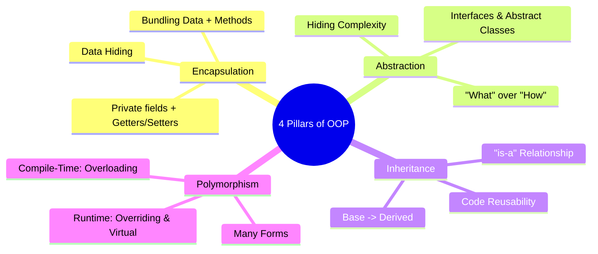
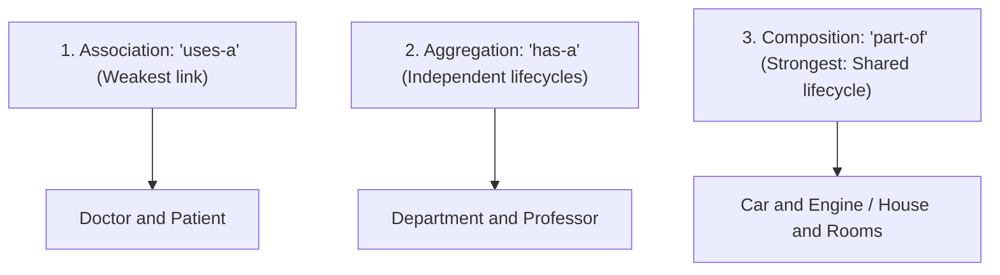
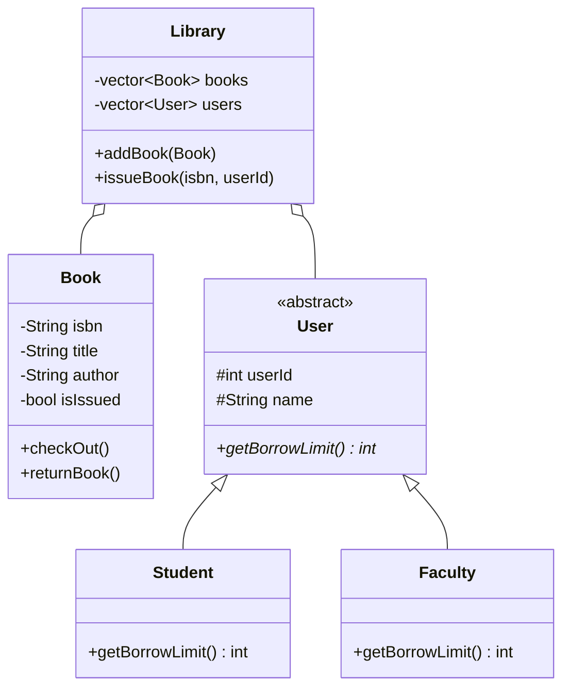

# Object-Oriented Programming (OOP) — Interview Question Answers (Q105 – Q122)

---

## Fundamentals

### Q105. Explain the four major principles of OOP: encapsulation, abstraction, inheritance, and polymorphism.
**Answer:**



1. **Encapsulation:** Bundling data (state) and the methods (behavior) that operate on that data into a single unit (class), while restricting direct external access to internal state (**Data Hiding** via `private` specifiers).
2. **Abstraction:** Hiding complex implementation details and exposing only essential high-level functionality through clean interfaces and abstract classes.
3. **Inheritance:** The mechanism by which a child class acquires attributes and behaviors from a parent class, facilitating code reusability and establishing an **"is-a"** relationship.
4. **Polymorphism:** The ability of an entity (function, object, interface) to take on multiple forms, enabling a single interface to control different underlying implementations (Compile-Time vs. Runtime).

---

### Q106. What is encapsulation? Why is keeping data private useful?
**Answer:**
**Encapsulation** is the containment of data members and member functions within a class boundary and enforcing access controls through getters and setters.

**Why Keeping Data Private is Useful:**
1. **Prevents Invariant Corruption:** Guarantees external callers cannot set invalid states (e.g., `account.setBalance(-500)` can throw an error or reject, whereas `account.balance = -500` would corrupt the system).
2. **Internal Refactoring Freedom:** The internal implementation of how data is stored (e.g., changing from an array to a hash map) can be changed without breaking external calling code.
3. **Read-Only / Write-Only Controls:** Allows creating read-only fields by providing only a getter without a setter.

---

### Q107. What is abstraction? How is abstraction different from encapsulation?
**Answer:**

| Dimension | Abstraction | Encapsulation |
| :--- | :--- | :--- |
| **Core Focus** | **Hiding Complexity ("What it does"):** Exposes only essential features to the user. | **Data Hiding ("How to protect"):** Restricts access to internal fields to protect state integrity. |
| **Implementation** | Achieved via **Abstract Classes**, **Pure Virtual Functions**, and **Interfaces**. | Achieved via **Access Specifiers (`private`, `protected`)** and **Getters/Setters**. |
| **Design Level** | **High-Level Design Phase:** Decides interface boundaries. | **Implementation Level:** Decides internal variable access. |
| **Real-World Analogy**| Driving a car: You use the **Steering Wheel and Brake pedal** without knowing the fuel injection algorithm. | The car engine is sealed **under the hood** so drivers don't accidentally disconnect spark plugs. |

---

### Q108. What is inheritance? What are the different forms of inheritance?
**Answer:**
**Inheritance** is the OOP mechanism allowing a derived class to inherit fields and methods from a base class.

```
1. Single:           A ───> B
2. Multilevel:       A ───> B ───> C
3. Multiple:         A ───┐
                     B ───┼───> C
4. Hierarchical:     A ───┬───> B
                          └───> C
5. Hybrid:           Combination of multiple & multilevel (Diamond problem)
```

---

### Q109. What is polymorphism? Explain compile-time and runtime polymorphism.
**Answer:**

| Feature | Compile-Time (Static) Polymorphism | Runtime (Dynamic) Polymorphism |
| :--- | :--- | :--- |
| **Binding Time** | Early Binding / Static Binding (Resolved by compiler). | Late Binding / Dynamic Binding (Resolved at runtime). |
| **Mechanisms** | **Function Overloading** and **Operator Overloading**, Templates. | **Function Overriding** using **`virtual` functions** and base class pointers. |
| **Performance** | **Zero runtime overhead** (Inlined directly by compiler). | Minimal pointer lookup overhead ($\approx 1$ pointer dereference via `vtable`). |
| **Flexibility** | Fixed at build time. | Highly flexible; supports dynamic plugin architectures. |

---

### Q110. What is function overloading? How does it differ from function overriding?
**Answer:**

| Feature | Function Overloading | Function Overriding |
| :--- | :--- | :--- |
| **Scope** | Within the **same class**. | Across **Base and Derived classes** (Inheritance). |
| **Signature** | Function name is same, but **parameters (type/count) MUST differ**. | Function name, parameter types, and count **MUST be identical**. |
| **Return Type** | Can be different, but return type alone cannot overload. | Must be identical (or covariant). |
| **Keywords** | None required. | Requires **`virtual`** in Base class and optionally **`override`** in Derived. |

---

### Q111. What is a virtual function? Why is it required for runtime polymorphism?
**Answer:**
A **Virtual Function** is a member function in a base class declared with `virtual` that derived classes can override. 

**Why It is Required:**
In C++, calling a method on a base class pointer (`Base* b = new Derived(); b->show();`) defaults to **Static Compile-Time Binding**, invoking `Base::show()`. Adding `virtual` tells the compiler to perform **Dynamic Late Binding**, looking up the object's runtime type via its `vptr` and invoking `Derived::show()`.

---

### Q112. What is a pure virtual function? What is an abstract class?
**Answer:**
* **Pure Virtual Function:** A virtual function declared with `= 0` that has no implementation in the base class:
  $$\text{Syntax: } \mathbf{\text{virtual void execute() = 0;}}$$
* **Abstract Class:** Any class that contains **at least one pure virtual function**.
  - An abstract class **cannot be instantiated** directly (`Base b;` is a compile error).
  - Acts as a strict contract / interface: Any derived class **must implement all pure virtual functions** or it remains an abstract class itself.

---

## Deeper OOP & Design Scenarios

### Q113. Explain public, protected, and private access specifiers. How do they affect inheritance?
**Answer:**

| Base Member Specifier | Public Inheritance (`: public Base`) | Protected Inheritance (`: protected Base`) | Private Inheritance (`: private Base`) |
| :--- | :--- | :--- | :--- |
| **`public`** | Becomes **`public`** in Derived. | Becomes **`protected`** in Derived. | Becomes **`private`** in Derived. |
| **`protected`** | Becomes **`protected`** in Derived. | Becomes **`protected`** in Derived. | Becomes **`private`** in Derived. |
| **`private`** | **Inaccessible** directly. | **Inaccessible** directly. | **Inaccessible** directly. |

---

### Q114. What is multiple inheritance? What problems can it introduce?
**Answer:**
**Multiple Inheritance** is when a derived class inherits directly from more than one base class (`class C : public A, public B`).
* **Problems Introduced:**
  1. **Name Ambiguity:** If both Class A and Class B have a function `display()`, calling `c.display()` causes a compile-time ambiguity error.
  2. **The Diamond Problem:** Duplication and ambiguity of common ancestor base classes.

---

### Q115. Explain the diamond problem. How does virtual inheritance solve it?
**Answer:**

```
Diamond Problem (Without Virtual Inheritance):
       [ Class A (int val) ]
          ▲            ▲
          │            │
    [ Class B ]    [ Class C ]  (Each gets its own copy of A)
          ▲            ▲
          │            │
       [ Class D (Has TWO copies of A::val!) ]
```

```cpp
// Solution: Virtual Base Classes
class A { public: int val; };
class B : virtual public A { };
class C : virtual public A { };
class D : public B, public C { }; // D now contains exactly ONE shared instance of A!
```
**How Virtual Inheritance Solves It:** The compiler inserts virtual base pointers (`vbptr`), ensuring that the most derived class (`D`) constructs only a single shared instance of the root ancestor (`A`).

---

### Q116. Differentiate association, aggregation, and composition using real-world examples.
**Answer:**



| Relationship | Coupling Strength | Lifecycle Dependency | Example |
| :--- | :--- | :--- | :--- |
| **Association ("uses-a")** | Weakest | Independent; objects communicate without ownership. | A `Driver` uses a `GPSNavigation`. |
| **Aggregation ("has-a")** | Moderate | **Independent:** Child can exist without Parent. | A `Department` has `Professors`. If department closes, professors still exist. |
| **Composition ("part-of")**| **Strongest** | **Dependent (Shared Lifecycle):** Child cannot exist without Parent. | A `House` is composed of `Rooms`. If House is demolished, Rooms cease to exist. |

---

### Q117. Why is composition often preferred over inheritance in software design?
**Answer:**
**"Favor Object Composition over Class Inheritance" (Gang of Four Principle):**
1. **Avoids Tight Coupling:** Inheritance exposes derived classes to internal implementation details of the base class ("Fragile Base Class Problem").
2. **Dynamic Runtime Flexibility:** Composition allows switching behaviors at runtime by swapping encapsulated objects (Strategy Pattern), whereas inheritance is statically fixed at compile-time.
3. **Prevents Class Hierarchy Explosion:** Combining multiple behaviors via multiple inheritance leads to confusing multi-level class bloat.

---

### Q118. Explain the SOLID principles in detail.
**Answer:**
* **S — Single Responsibility Principle (SRP):** A class should have **one, and only one, reason to change**. (e.g., An `Invoice` class handles invoice math; an `InvoicePrinter` handles PDF rendering).
* **O — Open/Closed Principle (OCP):** Software entities should be **open for extension, but closed for modification**. (Add new features via inheritance/interfaces without modifying tested existing code).
* **L — Liskov Substitution Principle (LSP):** Subtypes must be substitutable for their base types without altering program correctness. (A `Square` inheriting from `Rectangle` breaks LSP if resizing width alters height).
* **I — Interface Segregation Principle (ISP):** Clients should not be forced to depend on interfaces they do not use. (Split fat interfaces into small, cohesive interfaces).
* **D — Dependency Inversion Principle (DIP):** High-level modules should not depend on low-level modules; **both should depend on abstractions/interfaces**.

---

### Q119. Design a payment system supporting UPI, Credit Card, and Net Banking using OOP.
**Answer:**

```cpp
#include <iostream>
#include <memory>

// Abstract Strategy Interface (Abstraction & OCP)
class IPaymentStrategy {
public:
    virtual bool pay(double amount) = 0;
    virtual ~IPaymentStrategy() = default;
};

// Concrete Implementations
class UPIPayment : public IPaymentStrategy {
    std::string upiId;
public:
    UPIPayment(std::string id) : upiId(id) {}
    bool pay(double amount) override {
        std::cout << "Paid ₹" << amount << " via UPI ID: " << upiId << "\n";
        return true;
    }
};

class CreditCardPayment : public IPaymentStrategy {
    std::string cardNumber;
public:
    CreditCardPayment(std::string card) : cardNumber(card) {}
    bool pay(double amount) override {
        std::cout << "Paid ₹" << amount << " via Card ending in " << cardNumber.substr(12) << "\n";
        return true;
    }
};

// Context Class (Composition & Dependency Inversion)
class PaymentProcessor {
    std::unique_ptr<IPaymentStrategy> strategy;
public:
    void setPaymentMethod(std::unique_ptr<IPaymentStrategy> s) {
        strategy = std::move(s);
    }
    void executePayment(double amount) {
        if (strategy) strategy->pay(amount);
    }
};
```

---

### Q120. Design an extensible notification system (Email, SMS, WhatsApp, Push).
**Answer:**

```cpp
#include <iostream>
#include <vector>
#include <memory>

// Notification Interface
class INotificationChannel {
public:
    virtual void send(const std::string& recipient, const std::string& message) = 0;
    virtual ~INotificationChannel() = default;
};

class EmailNotification : public INotificationChannel {
public:
    void send(const std::string& recipient, const std::string& message) override {
        std::cout << "Sending Email to " << recipient << ": " << message << "\n";
    }
};

class WhatsAppNotification : public INotificationChannel {
public:
    void send(const std::string& recipient, const std::string& message) override {
        std::cout << "Sending WhatsApp to " << recipient << ": " << message << "\n";
    }
};

// Service closed for modification, open for extension (OCP)
class NotificationService {
    std::vector<std::shared_ptr<INotificationChannel>> channels;
public:
    void addChannel(std::shared_ptr<INotificationChannel> channel) {
        channels.push_back(channel);
    }
    void notifyAll(const std::string& user, const std::string& msg) {
        for (const auto& ch : channels) ch->send(user, msg);
    }
};
```

---

### Q121. What design problems arise when a `Car` directly instantiates `Engine`, `Logger`, and `PaymentService`? How does Dependency Injection solve it?
**Answer:**
* **Problems:**
  1. **Tight Coupling:** `Car` is hard-coded to a specific `GasolineEngine`. To create an `ElectricCar`, you must rewrite the `Car` class.
  2. **Untestable:** Unit tests cannot mock the `Logger` or `PaymentService`.
* **Solution via Dependency Injection (DI):** Pass abstract interfaces into `Car` via its constructor:

```cpp
class Car {
    std::shared_ptr<IEngine> engine;
    std::shared_ptr<ILogger> logger;
public:
    // Dependencies injected from outside
    Car(std::shared_ptr<IEngine> eng, std::shared_ptr<ILogger> log) 
        : engine(eng), logger(log) {}
};
```

---

### Q122. Design a Basic Library Management System using OOP.
**Answer:**



* **Classes & Structure:**
  1. `Book`: Holds metadata (`ISBN`, `title`, `author`, `isIssued`).
  2. `User` (Abstract Base Class): Encapsulates user details.
     - `Student` (Derived, limit = 3 books).
     - `Faculty` (Derived, limit = 10 books).
  3. `Transaction`: Records issuance dates, return dates, and fine calculations.
  4. `Library`: Acts as controller managing inventory via **Composition / Aggregation**.
