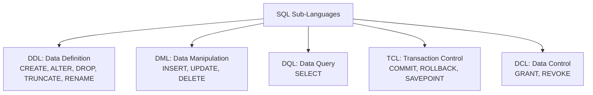

# 01. Basic SQL, Filtering, Sorting, and Aggregate Functions

---

## 1. SQL Commands Classification (DDL, DML, DQL, DCL, TCL)

### 🎯 2–4 Line Interview-Ready Explanation
> **SQL (Structured Query Language)** is the standard declarative language used to manage relational databases. SQL statements are divided into five core sub-languages: **DDL** (Schema Definition), **DML** (Data Mutation), **DQL** (Data Querying), **DCL** (Permissions & Security), and **TCL** (Transaction Control).

---



### DDL vs DML: DROP vs TRUNCATE vs DELETE

| Command | Category | Transaction / Rollback? | Performance | Resets Auto-Increment? | Space Deallocated? |
| :--- | :---: | :---: | :--- | :---: | :---: |
| **`DELETE`** | DML | ✅ **Can be Rolled Back** (Logs row by row in WAL/Undo log). | Slower for large datasets. | ❌ No | ❌ No (Keeps page allocation) |
| **`TRUNCATE`** | DDL | ⚠️ **Cannot be easily rolled back** (Deallocates entire data pages). | **Extremely fast** ($O(1)$ page deallocation). | ✅ **Yes** (Resets to 1) | ✅ **Yes** |
| **`DROP`** | DDL | ❌ **Cannot be rolled back** (Removes data AND schema table structure). | Instantaneous. | Table no longer exists | ✅ **Yes** |

```sql
-- DDL Examples
CREATE TABLE Employees (
    emp_id INT PRIMARY KEY AUTO_INCREMENT,
    first_name VARCHAR(50) NOT NULL,
    salary DECIMAL(10,2) CHECK (salary > 0),
    dept_id INT,
    hire_date DATE DEFAULT (CURRENT_DATE)
);

ALTER TABLE Employees ADD COLUMN email VARCHAR(100) UNIQUE;
ALTER TABLE Employees DROP COLUMN email;

-- DML Examples
INSERT INTO Employees (first_name, salary, dept_id) VALUES ('Alice', 85000.00, 10);
UPDATE Employees SET salary = salary * 1.10 WHERE dept_id = 10;
DELETE FROM Employees WHERE emp_id = 99;
```

---

## 2. Filtering, Operators, and Sorting

### 1. Filtering with `WHERE` & Comparison Operators
* **Logical Operators:** `AND`, `OR`, `NOT` (Precedence: `NOT` > `AND` > `OR`).
* **Range & Set Operators:**
  * `BETWEEN val1 AND val2` (Inclusive of both boundaries).
  * `IN (v1, v2, v3)` (Matches any value in the list).
  * `LIKE` with wildcards:
    * `%` matches zero or more characters (`'A%'` starts with A).
    * `_` matches exactly one character (`'_a%'` has 'a' as 2nd letter).

```sql
-- Pattern matching & Range query
SELECT emp_id, first_name, salary 
FROM Employees 
WHERE salary BETWEEN 50000 AND 100000 
  AND (first_name LIKE 'A%' OR first_name LIKE 'S%')
  AND dept_id IN (10, 20, 30);
```

---

### 2. Handling `NULL` Values (Three-Valued Logic)

> [!CAUTION]
> **Common Interview Trap:** In SQL, `NULL = NULL` evaluates to **`UNKNOWN`** (falsy), NOT `TRUE`!
> Never use `= NULL` or `!= NULL`. Always use **`IS NULL`** and **`IS NOT NULL`**.

```sql
-- Correct NULL check
SELECT * FROM Employees WHERE dept_id IS NULL;

-- Safe comparison with COALESCE
SELECT emp_id, COALESCE(bonus, 0) AS safe_bonus FROM Employees;
```

---

### 3. Sorting with `ORDER BY`, `DISTINCT`, and Pagination (`LIMIT`)

```sql
-- Retrieve Top 5 Highest Paid Employees (Skip Top 2)
SELECT DISTINCT dept_id, salary 
FROM Employees 
ORDER BY salary DESC, dept_id ASC
LIMIT 5 OFFSET 2; -- (In SQL Server: OFFSET 2 ROWS FETCH NEXT 5 ROWS ONLY)
```

---

## 3. Aggregate Functions

### 🎯 2–4 Line Interview-Ready Explanation
> **Aggregate Functions** perform a calculation on a set of column values and return a single scalar summary value. Except for `COUNT(*)`, all aggregate functions (`SUM`, `AVG`, `MIN`, `MAX`, `COUNT(col)`) **automatically ignore `NULL` values**.

---

### Key Aggregate Functions & Null Behavior

| Function | Description | `NULL` Handling Behavior |
| :--- | :--- | :--- |
| **`COUNT(*)`** | Counts total rows in table including `NULL` and duplicate rows. | **Includes NULL rows.** |
| **`COUNT(column)`** | Counts non-null entries in that specific column. | **Ignores NULLs.** |
| **`COUNT(DISTINCT column)`** | Counts unique non-null values. | **Ignores NULLs.** |
| **`SUM(column)`** | Calculates sum of numeric values. | **Ignores NULLs.** Returns `NULL` if all rows are null. |
| **`AVG(column)`** | Calculates arithmetic mean: $\text{SUM} / \text{COUNT(col)}$. | **Ignores NULLs** in both sum and divisor! |
| **`MIN(col)` / `MAX(col)`** | Returns minimum/maximum scalar value. | **Ignores NULLs.** |

```sql
-- Aggregate Examples
SELECT 
    COUNT(*) AS total_employees,
    COUNT(dept_id) AS assigned_dept_count,
    COUNT(DISTINCT dept_id) AS unique_departments,
    AVG(salary) AS avg_salary,
    MIN(salary) AS min_salary,
    MAX(salary) AS max_salary
FROM Employees;
```

---

## 4. Infosys SP L3 Interview Questions & Answers

### Q1: What is the exact difference between `TRUNCATE`, `DELETE`, and `DROP`?
**Answer:**
- **`DELETE` (DML):** Deletes rows conditionally via `WHERE`, logs each deleted row individually to the WAL/Undo log (can be rolled back inside a transaction), triggers `DELETE` database triggers, and does not reset auto-increment counters.
- **`TRUNCATE` (DDL):** Deallocates the entire data pages of the table in one operation ($O(1)$ complexity), cannot delete selectively with `WHERE`, resets auto-increment to 1, and releases disk space back to the OS.
- **`DROP` (DDL):** Completely destroys both the data records and the underlying table schema definition/indexes from the database catalog.

---

### Q2: Why does `SELECT COUNT(*)` return a different result than `SELECT COUNT(column_name)`?
**Answer:**
`COUNT(*)` counts every row in the result set regardless of whether column values contain `NULL`. In contrast, `COUNT(column_name)` counts only rows where `column_name` has a **non-NULL** value. If a table has 10 rows and 3 of them have `NULL` in `dept_id`, `COUNT(*)` returns 10 while `COUNT(dept_id)` returns 7.

---

### Q3: How does `AVG()` treat NULL values, and how can this introduce business reporting bugs?
**Answer:**
`AVG(salary)` calculates $\sum \text{salary} / \text{COUNT(salary)}$, which divides by the count of **non-null** salaries rather than the total employee count.
- If 4 employees earn \$100, \$200, \$300, and `NULL`, `AVG(salary)` evaluates to $(100 + 200 + 300) / 3 = \$200$, not $\$600 / 4 = \$150$.
- To treat `NULL` as 0: `AVG(COALESCE(salary, 0))`.
