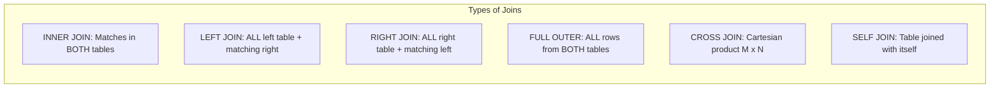
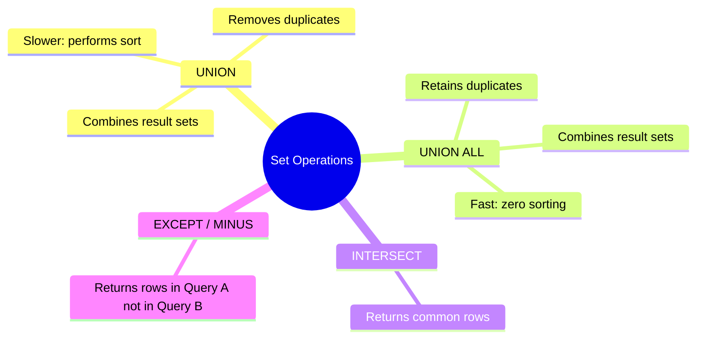

# 02. GROUP BY, HAVING, Joins, and Set Operations

---

## 1. GROUP BY and HAVING (⭐ Priority Topic)

### 🎯 2–4 Line Interview-Ready Explanation
> **`GROUP BY`** collapses rows that share the same values in specified columns into summary rows so aggregate functions (`COUNT`, `SUM`, `AVG`) can be calculated for each group. **`HAVING`** filters aggregated grouped rows *after* aggregation takes place, whereas **`WHERE`** filters individual rows *before* grouping occurs.

---

### SQL Query Execution Order (Crucial for Interviews)

SQL is a declarative language written in one order, but evaluated by the database query optimizer in a strict logical order:

```
Written Order:                       Logical Execution Order:
1. SELECT                            1. FROM & JOINs (Row source generation)
2. FROM & JOIN                       2. WHERE (Row-level filtering)
3. WHERE                             3. GROUP BY (Aggregation grouping)
4. GROUP BY                          4. HAVING (Group-level filtering)
5. HAVING                            5. SELECT (Column projection & Window Functions)
6. ORDER BY                          6. DISTINCT (Duplicate elimination)
7. LIMIT / OFFSET                    7. ORDER BY (Sorting)
                                     8. LIMIT / OFFSET (Pagination)
```

> [!IMPORTANT]
> **Why You Cannot Use Column Aliases in `WHERE` or `HAVING`:**
> `WHERE` and `HAVING` execute in steps 2 and 4, **before** `SELECT` (step 5) projects column aliases. However, you **can** use aliases in `ORDER BY` because `ORDER BY` executes in step 7.

---

### `WHERE` vs. `HAVING` Comparison Table

| Feature | `WHERE` Clause | `HAVING` Clause |
| :--- | :--- | :--- |
| **Execution Timing** | Executes **BEFORE** `GROUP BY` aggregation. | Executes **AFTER** `GROUP BY` aggregation. |
| **Applicable Target** | Filters individual **raw table rows**. | Filters **aggregated groups**. |
| **Aggregate Functions?** | ❌ **Strictly Forbidden** (`WHERE AVG(salary) > 5000` causes syntax error). | ✅ **Allowed** (`HAVING AVG(salary) > 5000`). |
| **Usage without GROUP BY?** | Standard usage across all queries. | Can work without `GROUP BY` (treats entire table as 1 giant group). |

```sql
-- Practical Example: Find departments with more than 3 active employees having avg salary > $60,000
SELECT 
    dept_id, 
    COUNT(*) AS emp_count, 
    AVG(salary) AS avg_sal
FROM Employees
WHERE status = 'Active'               -- Step 1: Filter individual rows
GROUP BY dept_id                      -- Step 2: Group by department
HAVING COUNT(*) > 3 AND AVG(salary) > 60000 -- Step 3: Filter groups
ORDER BY avg_sal DESC;               -- Step 4: Sort result
```

---

## 2. Joins in SQL (⭐ Priority Topic)

### 🎯 2–4 Line Interview-Ready Explanation
> A **JOIN** clause combines columns from two or more tables based on a related column between them (typically Primary Key $\leftrightarrow$ Foreign Key). While relational normalization splits entities into separate tables to eliminate redundancy, joins reassemble that data into unified result sets at query time.

---

### Visual Matrix of SQL Joins



```
Sample Tables:
Employees: (emp_id, name, dept_id)           Departments: (dept_id, dept_name)
(1, 'Alice', 10)                             (10, 'Engineering')
(2, 'Bob', 20)                               (20, 'HR')
(3, 'Charlie', NULL)                         (30, 'Finance')
```

#### 1. INNER JOIN
Returns only records that have matching values in **both** tables (excludes Charlie and Finance).
```sql
SELECT e.name, d.dept_name
FROM Employees e
INNER JOIN Departments d ON e.dept_id = d.dept_id;
-- Output: (Alice, Engineering), (Bob, HR)
```

#### 2. LEFT (OUTER) JOIN
Returns **all** rows from the left table, and matched rows from the right table. (Unmatched right columns become `NULL`).
```sql
SELECT e.name, d.dept_name
FROM Employees e
LEFT JOIN Departments d ON e.dept_id = d.dept_id;
-- Output: (Alice, Engineering), (Bob, HR), (Charlie, NULL)
```

#### 3. RIGHT (OUTER) JOIN
Returns **all** rows from the right table, and matched rows from the left table.
```sql
SELECT e.name, d.dept_name
FROM Employees e
RIGHT JOIN Departments d ON e.dept_id = d.dept_id;
-- Output: (Alice, Engineering), (Bob, HR), (NULL, Finance)
```

#### 4. FULL OUTER JOIN
Returns all records when there is a match in either left or right table. (In MySQL, simulated via `LEFT JOIN UNION RIGHT JOIN`).

#### 5. SELF JOIN
Joining a table to itself to model hierarchical parent-child relationships (e.g., Employee $\leftrightarrow$ Manager).
```sql
-- Find Employee and their Manager's name
SELECT 
    e.name AS employee_name, 
    m.name AS manager_name
FROM Employees e
LEFT JOIN Employees m ON e.manager_id = m.emp_id;
```

#### 6. CROSS JOIN (Cartesian Product)
Pairs every row of Table A with every row of Table B ($M \times N$ rows).
```sql
SELECT p.product_name, c.color_name 
FROM Products p 
CROSS JOIN Colors c;
```

---

## 3. Set Operations (UNION, UNION ALL, INTERSECT, EXCEPT)



### Rules for Set Operations:
1. Both queries must select the **same number of columns**.
2. The corresponding columns must have **compatible data types**.
3. Column names in the final output are determined by the **first `SELECT` query**.

| Operation | Removes Duplicates? | Performance |
| :--- | :---: | :--- |
| **`UNION`** | ✅ **Yes** | Slower (requires an expensive distinct sorting/hash phase). |
| **`UNION ALL`** | ❌ **No** | **Fastest** (simply concatenates record streams). Default choice unless deduplication is required. |
| **`INTERSECT`** | ✅ **Yes** | Returns rows present in **both** Query 1 and Query 2. |
| **`EXCEPT` / `MINUS`** | ✅ **Yes** | Returns rows in Query 1 that are **not** present in Query 2. |

```sql
-- Find all customer IDs from both US and Europe regions (with duplicates kept)
SELECT customer_id FROM US_Orders
UNION ALL
SELECT customer_id FROM EU_Orders;
```

---

## 4. Infosys SP L3 Interview Questions & Answers

### Q1: What is the difference between `ON` and `WHERE` in a `LEFT JOIN`?
**Answer:**
- **Condition in `ON` clause:** Filters the right table **before** performing the join. If a row in the right table fails the `ON` condition, the left row is **still included** with `NULL` right columns.
- **Condition in `WHERE` clause:** Filters the merged result set **after** the join. If a condition like `WHERE d.dept_name = 'HR'` is placed, any left rows that produced `NULL` right columns are eliminated, effectively converting the `LEFT JOIN` into an `INNER JOIN`.

---

### Q2: Why is `UNION ALL` preferred over `UNION` in high-throughput enterprise systems?
**Answer:**
`UNION` performs an internal `DISTINCT` sort or hash aggregation across the entire combined dataset to identify and discard duplicate rows. For datasets with millions of rows, this incurs massive CPU and memory/temp-disk overhead. `UNION ALL` performs a simple stream concatenation with zero deduplication sorting, executing in $O(1)$ memory.

---

### Q3: How do you find all employees who do not belong to any department using a JOIN?
**Answer:**
Use an Anti-Join pattern with `LEFT JOIN` and `IS NULL`:
```sql
SELECT e.emp_id, e.name
FROM Employees e
LEFT JOIN Departments d ON e.dept_id = d.dept_id
WHERE d.dept_id IS NULL;
```
