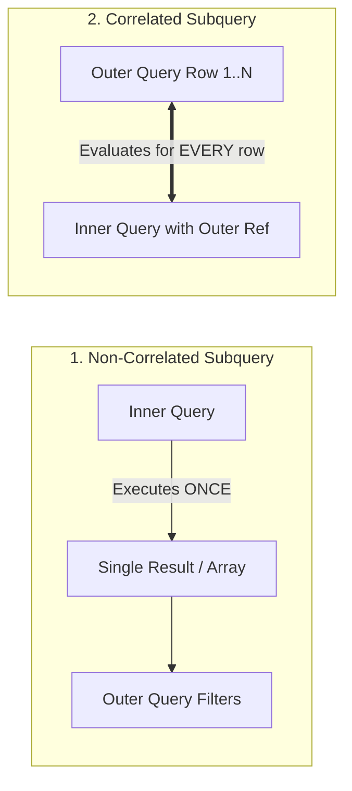

# 03. Subqueries, CASE Expressions, and Window Functions

---

## 1. Subqueries & Nested Queries (⭐ Priority Topic)

### 🎯 2–4 Line Interview-Ready Explanation
> A **Subquery** (or Nested Query) is a `SELECT` query nested inside another SQL statement (`SELECT`, `FROM`, `WHERE`, `HAVING`). Subqueries can be **Scalar** (returns single value), **Multi-row** (used with `IN`, `ANY`, `ALL`), or **Correlated** (subquery references columns from outer query and executes once for every outer row).

---

### Non-Correlated vs Correlated Subqueries



#### 1. Non-Correlated Scalar Subquery (Executes Once)
```sql
-- Find employees who earn more than the company average salary
SELECT name, salary 
FROM Employees 
WHERE salary > (SELECT AVG(salary) FROM Employees);
```

#### 2. Correlated Subquery (Executes per Outer Row)
```sql
-- Find employees who earn more than their own department's average salary
SELECT e.name, e.dept_id, e.salary
FROM Employees e
WHERE e.salary > (
    SELECT AVG(sub.salary) 
    FROM Employees sub 
    WHERE sub.dept_id = e.dept_id -- References outer query column 'e.dept_id'
);
```

---

### `EXISTS` vs. `IN` vs. `NOT EXISTS`

```sql
-- Check if department has at least 1 employee (EXISTS short-circuits on first match)
SELECT d.dept_name 
FROM Departments d 
WHERE EXISTS (
    SELECT 1 FROM Employees e WHERE e.dept_id = d.dept_id
);
```

> [!CAUTION]
> **The `NOT IN` with `NULL` Disaster:**
> If the inner subquery of a `NOT IN` returns even a single `NULL` value, the entire `NOT IN` expression evaluates to `UNKNOWN` and **returns 0 rows**!
> Always prefer **`NOT EXISTS`** or ensure `WHERE column IS NOT NULL` inside `NOT IN`.

---

## 2. CASE Expressions and Built-in Functions

### 1. `CASE` Expressions (SQL If-Else Logic)

```sql
-- Conditional Salary Tier Tagging
SELECT 
    name, 
    salary,
    CASE 
        WHEN salary >= 100000 THEN 'High Tier'
        WHEN salary >= 60000  THEN 'Mid Tier'
        ELSE 'Junior Tier'
    END AS salary_bracket
FROM Employees;
```

---

### 2. Essential Built-in Functions

* **`COALESCE(val1, val2, ..., valN)`:** Returns the **first non-null** value in the list.
* **`NULLIF(val1, val2)`:** Returns `NULL` if $val1 = val2$; otherwise returns $val1$. (Prevents Division by Zero: `val / NULLIF(divisor, 0)`).
* **String Functions:** `CONCAT(a, b)`, `SUBSTRING(str, start, len)`, `LENGTH(str)`, `LOWER(str)`, `UPPER(str)`, `REPLACE(str, from, to)`.
* **Date Functions:** `CURRENT_DATE`, `DATEDIFF(date1, date2)`, `DATE_ADD(date, INTERVAL 7 DAY)`.
* **Numeric Functions:** `ROUND(num, dec)`, `CEIL(num)`, `FLOOR(num)`, `ABS(num)`.

---

## 3. Window Functions (⭐ Critical Priority Topic)

### 🎯 2–4 Line Interview-Ready Explanation
> **Window Functions** perform aggregate-like calculations across a set of table rows (a "window") that are related to the current row, but **without collapsing rows into a single summary row**. Unlike `GROUP BY`, every individual input row retains its separate identity in the output while displaying the computed window value.

---

### Window Syntax Breakdown
$$\text{FUNCTION}() \quad \mathbf{OVER} \quad (\mathbf{PARTITION \ BY} \ \text{col1} \quad \mathbf{ORDER \ BY} \ \text{col2} \quad \mathbf{ROWS \ BETWEEN} \dots)$$

- **`PARTITION BY`:** Divides rows into groups (similar to `GROUP BY`, but doesn't collapse).
- **`ORDER BY`:** Specifies the order of rows inside each partition.
- **Frame Clause (`ROWS BETWEEN ...`):** Defines dynamic subset of rows (e.g., preceding 3 days).

---

### Ranking Functions: `ROW_NUMBER()` vs `RANK()` vs `DENSE_RANK()`

```
Given Salaries: [1000, 900, 900, 800]
```

| Salary | `ROW_NUMBER()` | `RANK()` | `DENSE_RANK()` (Standard for Nth Best) |
| :---: | :---: | :---: | :---: |
| **1000** | 1 | 1 | 1 |
| **900** | 2 | 2 (Tie) | 2 (Tie) |
| **900** | 3 | 2 (Tie) | 2 (Tie) |
| **800** | 4 | **4 (Skips 3!)** | **3 (No gaps!)** |

```sql
SELECT 
    name, dept_id, salary,
    ROW_NUMBER() OVER(PARTITION BY dept_id ORDER BY salary DESC) AS row_num,
    RANK()       OVER(PARTITION BY dept_id ORDER BY salary DESC) AS rnk,
    DENSE_RANK() OVER(PARTITION BY dept_id ORDER BY salary DESC) AS dense_rnk
FROM Employees;
```

---

### Value Navigation: `LAG()` and `LEAD()`

* **`LAG(col, offset, default)`:** Accesses data from a **previous row** in the window without a self-join.
* **`LEAD(col, offset, default)`:** Accesses data from a **subsequent row** in the window.

```sql
-- Compare monthly revenue with previous month's revenue (MoM Growth)
SELECT 
    order_month,
    revenue,
    LAG(revenue, 1, 0) OVER(ORDER BY order_month) AS prev_month_revenue,
    (revenue - LAG(revenue, 1, 0) OVER(ORDER BY order_month)) AS mom_growth
FROM MonthlySales;
```

---

### Cumulative Running Totals

```sql
-- Running total of sales by date
SELECT 
    order_date, 
    amount,
    SUM(amount) OVER(
        ORDER BY order_date 
        ROWS BETWEEN UNBOUNDED PRECEDING AND CURRENT ROW
    ) AS running_total
FROM Orders;
```

---

## 4. Infosys SP L3 Interview Questions & Answers

### Q1: What is the exact difference between `RANK()` and `DENSE_RANK()`?
**Answer:**
When multiple rows have identical values in the `ORDER BY` clause:
- **`RANK()`** assigns the same rank to ties, but **skips subsequent rank numbers** based on the count of ties (e.g., 1, 2, 2, 4).
- **`DENSE_RANK()`** assigns the same rank to ties and **does NOT skip rank numbers** (e.g., 1, 2, 2, 3).
For finding the "2nd or Nth highest salary", `DENSE_RANK()` is preferred so ties don't skip target ranks.

---

### Q2: Why is `EXISTS` usually faster than `IN` for subqueries?
**Answer:**
- **`IN`** evaluates the entire inner subquery, materializes all distinct results into memory, and then performs a linear or hash scan against the outer value.
- **`EXISTS`** is a boolean operator that **short-circuits (early exit)** as soon as the database engine encounters the first matching row in the index, terminating execution immediately without loading unnecessary rows.

---

### Q3: What is the difference between a Window Function and `GROUP BY`?
**Answer:**
`GROUP BY` groups multiple rows into a single summary output row, losing individual row-level detail. A Window Function computes calculations (running totals, rankings, moving averages) over a group of rows while **preserving every individual row in the output**.
