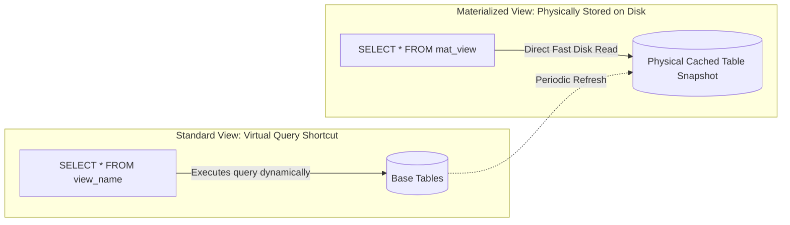
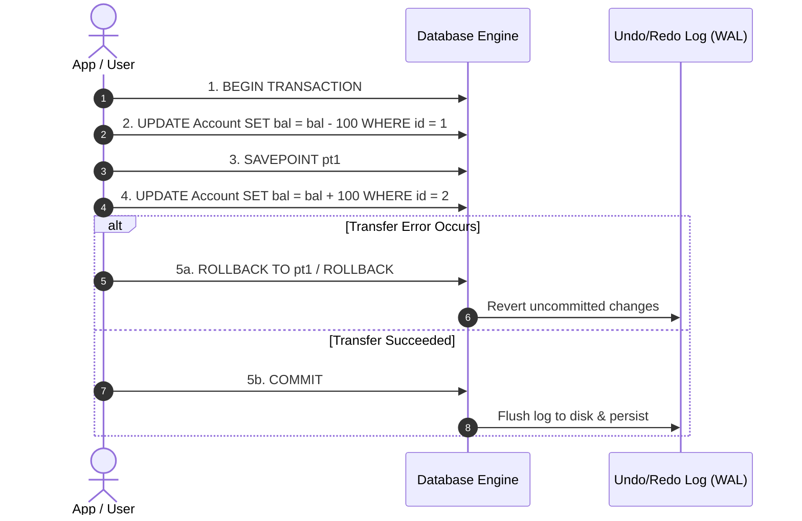

# 05. SQL Integrity Constraints, Views, Indexing, Transactions, and Security

---

## 1. Database Constraints & Keys

### 🎯 2–4 Line Interview-Ready Explanation
> **Constraints** are rules enforced on data columns by the RDBMS to ensure data accuracy, reliability, and domain integrity. Any `INSERT` or `UPDATE` operation that violates a constraint is immediately rejected and aborted by the database engine.

---

### Core SQL Constraints Summary

| Constraint | Enforcement Rule | NULLs Allowed? | Max Allowed Per Table |
| :--- | :--- | :---: | :---: |
| **`PRIMARY KEY`** | Uniquely identifies each record; creates a clustered B+ Tree index. | ❌ **No** | **1** |
| **`UNIQUE`** | Ensures all values in a column are distinct. | ✅ **Yes** (Multiple NULLs allowed in standard SQL) | **Multiple** |
| **`FOREIGN KEY`** | Enforces referential integrity pointing to PK of another table. | ✅ **Yes** | **Multiple** |
| **`CHECK`** | Validates that values satisfy a custom boolean expression (e.g., `age >= 18`). | ✅ **Yes** | **Multiple** |
| **`NOT NULL`** | Forbids column from storing `NULL`. | ❌ **No** | **Multiple** |
| **`DEFAULT`** | Assigns a default fallback value if no value is explicitly supplied. | — | **Multiple** |

```sql
CREATE TABLE Orders (
    order_id INT AUTO_INCREMENT PRIMARY KEY,
    customer_id INT NOT NULL,
    order_date TIMESTAMP DEFAULT CURRENT_TIMESTAMP,
    status VARCHAR(20) DEFAULT 'Pending',
    total_amount DECIMAL(10,2) CHECK (total_amount > 0.00),
    CONSTRAINT fk_customer FOREIGN KEY (customer_id) 
        REFERENCES Customers(customer_id) 
        ON DELETE CASCADE 
        ON UPDATE CASCADE
);
```

---

## 2. Views: Standard Views vs. Materialized Views



| Dimension | Standard View | Materialized View |
| :--- | :--- | :--- |
| **Storage** | **Virtual**: Stores only the SQL `SELECT` definition; consumes **0 disk space**. | **Physical**: Stores the computed query result physically on disk. |
| **Query Performance** | Executes the underlying query from scratch on every call (slower for complex joins). | **Extremely fast** (pre-computed and indexed like a regular table). |
| **Data Freshness** | Real-time (always reflects latest table data). | Lags until explicitly **refreshed** (`REFRESH MATERIALIZED VIEW`). |
| **Ideal Use Case** | Security masking (hiding columns) & query simplification. | Heavy analytical reporting, OLAP dashboards, aggregate queries. |

```sql
-- Standard View
CREATE VIEW ActiveEngineers AS
SELECT emp_id, name, email 
FROM Employees 
WHERE dept_id = 10 AND status = 'Active';

-- Materialized View (Postgres / Oracle)
CREATE MATERIALIZED VIEW MonthlyDepartmentBudget AS
SELECT dept_id, COUNT(*) AS head_count, SUM(salary) AS total_payroll
FROM Employees
GROUP BY dept_id;

REFRESH MATERIALIZED VIEW MonthlyDepartmentBudget;
```

---

## 3. SQL Indexing & The Leftmost Prefix Rule

```sql
-- Create a Composite Index on 3 columns
CREATE INDEX idx_emp_dept_salary ON Employees(dept_id, salary, hire_date);
```

### The Leftmost Prefix Rule (Crucial for Interviews)
A composite B+ Tree index on `(A, B, C)` can only accelerate queries that filter using a prefix of the indexed columns:

| Query Condition | Uses Index? | Reason |
| :--- | :---: | :--- |
| `WHERE A = 10` | ✅ **YES** | Leftmost prefix (A) present. |
| `WHERE A = 10 AND B = 5000` | ✅ **YES** | Leftmost prefix (A, B) present. |
| `WHERE A = 10 AND B = 5000 AND C = '2024-01-01'` | ✅ **YES** | Full index (A, B, C) used. |
| `WHERE B = 5000` | ❌ **NO** | Leftmost column (A) missing $\implies$ Full Table Scan. |
| `WHERE B = 5000 AND C = '2024-01-01'` | ❌ **NO** | Leftmost column (A) missing $\implies$ Full Table Scan. |

---

## 4. SQL Transactions & TCL Commands



```sql
-- Core Banking Fund Transfer
START TRANSACTION;

UPDATE Accounts SET balance = balance - 500.00 WHERE account_id = 101;

-- Verify sender balance is non-negative
IF (SELECT balance FROM Accounts WHERE account_id = 101) < 0 THEN
    ROLLBACK; -- Aborts entire transaction cleanly
ELSE
    UPDATE Accounts SET balance = balance + 500.00 WHERE account_id = 202;
    COMMIT;   -- Permanently writes changes
END IF;
```

---

## 5. SQL Injection & Prevention

### 🎯 What is SQL Injection (SQLi)?
A critical security vulnerability where an attacker manipulates an application's dynamic SQL string queries by injecting malicious SQL code through untrusted user inputs.

```
Vulnerable Java/Node.js Code:
String query = "SELECT * FROM Users WHERE username = '" + userInput + "' AND password = '" + passInput + "'";

Attacker inputs:
username: admin' --
password: (any)

Resulting SQL executed by DB:
SELECT * FROM Users WHERE username = 'admin' --' AND password = '...'
(The '--' comments out the entire password check, granting full admin access!)
```

### Prevention: Parameterized Queries / Prepared Statements

```sql
-- Safe: Uses parameter placeholders (?)
-- The database compiles the SQL syntax structure FIRST, treating input strictly as a literal data scalar.
SELECT * FROM Users WHERE username = ? AND password = ?;
```

---

## 6. Infosys SP L3 Interview Questions & Answers

### Q1: What is the Leftmost Prefix Rule in Composite Indexing?
**Answer:**
A Composite Index created on columns $(C_1, C_2, C_3)$ orders the underlying B+ Tree primarily by $C_1$, then ties by $C_2$, and further ties by $C_3$. Because of this tree ordering, the query optimizer can only utilize the index if the `WHERE` clause filters by $C_1$, $(C_1, C_2)$, or $(C_1, C_2, C_3)$. If the leftmost column $C_1$ is omitted (e.g., `WHERE C2 = 'x'`), the index cannot be searched efficiently and causes a full table scan.

---

### Q2: What is the difference between a Standard View and a Materialized View?
**Answer:**
- **Standard View:** A stored SQL query that is dynamically re-executed every time it is referenced. Consumes no disk space and always returns real-time fresh data, but has high query computation cost for complex multi-table joins.
- **Materialized View:** Stores the actual computed query output physically on disk as a snapshot. Provides ultra-fast read queries, but requires manual or scheduled refreshes and consumes disk storage.

---

### Q3: How do Prepared Statements prevent SQL Injection?
**Answer:**
Prepared Statements separate the **SQL code template** from the **user data payload**.
1. The SQL query structure with placeholders (`?`) is sent to the database engine to be parsed, analyzed, and compiled into an execution plan **first**.
2. When the user inputs are sent later, the database engine treats them strictly as literal scalar values (data), making it syntactically impossible for injected quotes or SQL commands (`OR 1=1; DROP TABLE`) to alter the pre-compiled query logic.
