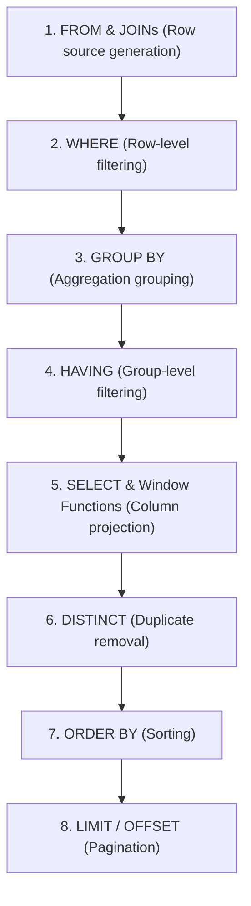

# Structured Query Language (SQL) — Master Interview Repository

> **Target Role:** Infosys Specialist Programmer (SP) L3 Interview  
> **Course Scope:** Complete Core SQL Curriculum (Fundamentals, Filtering & Aggregations, GROUP BY & HAVING ⭐, Joins ⭐, Subqueries ⭐, Window Functions ⭐, High-Frequency Interview Problems ⭐, Indexing & Transactions).

---

## 🧭 SQL Query Execution Order

Understanding the difference between the **written syntax order** and the internal **logical execution order** is essential for optimizing queries and answering interview questions on aliases, `WHERE` vs `HAVING`, and window functions:



---

## 📚 Master Topic Index & Curriculum Roadmap

| Module | File | Core Concepts Covered |
| :--- | :--- | :--- |
| **01** | [01. Basics, Filtering & Aggregations](file:///d:/interview/Infosys/SQL/01-sql-basics-filtering-aggregations.md) | DDL vs DML vs DQL vs TCL, DROP vs TRUNCATE vs DELETE, `WHERE` operators (`LIKE`, `BETWEEN`, `IN`), Three-Valued Logic (`NULL`), Aggregate Functions (`COUNT(*)`, `COUNT(col)`, `SUM`, `AVG`, `MIN`, `MAX`), Pagination (`LIMIT`/`OFFSET`). |
| **02** | [02. GROUP BY, HAVING & Joins](file:///d:/interview/Infosys/SQL/02-group-by-having-and-joins.md) | `GROUP BY` multi-column grouping, `HAVING` vs `WHERE`, All 6 Joins (`INNER`, `LEFT`, `RIGHT`, `FULL OUTER`, `CROSS`, `SELF JOIN`), Join condition evaluation (`ON` vs `WHERE`), Set Operations (`UNION`, `UNION ALL`, `INTERSECT`, `EXCEPT`). |
| **03** | [03. Subqueries & Window Functions](file:///d:/interview/Infosys/SQL/03-subqueries-case-and-window-functions.md) | Non-correlated vs Correlated subqueries, `EXISTS` vs `IN`, `CASE` expressions, String/Date/Numeric functions, `COALESCE` & `NULLIF`, Window Functions (`OVER()`, `PARTITION BY`, `ORDER BY`), `ROW_NUMBER()` vs `RANK()` vs `DENSE_RANK()`, `LAG()`/`LEAD()`, Running totals. |
| **04** | [04. High-Frequency Interview Problems](file:///d:/interview/Infosys/SQL/04-sql-interview-problems-and-patterns.md) | Second/Nth Highest Salary (3 methods), Top N per department, Employees earning > department average, Find & Delete duplicate records, Anti-joins (`LEFT JOIN ... IS NULL`), Consecutive records / Login streaks, Most recent record per user. |
| **05** | [05. Constraints, Views & Security](file:///d:/interview/Infosys/SQL/05-sql-concepts-and-transactions.md) | Integrity Constraints (`PK`, `FK`, `UNIQUE`, `CHECK`, `NOT NULL`, `DEFAULT`), Standard Views vs Materialized Views, Composite Indexing & Leftmost Prefix Rule, Transactions (`BEGIN`, `COMMIT`, `ROLLBACK`, `SAVEPOINT`), SQL Injection prevention via Prepared Statements. |

---

## ⚡ Top 10 High-Yield SQL Interview Q&A (Quick Revision)

### 1. What is the difference between `DELETE`, `TRUNCATE`, and `DROP`?
- **`DELETE` (DML):** Deletes rows conditionally with `WHERE`, logs each row in the transaction rollback log (can be rolled back), and fires triggers.
- **`TRUNCATE` (DDL):** Deallocates data pages in bulk ($O(1)$ speed), resets auto-increment to 1, and cannot use `WHERE`.
- **`DROP` (DDL):** Destroys the entire table schema and data permanently.

### 2. What is the difference between `WHERE` and `HAVING`?
`WHERE` filters individual rows **before** `GROUP BY` aggregation takes place and cannot contain aggregate functions. `HAVING` filters aggregated groups **after** `GROUP BY` aggregation and can filter on aggregate functions (e.g., `HAVING COUNT(*) > 5`).

### 3. What is the difference between `UNION` and `UNION ALL`?
`UNION` eliminates duplicate rows between query result sets by executing an expensive sorting/deduplication step. `UNION ALL` simply concatenates the result sets without deduplication and executes in $O(1)$ memory.

### 4. What is the difference between `RANK()`, `DENSE_RANK()`, and `ROW_NUMBER()`?
- `ROW_NUMBER()` assigns a unique, sequential integer to every row (1, 2, 3, 4).
- `RANK()` assigns identical ranks to ties, but skips rank numbers after ties (1, 2, 2, 4).
- `DENSE_RANK()` assigns identical ranks to ties without skipping rank numbers (1, 2, 2, 3).

### 5. How do you find the 2nd Highest Salary in SQL?
```sql
SELECT MAX(salary) AS SecondHighestSalary
FROM Employee
WHERE salary < (SELECT MAX(salary) FROM Employee);
```

### 6. What is a Correlated Subquery and why is it slower?
A subquery that references a column from the outer query. It cannot be evaluated once independently; the database engine must execute the inner subquery repeatedly **for every single row** evaluated by the outer query ($O(N \times M)$ complexity).

### 7. What is the Leftmost Prefix Rule in Composite Indexes?
A composite B+ Tree index on columns $(A, B, C)$ can only be used by queries that filter starting from the leftmost column: $A$, $(A, B)$, or $(A, B, C)$. If the leftmost column $A$ is missing in the `WHERE` clause (e.g., `WHERE B = 10`), the index cannot be traversed and causes a full table scan.

### 8. What is the difference between a Standard View and a Materialized View?
A Standard View is a virtual saved query executed dynamically on demand without taking disk storage. A Materialized View stores the physical computed query result on disk, offering fast read performance for heavy analytics at the expense of storage and periodic refreshes.

### 9. Why does `NOT IN` return 0 rows when the subquery contains a `NULL`?
In SQL three-valued logic, `x NOT IN (1, 2, NULL)` evaluates to `(x != 1 AND x != 2 AND x != NULL)`. Since `x != NULL` evaluates to `UNKNOWN`, the entire `AND` expression evaluates to `UNKNOWN` (falsy) for every row, returning an empty set.

### 10. How do Prepared Statements prevent SQL Injection?
Prepared statements pre-compile the SQL query structure with placeholders (`?`) at the database engine level *before* user inputs are received. When user input arrives, the DB engine treats it strictly as literal data, making it impossible for injected SQL syntax (`' OR 1=1 --`) to alter the execution tree.
